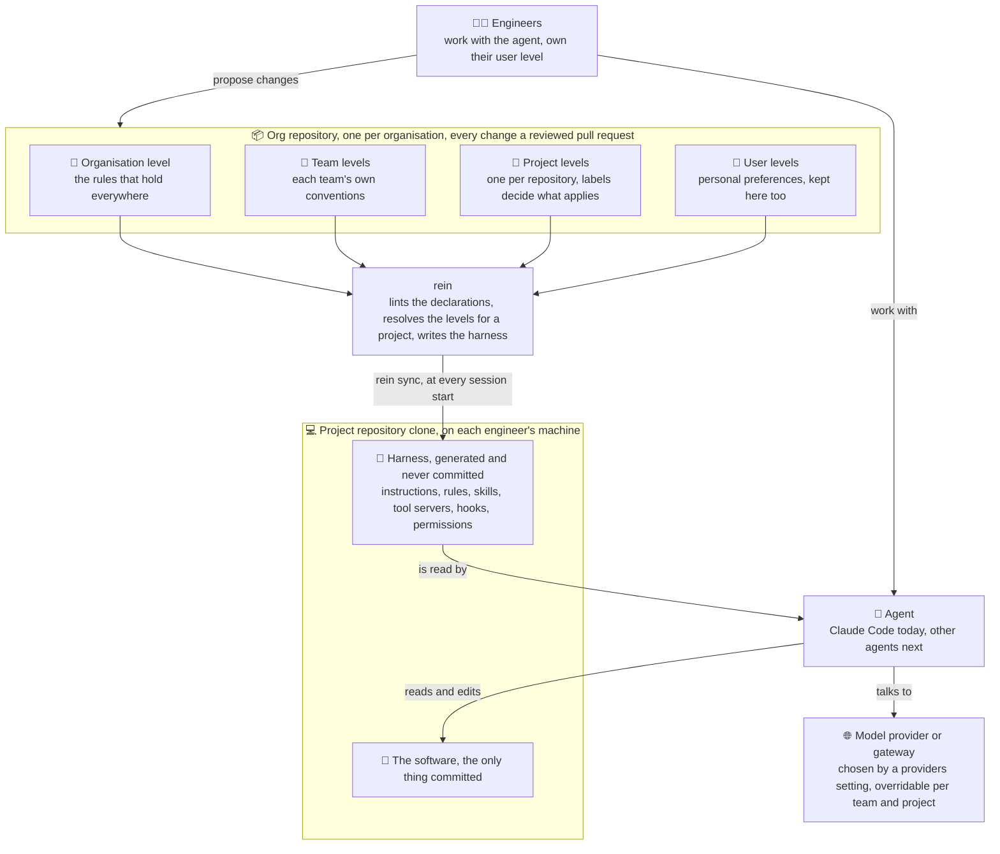
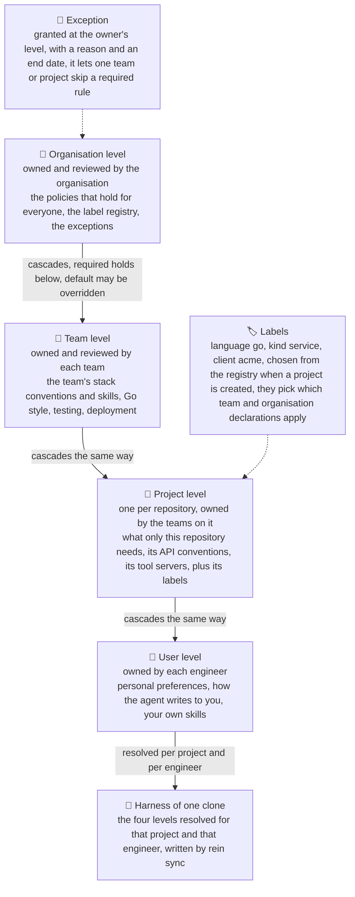

  <picture>
    <source media="(prefers-color-scheme: dark)" srcset="docs/images/rein-logo-dark.svg">
    
  </picture>

# Agents Rein

Agents Rein keeps the settings of your AI coding agents in one place and brings them to every
project you work in, whatever agent tool you use and whichever model provider it talks to.
Switching tool or provider then changes nothing about how you work.

Agent settings are the instructions, rules, skills, tool servers, hooks and permissions an
agent reads before it does anything. Today they are scattered: copied into every repository,
drifting apart, written in one vendor's format, and lost when the repository changes hands.

## Who it is for

- **One developer with several clients and kinds of projects.** Your own conventions follow you
  everywhere; a client's conventions apply in that client's repositories only; a static site
  and a Go service get different skills. Labels on projects decide which settings apply where.
- **An organisation with many teams.** The organisation's rules hold everywhere, each team adds
  its own, every change is reviewed as a pull request by the people who own that level, and a
  lint runs before anything is distributed.

## How it works

Settings are declarations in one git repository per organisation, the org repository, at four
levels: organisation, team, project and user. Agents Rein validates them (`rein lint`), resolves
which apply to a project, and writes them into each clone in the form the agent tool reads.

### What is what

Engineers write the levels into the org repository; rein turns them into the harness of each
project clone; the agent reads the harness and works on the software.

The principle: **agent settings are not repository settings.** A project repository contains
the software alone. What rein writes into a clone is never committed; the only trace is a
marked block in `.gitignore`. A fresh clone gets back on track with one `rein sync`. To hand
your settings to someone, `rein export` makes a zip in rein's own format, and `rein import`
places it for whatever agent the receiver uses.

Declarations are written in open formats, AGENTS.md, Agent Skills and MCP, so another agent
is another output of the compiler, not a rewrite of your settings. Which model provider or
gateway a project talks to is one of the settings rein carries, set at the organisation level
and overridable by a team or a project; the switch itself happens at the gateway, which rein
never replaces.

### The four levels

Every level is a folder of declarations in the org repository with its own owners and
reviewers. Levels cascade from the organisation down to the engineer: a rule marked `required`
holds at every level below, a rule marked `default` may be overridden there.

## Supported agents

The agent is the program that reads your settings and acts; the harness is everything it reads
before acting, which is what Agents Rein manages. Agents Rein is agent-agnostic by design, and
the first agent is only the first.

| Agent | State |
|---|---|
| Claude Code | supported: instructions, rules, skills, tool servers, hooks, permissions |
| Codex, Cursor, GitHub Copilot, Gemini CLI, OpenCode | planned: each reads AGENTS.md and Agent Skills natively ([findings, Q4](docs/harness-management.md#harness-portability-across-tools)), so each is another output of the same compiler |

## Commands

What exists today:

| Command | What it does |
|---|---|
| `rein config` | Sets up this machine. Your identity is your GitHub account, read from `gh`; the agent is the one rein writes for; until your organisation's repository exists, it also places your instructions and skills from a folder into the agent's home. It shows what it found and confirms before changing anything. Every other command that acts for you refuses until it has run. |
| `rein status` | Shows what rein has set up on this machine: user, agent, every placed file and whether its target still exists, organisations, projects. |
| `rein org connect <remote>`, `list`, `use <slug>`, `disconnect <slug>` | Clones an org repository and remembers it; lists the connected ones with the active one marked; switches; forgets one and removes its clone without touching the remote. |
| `rein lint <path>` | Checks skills against the Agent Skills specification, rule files, permission rules, and skills that share a name. Needs no config, so CI runs it on an org repository. |
| `rein export [--out <path>]` | Writes your settings as a zip in rein's own exchange format: one level in the declarations layout, with a manifest that hashes every file. |
| `rein import <zip>` | Verifies and lints an export, then places it for your agent. It never replaces a file it did not place itself. |
| `rein version` | Prints the version. |

Planned, in the board's order: `rein init` and `rein sync`, which bind a clone to its project
and write its harness; `rein org create` and `destroy`; `rein propose` and `rein review`;
`rein label`; `rein reset`; `rein update`.

The reasoning is the [ADR](docs/decisions/2026-10-11_harness-tool-compiler-and-linter.md); the
design, the decisions and what is next are on the
[board](docs/implementation_plans/2026-10-11_harness-distribution-tool.md). The code is Go,
with cobra and yaml.v3 as the only dependencies. Every repeatable command is a task in
[Taskfile.yml](Taskfile.yml): `task rein:install` installs the binary, `task rein:check` is the
gate, format check, vet, tests and lint; `task --list` shows the rest.

## The research behind it

This repository began as research: how does a large engineering organisation manage
AI-assisted development across many teams? Six questions, answered with sources in
[docs/harness-management.md](docs/harness-management.md):

- **Q1 — Receiving the harness.** How dev teams receive a shared harness with as little
  friction as possible.
- **Q2 — Extending without breaking.** How a team extends it for its own stack without breaking
  the organisation-wide rules.
- **Q3 — Using services.** How teams use shared services, tool servers, internal APIs and
  gateways, through the harness.
- **Q4 — Provider flexibility.** How to stay free to change model provider or move to private
  inference.
- **Q5 — Mixing providers.** Whether cloud and private inference can be mixed.
- **Q6 — Adopt or build.** What exists, and what to build. The answer, adopt the vendor layers
  and build only a compiler and a linter, is what Agents Rein is.

## Where things are

- [docs/harness-management.md](docs/harness-management.md) — the findings, one section per
  question.
- [docs/decisions/](docs/decisions/) — Architecture Decision Records, the immutable "why".
- [docs/implementation_plans/](docs/implementation_plans/) — the live boards: one for Agents Rein,
  one for the personal toolkit.
- [docs/future-ideas.md](docs/future-ideas.md) — ideas parked on purpose, with what would make
  them current.
- [cmd/rein/](cmd/rein/) and [internal/](internal/) — the tool.
- [toolkit/](toolkit/) — the personal agent toolkit: global instructions and ten skills in open
  formats, the content of the pilot. Today `rein config` places it into `~/.claude/`; it moves
  into the pilot's org repository when `rein sync` delivers the personal level per project
  ([ADR](docs/decisions/2026-10-10_personal-toolkit-open-formats.md),
  [board](docs/implementation_plans/2026-10-10_agent-toolkit.md)).
- `CLAUDE.md` and `.claude/` — the harness this repository runs with, on each machine and not
  committed, since agent settings are not repository settings. From the pilot on, `rein sync`
  writes it; until then it is this machine's copy, and a fresh clone has none.

## Licence

Apache-2.0, see [LICENSE](LICENSE).
