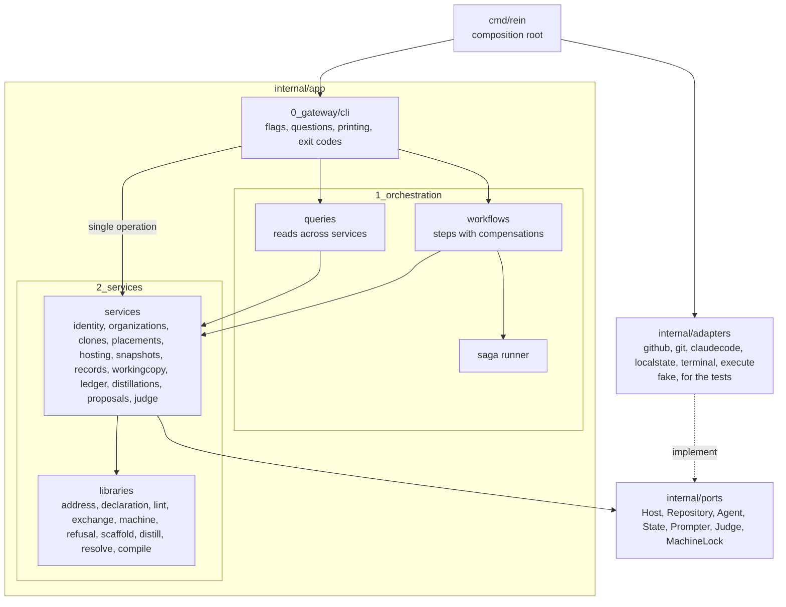

# How the code of `rein` is organised

The rules the code under [cmd/rein/](../cmd/rein/) and [internal/](../internal/) follows, why
they exist, and where a new piece goes. The mechanical part is enforced by the test in
[internal/architecture/architecture_test.go](../internal/architecture/architecture_test.go);
the rest is convention. Decided as D15 to D18 on the
[board](implementation_plans/2026-10-11_harness-distribution-tool.md#decisions); the product
boundary, a compiler and a linter and never a service, is the
[ADR](decisions/2026-10-11_harness-tool-compiler-and-linter.md).

## The shape

One binary, one process, a modular monolith: three application layers under `internal/app/`,
numbered so a reader meets them in call order, with the ports and the adapters beside them.
Dependencies point one way, from the gateway inward to the ports; the adapters implement the
ports and are known only to `main`.

## The layers

| Layer | Folder | Holds | May import |
|---|---|---|---|
| Composition root | `cmd/rein` | `main` and `wire`, the one place that knows every adapter | everything |
| Gateway | `internal/app/0_gateway/cli` | cobra commands: read flags, ask through the prompter, call, print, map errors to exit codes | `1_orchestration`, `ports`, the libraries, `adapters/terminal`, `adapters/execute`, `version` |
| Orchestration | `internal/app/1_orchestration` | the one concrete `Orchestrator`, which embeds `Services`: the workflows, the queries, the saga runner, `NewServices` and `New` | `2_services`, `ports` |
| Services | `internal/app/2_services/<service>` | one piece of state or one kind of side effect each, behind the ports | `ports`, the libraries |
| Libraries | `internal/app/2_services/{address, declaration, lint, exchange, machine, refusal, scaffold, distill, resolve, compile}` | pure logic and data types, no I/O beyond reading or writing files they are pointed at | the other libraries |
| Ports | `internal/ports` | the interfaces at the edge and their data types | the libraries |
| Adapters | `internal/adapters/<name>` | one implementation of a port each; `fake` holds the in-memory ones every layer's tests use | `ports`, the libraries, `adapters/execute` |

The folder names carry the numbers; the package names stay plain (`cli`, `orchestration`,
`organizations`). The test [architecture_test.go](../internal/architecture/architecture_test.go)
holds this table as its `allowed` map and fails on any import outside it.

## The rules

1. **Dependencies point inward.** Gateway to orchestration to services to ports. Nothing
   under `internal/` imports an adapter except `main`, the gateway's own device (the terminal)
   and the shell-out helper. Enforced by the test.
2. **The gateway holds one concrete `Orchestrator` and nothing else of the inside.** It calls
   `orchestrator.ConnectOrganization(...)` for a workflow and `orchestrator.Organizations.List()`
   for a single operation. There is no interface in front of it and no `local` implementation:
   a backend, should one ever exist, would be called from the gateway, and Go lets an
   interface be drawn around the concrete type the day a second implementation appears, with
   no change to the type (D18). Every method takes and returns plain data and never asks or
   prints. The gateway's tests run the real orchestrator over the fake adapters and a scratch
   home, so they test real behaviour and no fake has to mirror an interface.
3. **A service owns its state and knows no other service.** `organizations` owns the
   organisations section of the machine state, `placements` the placements and imports,
   `clones` the folders under `~/.rein/orgs/`, `snapshots` the files under
   `~/.rein/snapshots/`, `hosting` the repositories on the host, `records` the record files
   in an org clone and their publication, `workingcopy` a project's working copy, `ledger`
   the removals file, `identity` the answer to "who". A service
   reaches the outside only through a port, so a test gives it a memory state or a fake host.
   Enforced by the test: a service package may import the ports and the libraries, never a
   sibling service.
4. **A single operation is a service method, and the gateway calls it directly.** `org list`
   and `org use` reach `organizations` through `orchestrator.Organizations`. The identity gate
   is the gateway's: a command that acts for a user calls `requireIdentity` first and refuses
   without one, like authentication at a gateway, so no workflow checks it again.
5. **Several operations in order are a workflow, and a workflow is a list of steps with
   compensations.** The saga runner performs the steps and, when one fails, runs the `Undo`
   of every completed step in reverse order. A step without an `Undo` is allowed for a read
   and for the last step. A deletion that cannot be compensated runs in the order that leaves
   the least damage, files first and then the state that describes them, and the workflow
   says so in its comment (`ResetMachine`). **Every workflow is its own file**, named
   `workflow_<name>.go` after the method in snake case, holding that workflow and its result
   types and nothing else, so the folder listing is the list of workflows; the queries share
   `queries.go` and the runner is `saga.go`. Enforced by the test.
6. **A query changes nothing.** `Status` and `PlanReset` read across services and return a
   report; the gateway shows it and, for a reset, asks before calling the workflow with the
   plan the person confirmed. A command that changes the machine holds the machine lock from
   its start to its end, through `orchestrateLocked` in the gateway; a query runs without it.
7. **A refusal is not a crash.** A precondition that failed, nothing changed, is a refusal
   from the `refusal` library, `refusal.New(reason)`, and exits 1; any other error exits 2; a
   program rein ran that failed exits 3. Every layer raises refusals the same way: a service
   for its own preconditions, with typed errors that match `refusal.ErrRefused`
   (`organizations.ErrNotConnected`, `ErrAlreadyConnected`), a workflow for a step that must
   not go on, the gateway for a missing terminal or a declined confirmation. The gateway
   checks `errors.Is(err, refusal.ErrRefused)` once, in `runCommand`.
8. **Output goes through the writers `Run` receives.** No `fmt.Print`, `os.Stdout` or
   `os.Stderr` anywhere but `main`. Enforced by a guard test in the gateway.
9. **A port exists only where a second implementation is plausible.** The host (GitHub, later
   GitLab), the agent (Claude Code, later others), the repository (git), the state, the
   prompter, and later the judge and the snapshots. Everything else is a concrete type, the
   orchestrator included.
10. **No library for the workflows.** A durable-execution engine brings a server to run
    beside the binary, and rein has none by decision (ADR, N1). The runner is fifty lines in
    [saga.go](../internal/app/1_orchestration/saga.go): `Step{Name, Do, Undo}`, `runSteps`,
    and `CompensationError` for the case where an undo fails too.
11. **Names are descriptive everywhere**, in the words of the toolkit's `go-style` skill: a
    name says its subject, its kind and its role (`temporaryOrgClonePath`, `OrgClonesFolder`,
    `seedConnectedOrganization`), no abbreviations and no single letters beyond the ones Go
    convention fixes. A field is named by what it holds (`Current machine.State`), a bool
    reads as a fact (`BecameActive`), a result struct says what it reports (`ActiveAfter`).
12. **Every record carries the time it was written** (D20): `OrganizationRef.ConnectedAt`
    today, the ledger's entries later. A service that writes records takes a `Clock` so its
    tests can fix the time; nil means the wall clock.

## Where a new piece goes

- **A new command that does one thing to one service**: a method on that service, the cobra
  command in the gateway calling it through `orchestrator.<Service>`, behind `requireIdentity`
  when the command acts for a user. Example: `org use`.
- **A new command that touches several services or takes several steps with side effects**:
  a workflow in `1_orchestration`, in its own file `workflow_<name>.go`, written as
  `runSteps([]Step{...})` with an `Undo` on every step that changes something, returning a result
  struct the gateway prints. Example: `org connect` is clone, verify, register, place; a
  failure after registering forgets the registration and removes the clone, and a second
  connect of the same organisation is refused before its existing clone is touched.
- **A new read for `status` or a plan**: a query in `queries.go` under `1_orchestration`.
- **A new piece of state or a new kind of side effect**: a new service package under
  `2_services`, with its own test on a memory state or a fake port.
- **A new outside dependency** (another host, another agent, a model endpoint): a port in
  `internal/ports`, an adapter under `internal/adapters/`, its fake in `internal/adapters/fake`,
  and the wiring in `main`.
- **Pure logic with no state**: a library under `2_services`; add its path to `libraries` in
  the architecture test so everything may import it.

## Tests per layer

| Layer | Test style |
|---|---|
| Services | the real service over the fake adapters |
| Orchestration | the real services over the fake adapters; the saga runner on scripted steps, including a failing undo |
| Gateway | the real orchestrator over the fake adapters and a scratch home; scripted answers for the prompts; the output guard |
| `cmd/rein` | end to end with a stub `gh` and `claude` on the `PATH` and a scratch home through `REIN_HOME` |
| Architecture | the import-direction test over every Go file under `internal/`, and the one-workflow-per-file check over the orchestration |

`task rein:check` runs gofmt, `go vet ./...`, `go test ./...`, builds the binary and runs
`rein lint .` on this repository; it runs before every handover.

## Terms

- **Service**: a package under `2_services` that owns one piece of state or one kind of side
  effect, isolated behind ports. Not a process (ADR, N1).
- **Library**: a package under `2_services` with pure logic that anything may import.
- **Workflow**: an operation of several steps across services, with a compensation per step,
  run by the saga runner.
- **Query**: a read across services that changes nothing.
- **Saga runner**: `runSteps` in the orchestration, which performs steps and undoes the
  completed ones in reverse when a step fails.
- **Port**: an interface at the edge of the application. **Adapter**: its implementation
  for one technology. **Fake**: the in-memory adapter of a port under `internal/adapters/fake`,
  used by the tests of every layer.
- **Refusal**: a precondition that failed with nothing changed, raised by any layer through
  the `refusal` library and mapped to exit code 1 by the gateway.
- **Composition root**: `main`, where adapters, services and the orchestrator are wired.
