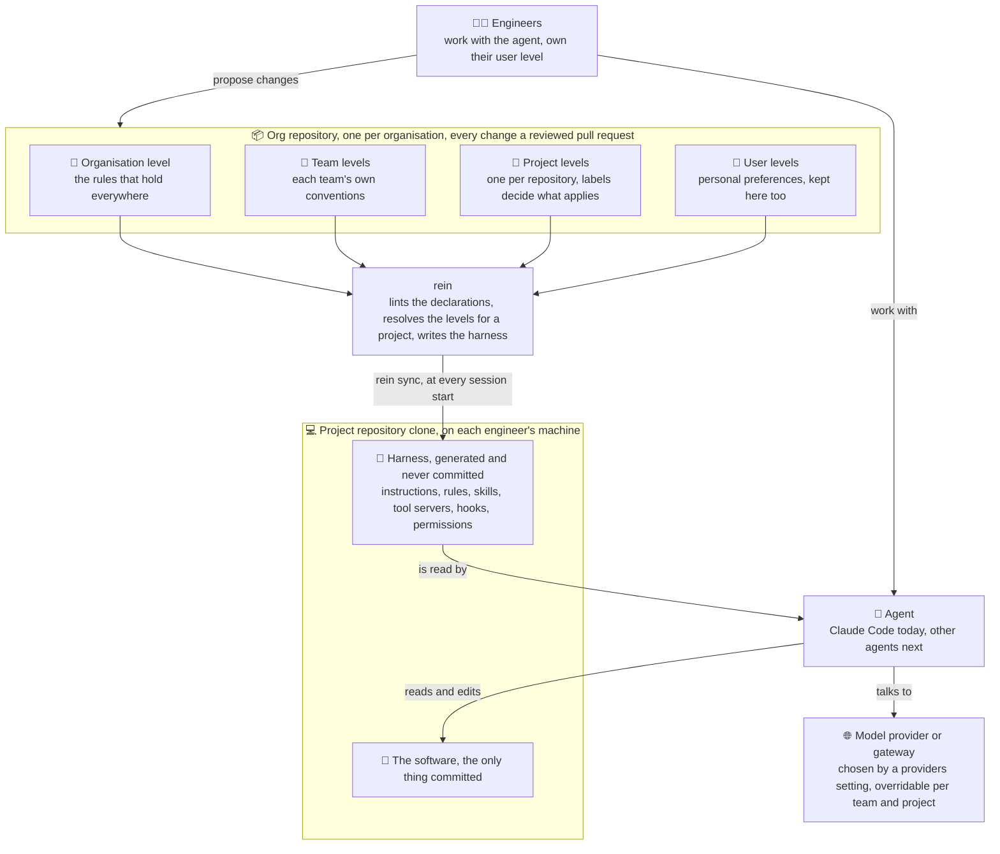
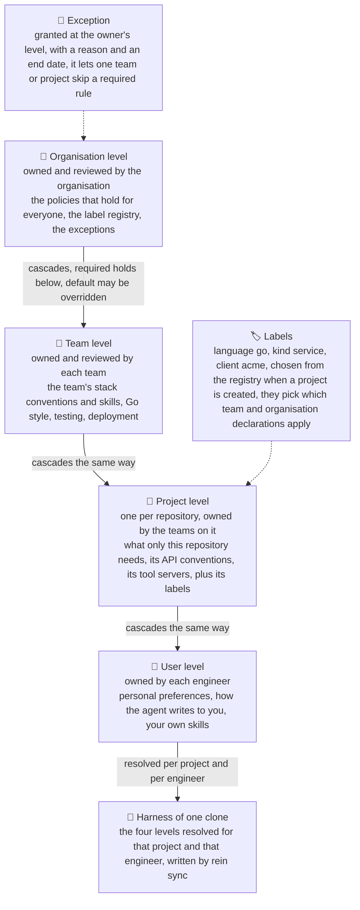

# The model of Agents Rein

What rein keeps, where, and how it reaches an agent. The commands are in
[commands.md](commands.md); the code is in [architecture.md](architecture.md); the reasoning is
the [ADR](decisions/2026-10-11_harness-tool-compiler-and-linter.md) and the
[board](implementation_plans/2026-10-11_harness-distribution-tool.md).

## In one paragraph

Settings are declarations in one git repository per organisation, the org repository, at four
levels: organisation, team, project and user. Agents Rein validates them (`rein lint`), resolves
which apply to a project, and writes them into each clone in the form the agent tool reads.

## What is what

Engineers write the levels into the org repository; rein turns them into the harness of each
project clone; the agent reads the harness and works on the software.



The principle: **agent settings are not repository settings.** A project repository contains
the software alone. What rein writes into a clone is never committed; the only trace is a
marked block in `.gitignore`. A fresh clone gets back on track with one `rein sync`. To hand
your settings to someone, `rein export` writes a level as a zip in rein's own format, and
`rein import` adds it to the receiver's organisation, for whatever agent they use.

Declarations are written in open formats, AGENTS.md, Agent Skills and MCP, so another agent
is another output of the compiler, not a rewrite of your settings. Which model provider or
gateway a project talks to is one of the settings rein carries, set at the organisation level
and overridable by a team or a project; the switch itself happens at the gateway, which rein
never replaces.

## The four levels

Every level is a folder of declarations in the org repository with its own owners and
reviewers. Levels cascade from the organisation down to the engineer: a rule marked `required`
holds at every level below, a rule marked `default` may be overridden there.



## The org repository's layout

One repository holds one organisation, so its folders leave the organisation out:

```
declarations/
  organization.yaml      the organisation's record
  labels/                the label registry, one file per category
  rules/ skills/ ...     the organisation's own declarations
  teams/<slug>/          team.yaml and the team's declarations
  projects/<slug>/       project.yaml and the project's declarations
  users/<slug>/          user.yaml and the person's declarations
```

Addresses keep the organisation in front, because a machine can be connected to several
org repositories and `organizations.dani.skills.go-style` must name one thing wherever it is
read: `organizations.<org>` is the organisation, `organizations.<org>.teams.<team>`,
`organizations.<org>.projects.<project>` and `organizations.<org>.users.<user>` are its
levels, and a declaration adds its kind and id, `organizations.dani.users.danidani23.rules.global`.
A user level is a level of the organisation: a person with two organisations has one in each
repository, and they may differ.

## Labels and the registry

A project carries labels, `category:value`, chosen from the organisation's registry when the
project is created and changed with `rein project edit`. Declarations say which projects they
are for through `applyIf` and `doNotApplyIf` over these labels: a Go service receives the Go
skills without anyone listing it. The registry is one file per category under
`declarations/labels/`: its values with a one-line description each,
`required: true` when every project must carry one of its values, and `multiple: true` when a
project may carry several. A new organisation starts with `kind`, required and single,
`language`, several allowed, and `data`, single. `rein label` changes the registry; the lint
refuses two values of a single-valued category and warns about a missing required one.

## On your machine

Everything rein keeps outside the org repository lives under `~/.rein/`, written by rein and
read by `rein status`:

| Path | What it holds |
|---|---|
| `state.yaml` | the logins, the connected organisations with the login that acts on each, the active one, the clones of org repositories, the initialised project clones, the placements in your agents' homes; `state.yaml.previous` is the copy before the last write |
| `orgs/<id>/` | the clone of each connected org repository |
| `snapshots/` | what was there before rein: your agents' homes at connect, a project's harness at `init`, a hand-edited file before `sync --force`; `rein restore` reads them, `rein reset` removes them |
| `removals.yaml`, `inserts/<org id>.yaml` | the ledger: every file `init` moved out and every file `sync` wrote, with its hash |
| `proposals/` | the history of every proposal `rein propose` opened, one file per organisation and proposal, and under `pending/` the proposals distilled from your agents' homes that wait for `propose`; a project's pending proposals wait in its own `.rein/proposals/` instead |

Tokens are never in these files: they live in the operating system's keychain, one per login.
Secrets a tool server needs are `${REIN_...}` references to variables of your shell, which
`rein sync` names when they are missing.

## Supported agents

The agent is the program that reads your settings and acts; the harness is everything it reads
before acting, which is what Agents Rein manages. Agents Rein is agent-agnostic by design, and
the first agent is only the first.

| Agent | State |
|---|---|
| Claude Code | supported: instructions, rules, skills, tool servers, hooks, permissions |
| Codex, Cursor, GitHub Copilot, Gemini CLI, OpenCode | planned: each reads AGENTS.md and Agent Skills natively ([findings, Q4](docs/harness-management.md#harness-portability-across-tools)), so each is another output of the same compiler |
