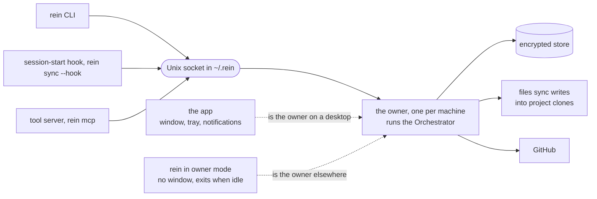

# An always-running app owns the machine, and the CLI asks it

**Date:** 2026-10-28
**Status:** Accepted

## Context

rein runs one process per command ([architecture.md](../architecture.md)): each command opens
the machine's state in `~/.rein`, takes the machine lock to write, and exits. The
[scheduled check](2026-10-28_a-scheduled-check-between-sessions.md), decided earlier the same
day, kept that shape: the operating system's scheduler starts a short `rein` run every minute,
and nothing calls it.

The same day the user asked for more than that gives (Q24 to Q26):

- **An experience of its own.** An icon in the menu bar or tray that shows what rein knows,
  notifications whose buttons open the right page, a window and an icon of its own, a start at
  login. A browser tab and scripts around each system's notification command give none of it.
- **State that neither agents nor people write into.** `state.yaml` and the ledger are text
  files that any program running as the developer can change. How the state is kept is the
  [store ADR](2026-10-28_the-machine-state-in-an-encrypted-store.md); it needs one program that
  alone holds the store's key.

The [rein ui ADR](2026-10-27_rein-ui-a-gateway-served-to-the-browser.md) turned a native window
down (its candidate 5) because it needed a frontend build and libraries on every system. Wails
v3.0.0, released on 2026-10-26, brings a "System tray … and the option to attach a window to the
tray icon", "Native desktop notifications with actions", multiple windows, and services that
"can serve HTTP routes" ([release notes](https://github.com/wailsapp/wails/releases/tag/v3.0.0)).
A window shows any `http.Handler` given as `application.AssetOptions{Handler: …}`
([Wails guide](https://github.com/wailsapp/wails/blob/v3.0.0/docs/mpress/content/guides/gin-routing.md)),
so the pages of `rein ui` become the window without a frontend build.

## Candidates Considered

1. **The browser and the scheduled check, as decided.** Standard library only, one build without
   cgo (Go calling C code). No tray, no window of its own, notifications through each system's
   commands, and the state stays files every program can write.
2. **An app beside the CLI, each opening the store itself.** The CLI works without the app. But
   then the CLI needs the store's key, and whatever the CLI can fetch, an agent can fetch the
   same way; the CLI also carries the store's library.
3. **An app that owns the state; the CLI, the session-start hook and the tool server ask it**
   over a local socket. Docker works this way: "The Docker client talks to the Docker daemon"
   "over UNIX sockets" ([Docker](https://docs.docker.com/get-started/docker-overview/)). So does
   1Password, whose CLI signs in through the desktop app "the same way you unlock your device"
   ([1Password](https://www.1password.dev/cli/app-integration/)). One writer, a key that never
   leaves the owner, and an owner that can ask the developer before anything destructive. The
   CLI needs an owner running, and machines without a desktop need one without a window.
4. **A native app per operating system,** Swift on macOS and a Windows-native stack. Desktop
   widgets become possible; three codebases stand beside the Go one.
5. **The owner as a system service under a user account of its own.** The operating system would
   keep the developer's programs out of the state. But the owner writes `CLAUDE.md` and
   `.claude/` into the developer's project folders, so it would need rights over their home
   folder.

## Decision

Candidate 3, chosen by the user (Q26, Q29 a, Q30 a, Q31 a, Q32 a).

- **One owner per machine.** The owner is the only process that opens the machine's store and
  holds its key. It runs the one `Orchestrator` and serves it on a Unix domain socket in rein's
  home that only the developer's account can open. The store's file lock keeps a second owner
  out.
- **Two programs can be the owner.**
  - **`rein`**, still built without cgo, gains an owner mode without a window. Where the app is
    not installed, such as over SSH, in a dev container or in a cloud session, the CLI starts it
    at its first request, and it exits when idle (Q32 a).
  - **The app**, a Wails v3 program, is the owner plus a window showing the pages of `rein ui`,
    an icon in the menu bar or tray, native notifications, one instance at a time, and a start
    at login when the developer turns it on (`app.Autostart`,
    [Wails](https://github.com/wailsapp/wails/blob/v3.0.0/docs/mpress/content/features/autostart/basics.md)).
    Where it is installed, the CLI starts the app when no owner answers.
- **The CLI, the session-start hook and the tool server are clients.**
  - Each request goes as HTTP with JSON over the socket, and the client shows what comes back.
  - Progress arrives as server-sent events, as on the run page of `rein ui`, and Ctrl-C sends a
    cancel that does what it does today.
  - The questions a command asks stay in the CLI, which sends the answers with the request: the
    orchestration already takes and returns plain data and never asks or prints.
  - Every request carries the protocol's version. A client and an owner of different versions
    say so and name the update instead of guessing.
  - Windows has these sockets since Windows 10 build 17063
    ([Microsoft](https://devblogs.microsoft.com/commandline/af_unix-comes-to-windows/)), and Go
    supports them there since 1.12 ([Go 1.12](https://go.dev/doc/go1.12)).
  - A command that needs no machine state, such as `rein lint` on CI, runs in the CLI's own
    process as today.
- **The check runs inside the app.** Every minute while the app runs, it does what the
  [scheduled check](2026-10-28_a-scheduled-check-between-sessions.md) described:
  - it compares the clones' rein folders and the agent's home with the ledger;
  - every few minutes it asks whether each organisation's main branch moved;
  - it syncs only the projects the developer chose;
  - it tells each new finding once, now as a native notification whose button opens the page
    concerned.

  An owner without a window does not check. On those machines the session-start sync stays the
  trigger.
- **What removes or overwrites waits for the developer** (Q31 a). A reset of a project or of
  the machine, or a sync with `--force`, asked from the command line, is confirmed in the app's
  window. Whether the system's own authentication (Touch ID, Windows Hello) can stand behind that
  is checked when it is built. An agent can type the command but cannot confirm it. Where no app
  runs, the terminal question asks as today.
- **Release.** `rein` is released as today: every platform built on one machine, cgo off
  ([.goreleaser.yaml](../../.goreleaser.yaml)). The app is built on each operating system:
  - **macOS:** signed with a Developer ID and notarised. Gatekeeper checks "for a Developer ID
    certificate from apps distributed outside the Mac App Store"
    ([Apple](https://developer.apple.com/developer-id/)); the program is "99 USD per membership
    year" ([Apple](https://developer.apple.com/programs/enroll/)).
  - **Windows:** signed through Microsoft's Artifact Signing, 9.99 USD a month for the Basic tier
    ([Azure price list](https://prices.azure.com/api/retail/prices?$filter=serviceName%20eq%20%27Trusted%20Signing%27)).
    "Individual developers must be located in the United States or Canada"; organisations may
    also be in the European Union and further countries
    ([quickstart](https://learn.microsoft.com/en-us/azure/artifact-signing/quickstart)).
    SmartScreen, Windows' check on downloaded apps, still warns until a signed file has
    "sufficient download history" ([FAQ](https://learn.microsoft.com/en-us/azure/artifact-signing/faq)).
    The WebView2 runtime that draws the window is part of Windows 11 and present on "the vast
    majority of Windows 10 devices"
    ([Microsoft](https://learn.microsoft.com/en-us/microsoft-edge/webview2/concepts/distribution));
    Wails' installer fetches it where it is missing
    ([Wails](https://github.com/wailsapp/wails/blob/v3.0.0/docs/mpress/content/guides/build/windows.md)).
  - **Linux:** `.deb` and `.rpm` packages that name GTK4 and WebKitGTK 6.0 as their dependencies,
    and an AppImage that "bundles WebKit"
    ([Wails](https://github.com/wailsapp/wails/blob/v3.0.0/docs/mpress/content/guides/build/linux.md)).
    Distributions without WebKitGTK 6.0, such as Ubuntu 22.04 and Debian 12, use `rein` and the
    browser; Wails' GTK3 fallback for them "will be removed in v3.1" (same page).
- **Dependency.** Wails v3 joins the module for the app's program only; `rein` imports none of
  it. This ADR records it, as the dependency rule of the
  [MCP gateway ADR](2026-10-23_mcp-gateway-on-the-official-sdk.md) asks.

### How the programs relate

## Consequences

- The rule of one process per command in [architecture.md](../architecture.md) no longer holds,
  and the CLI reaches the `Orchestrator` through the owner, where the rule says "There is no
  interface in front of it". The document and the architecture test change with the code.
- The CLI needs an owner: the app where it is installed, its own owner mode elsewhere.
- The scheduled check's scheduler, its notification scripts and the command that turns it on
  are dropped, so its [ADR](2026-10-28_a-scheduled-check-between-sessions.md) is superseded by
  this one. Its opt-in for automatic sync (D48) carries over.
- D2 is amended again: the app pulls between sessions for the projects the developer chose, and
  nothing pushes into a session. N1 of the [compiler ADR](2026-10-11_harness-tool-compiler-and-linter.md),
  a daemon that pushes, stays unbuilt.
- The [rein ui ADR](2026-10-27_rein-ui-a-gateway-served-to-the-browser.md) is amended. Its pages
  become the app's window, and its candidate 1, a resident process the page calls, is what the
  owner now is. Its gateway, token, `Host` and `Origin` checks stay for the browser.
- The developer runs a second program that stays resident, and the two are updated together;
  the version in every request makes a mismatch visible.
- Before the app is released, the user enrols in the Apple Developer Program, and takes an Azure
  subscription with identity validation for Windows signing.
- Desktop widgets stay out: the release notes of Wails v3.0.0 name none.
- The board records this as D50, D52 to D54 and the phase P6.
