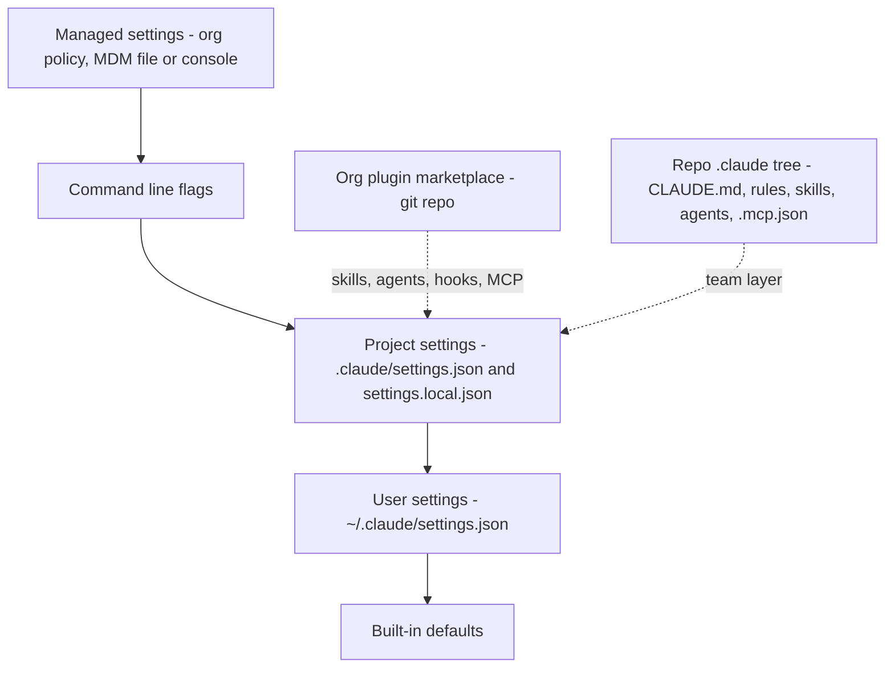
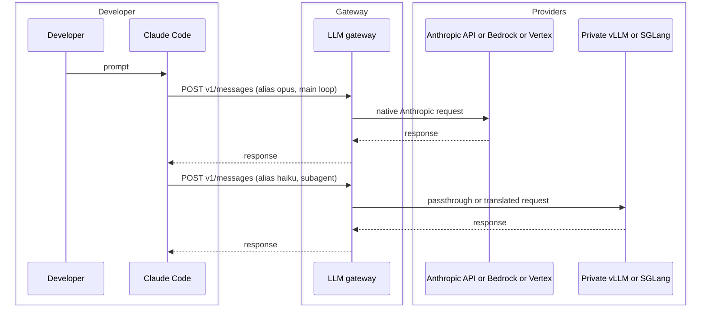

# Managing AI-Assisted Development for Large Teams — Findings

**Date:** 2026-10-01 (every external page was read on this date)
**Status:** first full pass; open points at the end
**Board:** [2026-10-01_research-questions.md](implementation_plans/2026-10-01_research-questions.md)

A *harness* is everything around the model that shapes what a coding agent does: always-on
instructions, path-scoped rules, skills (procedures), subagents, hooks, permissions, tool servers
(MCP), and the model/provider configuration. This document answers six questions for an
organisation with many dev teams, using Claude Code as the reference tool and the wider
ecosystem as the comparison. Facts marked **[unverified]** come from secondary sources only.

## The six questions

- **Q1 — Receiving the harness.** How dev teams receive a shared harness with as little
  friction as possible.
- **Q2 — Extending without breaking.** How a team extends it for its own stack without breaking
  the organisation-wide rules.
- **Q3 — Using services.** How teams use shared services, tool servers, internal APIs and
  gateways, through the harness.
- **Q4 — Provider flexibility.** How to stay free to change model provider or move to private
  inference.
- **Q5 — Mixing providers.** Whether cloud and private inference can be mixed.
- **Q6 — Adopt or build.** What exists, and what to build. The answer, adopt the vendor layers
  and build only a compiler and a linter, is what Agents Rein is.

## Summary

- **Q1 — Receiving.** Three delivery channels exist in Claude Code and the same three recur in
  every competing tool: a *managed settings* file or server-fetched policy (org-locked), a
  *plugin marketplace* (git repo; carries skills, agents, hooks, MCP servers), and the repo's own
  `.claude/` tree. A new developer should need only: install, log in with the forced org login,
  open a repo. Everything else arrives through those channels.
- **Q2 — Extending without breaking.** Keep *policy* (small, locked, managed settings) separate
  from *guidance* (large, overridable, plugins and repos). Policy is enforced mechanically:
  deny lists, `allowManagedPermissionRulesOnly`, `allowManagedMcpServersOnly`,
  `strictKnownMarketplaces`, `disableBypassPermissionsMode`. Guidance is extended by *adding*
  a layer (team plugin, repo rules with `paths:`), never by editing the org layer. Prose rules
  are not enforceable; what must hold gets a hook, a linter or a deny rule.
- **Q3 — Services.** MCP is the service interface. Distribute servers by name through an
  internal registry/gateway with an org allowlist; never static secrets in repos. The large
  rollouts (Uber, Spotify, Shopify) all converged on one MCP gateway/registry behind one auth
  and policy plane.
- **Q4 — Provider flexibility.** Claude Code speaks only the Anthropic Messages API, to
  Anthropic, Bedrock, Vertex, Foundry or any gateway at `ANTHROPIC_BASE_URL`. The gateway is
  the switch point: LiteLLM and Bifrost ingest `/v1/messages` and route to vLLM/SGLang/Ollama;
  vLLM, SGLang, llama.cpp and Ollama now speak `/v1/messages` natively. Expect lossy tool-use
  translation, dropped thinking blocks and lost prompt caching on non-Anthropic routes. The
  harness *content* (AGENTS.md, Agent Skills, MCP) is portable across tools; hooks, permissions
  and plugins are not.
- **Q5 — Mixing.** Yes, at the gateway: Claude Code picks one provider per session, but the
  gateway routes by model alias, so `haiku`-tier calls or named subagents can go to a private
  model while the main loop stays on a frontier model. Route by data sensitivity and by task
  class, and measure.
- **Q6 — Adopt or build.** Adopt. No open-source tool implements org → team → repo → user
  layering with locking; the vendors' managed-settings layers do. Build only the thin org layer:
  a marketplace repo with a baseline plugin, the managed-settings file, a gateway deployment, an
  MCP registry, CI validation of harness changes, and telemetry. Do not build an agent runtime,
  a rules-sync tool or a gateway.

## 0. The harness, layer by layer

Which parts are portable across tools, and which an organisation can lock, decides the whole
design. Claude Code specifics come from the official docs
([managed settings](https://code.claude.com/docs/en/managed-settings),
[settings reference](https://code.claude.com/docs/en/settings-reference),
[plugins](https://code.claude.com/docs/en/plugins/manifest-reference),
[skills](https://code.claude.com/docs/en/skills), [MCP](https://code.claude.com/docs/en/mcp),
[managed MCP](https://code.claude.com/docs/en/managed-mcp),
[subagents](https://code.claude.com/docs/en/sub-agents), [hooks](https://code.claude.com/docs/en/hooks)).

| Layer | Claude Code artefact | Cross-tool standard | Org can lock it |
|---|---|---|---|
| Always-on instructions | `CLAUDE.md` (managed, user, project, nested, local), `@import`; `AGENTS.md` read natively from v2.1.277 | **AGENTS.md** (Linux Foundation, [agents.md](https://agents.md/)) | Yes — managed `CLAUDE.md` at the policy path, or the `claudeMd` key in managed settings; cannot be excluded |
| Path-scoped rules | `.claude/rules/<name>.md` with `paths:` globs, discovered recursively; `~/.claude/rules/` for the user; symlinks allowed ([memory docs](https://code.claude.com/docs/en/memory#organize-rules-with-claude/rules/)) | None (Cursor `.mdc` globs, Copilot `applyTo`, nested AGENTS.md are per-tool) | No — repo or user level only; not shippable in plugins |
| Skills | `.claude/skills/<name>/SKILL.md` | **Agent Skills** ([agentskills.io](https://agentskills.io/specification)) | Enterprise skills via managed settings; plugins |
| Subagents | `.claude/agents/<name>.md` | None | Managed agents; plugins |
| Hooks | `hooks` in settings or plugin `hooks/hooks.json` | None | Managed hooks merge in; managed matchers replace local ones for the same event |
| Permissions | `permissions.allow/ask/deny` | None (skills' `allowed-tools` is only a hint) | Yes — `allowManagedPermissionRulesOnly`, `disableBypassPermissionsMode` |
| Tool servers | `.mcp.json`, user and local scopes | **MCP** (Linux Foundation) | Yes — `managed-mcp.json`, `managedMcpServers`, `allowedMcpServers`/`deniedMcpServers`, `allowManagedMcpServersOnly` |
| Model and provider | env (`CLAUDE_CODE_USE_*`, `ANTHROPIC_BASE_URL`), `model`, `availableModels`, `allowedProviders` | None | Yes |
| Packaging | Plugins and marketplaces | None (Copilot has an equivalent) | Yes — `enabledPlugins`, `extraKnownMarketplaces`, `strictKnownMarketplaces`, `blockedMarketplaces` |

Two facts shape everything below:

1. **Managed settings sit above everything** — above command-line flags, project settings and
   user settings — and can be delivered as a file (`/Library/Application Support/ClaudeCode/
   managed-settings.json`, `/etc/claude-code/managed-settings.json`, `C:\Program Files\
   ClaudeCode\managed-settings.json`) pushed by MDM, or fetched from the Anthropic console for
   Team/Enterprise logins at startup and hourly
   ([server-managed settings](https://code.claude.com/docs/en/server-managed-settings)).
2. **Plugins cannot carry `CLAUDE.md` or `.claude/rules`** (the docs flag a plugin-root
   `CLAUDE.md` as a warning). Org-wide prose therefore travels as a managed `CLAUDE.md` file
   at the policy path, as the `claudeMd` managed key, or inside skills; path-scoped rules stay
   in the repo (or in `~/.claude/rules/`, where symlinked shared rules load without approval).
   The docs are explicit about the limit of prose: "Settings rules are enforced by the client
   regardless of what Claude decides to do. CLAUDE.md instructions shape Claude's behavior but
   are not a hard enforcement layer"
   ([memory docs](https://code.claude.com/docs/en/memory#manage-claude-md-for-large-teams)).

### Resolve the effective configuration

How the layers stack for one session, highest authority at the top.

## Q1 — How dev teams receive the harness

### What the mechanism is

Claude Code has three channels, each with a clear owner:

| Channel | Carries | Owner | How it reaches the developer |
|---|---|---|---|
| Managed settings (+ managed `CLAUDE.md`) | permissions, env, model/provider, `claudeMd` or the managed `CLAUDE.md` file, managed MCP, hooks, `enabledPlugins`, `extraKnownMarketplaces`, `forceLoginMethod`/`forceLoginOrgUUID`, `minimumVersion`, `companyAnnouncements` | Platform team | MDM-pushed files, or console-managed and fetched on login |
| Org plugin marketplace | plugins: skills, subagents, hooks, MCP and LSP servers, commands, settings defaults | Platform team (baseline plugin), teams (their own plugins) | Marketplace pre-registered by managed settings; baseline plugin force-enabled; others opt-in via `/plugin` |
| Repository `.claude/` | `CLAUDE.md`, rules with `paths:`, repo skills and agents, `.mcp.json`, project settings | The team that owns the repo | `git clone` |

The onboarding path is then: install Claude Code, log in (the org login is forced), clone a
repo. Nothing to copy, nothing to configure. The baseline plugin is pinned by its `version`
field; users stay on a version until the platform team updates the marketplace.

### What the other tools do

The same three-channel shape recurs everywhere, which means the design is stable even if the
tool changes:

- **GitHub Copilot** — `copilot/managed-settings.json` in the enterprise `.github-private` repo
  (GA July 2026: marketplaces, `enabledPlugins`, `strictKnownMarketplaces`, bypass-mode, model),
  org-level custom instructions, MCP allowlists with a bring-your-own registry
  ([changelog](https://github.blog/changelog/2026-07-01-enterprise-managed-settings-json-is-generally-available/),
  [MCP allowlists](https://github.blog/changelog/2026-08-06-mcp-allowlists-in-enterprise-managed-settings/)).
- **OpenAI Codex** — `requirements.toml` that users cannot override, delivered by MDM profile,
  cloud bundle from the ChatGPT Enterprise console, or `/etc/codex/`; covers approval policy,
  sandbox, MCP allowlists, marketplace sources, network allow/deny
  ([managed configuration](https://learn.chatgpt.com/docs/enterprise/managed-configuration)).
- **Gemini CLI** — system overrides in `/etc/gemini-cli/settings.json`, a TOML policy engine
  with an admin tier, and console controls
  ([enterprise](https://github.com/google-gemini/gemini-cli/blob/main/docs/cli/enterprise.md),
  [policy engine](https://geminicli.com/docs/reference/policy-engine/)).
- **Factory (Droid)** — the most explicit model: four tiers (org → project → folder → user)
  with one schema, "lower levels can extend but never weaken" for hard controls, bottom-up for
  defaults ([hierarchical settings](https://docs.factory.com/enterprise/hierarchical-settings-and-org-control)).
- **OpenCode** — a remote `.well-known/opencode` org baseline merged below local layers, with
  managed settings or MDM on top ([config](https://opencode.ai/docs/config/)).
- **Goose (Block)** — no server at all: binary + YAML recipes + an allowlist URL fetched on
  every restart ([allowlist](https://block.github.io/goose/docs/guides/allowlist/)).

### What large rollouts report

- **Uber** runs a skills runtime with 3,600+ skills and 30k+ executions a day behind one LLM
  gateway and one MCP gateway
  ([Uber engineering](https://www.uber.com/us/en/blog/efficient-software-factory/)).
- **Meta** exposes an internal agent marketplace where engineers browse, fork and extend
  agents **[secondary]** ([LinearB](https://linearb.io/blog/meta-ai-control-plane-james-everingham-guildai)).
- **Sourcegraph** sources site/org/user guidance and skills from a path in a reviewed repo, so
  harness changes go through code review
  ([configuration](https://sourcegraph.com/docs/agentic-batch-changes/configuration)).
- **Shopify**'s six-person team "standardised the infrastructure layer, not the tool": one LLM
  proxy for every agent product, bulk tokens, spend alerts
  ([BVP](https://www.bvp.com/atlas/inside-shopifys-ai-first-engineering-playbook)).

### Answer

Build one **org marketplace repository** holding a baseline plugin (org skills, subagents,
hooks, remote MCP server definitions) and let teams add their own plugins beside it. Push a
**managed settings** file by MDM (or configure it in the console) that forces the org login,
pre-registers the marketplace, enables the baseline plugin, sets the provider and model
allowlist, and carries the org-wide prose as `claudeMd`. Everything stack-specific lives in the
repository's `.claude/` tree, owned by the team. This repo's own [`.claude/`](../.claude/) is
the generic layer of such a harness, lifted from a product repo with the stack rules removed.

## Q2 — Extending the harness without breaking global rules

### Policy versus guidance

Separate two kinds of content, because they have opposite needs:

| | Policy | Guidance |
|---|---|---|
| Examples | "never run `git push`", "no bypass-permissions mode", "only these MCP servers", "only these models" | coding style, architecture conventions, procedures, review checklists |
| Size | small, stable | large, changes often |
| Where | managed settings | plugins and repo `.claude/` |
| Enforcement | mechanical, cannot be overridden | advisory, overridable by design |
| Owner | platform/security | the team |

### Mechanics that make policy unbreakable

- A `deny` rule wins over any `allow` at any level; with `allowManagedPermissionRulesOnly` the
  managed rules are the *only* permission rules considered.
- `allowManagedMcpServersOnly` and a `managed-mcp.json` give exclusive control of tool servers;
  `allowedMcpServers`/`deniedMcpServers` merge in from any scope.
- `strictKnownMarketplaces` and `blockedMarketplaces` stop teams pulling plugins from
  unreviewed sources.
- `disableBypassPermissionsMode`, `availableModels`, `allowedProviders` (v2.1.285+),
  `minimumVersion` close the remaining escape hatches.
- Managed hooks are merged with local hooks; for the same event a managed matcher replaces the
  local one, so an org `PreToolUse` guard cannot be shadowed by a repo hook.

### Mechanics that let guidance grow

- **Precedence by scope, not by edit.** A team extends by adding a *team plugin* on top of the
  baseline, or `.claude/rules/<name>.md` with `paths:` in the repo. The org layer is never
  edited by a team; CODEOWNERS routes any change to the marketplace repo to the platform team.
- **Path-scoped rules** are the right tool for stack conventions: a rule with
  `paths: ["**/*.go"]` loads only when Go files are touched, so a Flutter team never sees it.
- **Namespacing.** Skills and agents are addressed by name; prefix org ones (`org-commit`) and
  team ones (`payments-release`) so a team cannot shadow an org skill by accident.
- **A harness lint in CI.** No open-source tool enforces "generated files match the baseline"
  ([survey finding](#q6--adopt-existing-solutions-or-build)). A small CI job that validates
  frontmatter, unique rule and skill names, and that `.claude/settings.json` adds no `allow`
  pattern matching an org `deny` pattern, is a morning's work and worth it. Claude Code itself
  offers `/doctor prompt-audit` (v2.1.283+) to find contradictory or stale instruction files,
  and an `InstructionsLoaded` hook that logs which `CLAUDE.md` and rules files loaded and why
  ([memory docs](https://code.claude.com/docs/en/memory#troubleshoot-memory-issues)).

### Prose does not enforce anything

Every experience report says the same thing. OpenAI replaced one large AGENTS.md with a
~100-line table of contents and moved enforcement into custom linters whose messages tell the
agent how to fix the violation ([Harness engineering, via secondary](https://madplay.github.io/en/post/harness-engineering)).
Thoughtworks' vocabulary is *guides* (feed-forward: context files, prompts) versus *sensors*
(feedback: tests, linters, hooks, evals)
([SE Radio 730](https://se-radio.net/2026/07/se-radio-730-birgitta-boeckeler-on-harness-engineering-for-ai-agents/)).
A survey of 391 public harness repos found prose rules "almost never enforced" and only 22
repos using hooks; a cited paper found only 4–16 % of security rules in 481 public `CLAUDE.md`
files have executable backing **[paper not read directly]**
([Marmelab, Sep 2026](https://marmelab.com/blog/2026/09/24/the-state-of-ai-harness-engineering-2026.html)).

The worked example in this repo: the `git` rule says the agent never runs a mutating git
command, and the `deny` list in [`.claude/settings.json`](../.claude/settings.json) is the
mechanical form of that sentence. The rule explains; the deny list enforces. A second case from
the same rule: "never add an attribution trailer" is a sentence today, while the official
`attribution` and `includeGitInstructions` settings would make it configuration
([memory docs](https://code.claude.com/docs/en/memory#claude-isnt-following-my-claudemd)).

### Answer

Lock the small set of policies in managed settings, where nothing below can override them.
Put all guidance in layers that teams *add to* (team plugin, repo rules with `paths:`), never
edit. Turn every rule that must hold into a hook, a linter or a deny entry, and lint the
harness itself in CI.

## Q3 — Using services through the harness

This question was read as *shared services reached by the agent*: internal APIs, documentation
systems, data platforms, CI, ticketing. (Open point O1 on the board if another meaning was
intended.)

### MCP is the interface

Every tool in the survey consumes MCP, and MCP is now a Linux Foundation project alongside
AGENTS.md ([AAIF announcement](https://www.linuxfoundation.org/press/linux-foundation-announces-the-formation-of-the-agentic-ai-foundation)).
In Claude Code a server is declared at local, project (`.mcp.json`), user or managed scope;
plugins bundle servers too, and a `managed-mcp.json` suppresses plugin servers unless
explicitly allowed ([managed MCP](https://code.claude.com/docs/en/managed-mcp)).
`managedMcpServers` in managed settings (v2.1.259+) accepts remote HTTP/SSE servers only, which
is the right constraint: org services are remote, authenticated, and not run from a laptop.

### The registry pattern

- **Uber**: 1,000+ MCP servers behind one gateway providing auth and policy
  ([Uber](https://www.uber.com/us/en/blog/efficient-software-factory/)).
- **Spotify**: Backstage (ownership, docs, contacts) exposed as MCP to its Honk agents
  ([Spotify](https://engineering.atspotify.com/2026/6/code-with-claude-coding-is-no-longer-the-constraint)).
- **Shopify**: internal MCP servers for wiki, data warehouse and Salesforce that respect the
  existing ACLs ([BVP](https://www.bvp.com/atlas/inside-shopifys-ai-first-engineering-playbook)).
- **Sourcegraph Amp**: a workspace MCP registry allowlist; if the registry is unreachable *all*
  MCP is blocked ([Amp](https://ampcode.com/docs/enterprise/mcp-registry-allowlist)).
- **Copilot**: bring-your-own MCP registry as the allowlist source
  ([changelog](https://github.blog/changelog/2026-04-16-copilot-cli-supports-custom-registry-based-mcp-allowlists/)).
- **Port**: skills defined in the developer portal, distributed to any MCP client with RBAC
  ([Port](https://www.port.io/blog/introducing-skills-in-port)).

### Rules of thumb

1. Services are reached by **name** through the registry; the harness never embeds a URL plus
   a token. Remote servers authenticate with the developer's SSO identity so ACLs hold.
2. The org **allowlist** is the registry; `allowManagedMcpServersOnly` makes it exclusive where
   the data is sensitive, and `deniedMcpServers` is enough elsewhere.
3. A **skill wraps a service** when the agent needs a procedure, not just a tool: Uber exposes
   skills as CLI commands through its gateway; Spotify wires golden-state linting as agent
   feedback.
4. Everything the agent can reach through the harness is in scope for the same review and
   audit as human access; OpenTelemetry export (`OTEL_LOGS_EXPORTER`, `OTEL_LOG_TOOL_DETAILS`)
   records which servers and tools were used
   ([monitoring](https://code.claude.com/docs/en/monitoring-usage)).

### Answer

Run an internal MCP registry/gateway with SSO-bound auth. Teams publish servers to it; the
baseline plugin and managed settings reference them by name; the org allowlist is the registry.

## Q4 — Staying flexible on model provider and private inference

### What Claude Code can talk to

Claude Code speaks the Anthropic Messages API and nothing else. Documented targets
([authentication](https://code.claude.com/docs/en/authentication),
[LLM gateway](https://code.claude.com/docs/en/llm-gateway-connect)):

| Target | Switch |
|---|---|
| Anthropic API | default (`ANTHROPIC_API_KEY` or org login) |
| Amazon Bedrock | `CLAUDE_CODE_USE_BEDROCK=1` |
| Google Vertex AI | `CLAUDE_CODE_USE_VERTEX=1` |
| Microsoft Foundry | `CLAUDE_CODE_USE_FOUNDRY=1` |
| Any gateway exposing `/v1/messages` | `ANTHROPIC_BASE_URL`, `ANTHROPIC_AUTH_TOKEN` or `apiKeyHelper`, `ANTHROPIC_CUSTOM_HEADERS` |

Model names are remappable per tier (`ANTHROPIC_MODEL`, `ANTHROPIC_DEFAULT_OPUS_MODEL`,
`ANTHROPIC_DEFAULT_SONNET_MODEL`, `ANTHROPIC_DEFAULT_HAIKU_MODEL`, `CLAUDE_CODE_SUBAGENT_MODEL`),
which is what makes gateway aliasing work. Non-Anthropic models are not officially supported;
they work only insofar as a gateway or inference server implements the Messages API faithfully.

### The gateway is the switch point

A gateway that ingests `/v1/messages` is the only place a provider change is invisible to
every developer. Which gateways can do what:

| Gateway | Ingests `/v1/messages` | Routes to OpenAI-compatible / self-hosted | Licence |
|---|---|---|---|
| [LiteLLM Proxy](https://docs.litellm.ai/docs/tutorials/claude_non_anthropic_models) | Yes | Yes — translation to 100+ providers, plus [native passthrough](https://docs.litellm.ai/docs/anthropic_unified/native_passthrough) to vLLM/SGLang endpoints that speak Messages themselves | MIT core, enterprise features commercial |
| [Bifrost](https://docs.getbifrost.ai/integrations/anthropic-sdk/overview) (Maxim) | Yes | Yes — prefix routing to OpenAI, Azure, Vertex, Ollama, SGLang/vLLM | Apache-2.0 |
| [Portkey](https://portkey.ai/docs/product/ai-gateway/universal-api) | Yes | Yes — automatic translation | OSS core, platform proprietary |
| [Higress](https://higress.ai/en/ai-gateway/integrations/claude) | Yes | Yes, with reported field loss ([#3812](https://github.com/higress-group/higress/issues/3812)) | Apache-2.0 |
| [TrueFoundry](https://www.truefoundry.com/docs/ai-gateway/messages-overview) | Yes | Partial — `cache_control` stripped for non-Claude | Proprietary |
| [Kong AI Gateway](https://developer.konghq.com/ai-gateway/use-claude-code-with-ai-gateway-anthropic/) | Yes | No — Anthropic-to-Anthropic passthrough only | OSS / Enterprise |
| [Envoy AI Gateway / Agent Router](https://theagentrouter.ai/docs/0.4/capabilities/llm-integrations/supported-endpoints/) | Yes | No — Anthropic on Anthropic, GCP, AWS only (v0.4 docs) | Apache-2.0 |
| [Cloudflare AI Gateway](https://developers.cloudflare.com/ai-gateway/integrations/coding-agents/claude-code/) | Yes | No self-hosted translation documented | SaaS |
| [Azure API Management AI Gateway](https://learn.microsoft.com/en-us/azure/api-management/ai-gateway-overview) | Passthrough to Foundry/Anthropic | No | SaaS |

Inference servers that now expose `/v1/messages` **natively**, so a gateway is needed for
governance rather than for the protocol: **vLLM**, **SGLang**
([docs](https://docs.sglang.io/docs/basic_usage/anthropic_api)), **llama.cpp**
([Jan 2026](https://huggingface.co/blog/ggml-org/anthropic-messages-api-in-llamacpp)),
**Ollama** v0.14+ ([docs](https://docs.ollama.com/integrations/claude-code)), Ray Serve LLM,
NVIDIA NeMo Gym.

### Known losses on non-Anthropic routes

Collated from the gateway docs and issue trackers; the vLLM maintainers' audit of real Claude
Code traffic ([RFC #58647, 25 Sep 2026](https://github.com/vllm-project/vllm/issues/58647))
is the most thorough single source:

1. **Tool use** — schema translation is lossy; tool IDs, `is_error` and image tool results are
   dropped on some model families (worst on Qwen, Mistral, Kimi per the RFC).
2. **Extended thinking** — thinking blocks dropped or not round-tripped across turns
   (LiteLLM [#24985](https://github.com/BerriAI/litellm/issues/24985)).
3. **Prompt caching** — `cache_control` is stripped by most translators, and prefix caching on
   vLLM/SGLang is defeated by system-message hoisting and by Claude Code's per-request
   attribution header (set `CLAUDE_CODE_ATTRIBUTION_HEADER=0` on SGLang). Long sessions get
   markedly slower and costlier.
4. **Context window** — Claude Code enforces known windows; unknown models need
   `CLAUDE_CODE_DISABLE_UNKNOWN_MODEL_WINDOW_ENFORCEMENT=1` (Kong doc), and non-Anthropic
   overflow errors block auto-compaction.
5. **Beta headers** are blocked by default on Bifrost and omitted on TrueFoundry.
6. Features that assume Anthropic infrastructure (hosted web search/fetch, parts of telemetry)
   are partial behind a gateway.

### Harness portability across tools

If flexibility means *changing the agent tool*, not only the model: the content layer is
portable, the control layer is not.

- **Portable**: AGENTS.md (23 tools listed as native readers on agents.md; Claude Code reads
  it natively from v2.1.277 when no `CLAUDE.md` is present, or alongside it with the
  `claude-md-and-agents-md` project-instructions setting, and `/import` migrates another
  agent's instructions, MCP servers, commands, subagents and skills —
  [memory docs](https://code.claude.com/docs/en/memory#agents-md)), Agent Skills (50+ clients on
  agentskills.io including Codex, Copilot, Cursor, Gemini CLI, OpenCode, Goose, Junie, Tabnine,
  Qodo), MCP server definitions.
- **Not portable**: hooks, permissions, model allowlists, plugins, path-scoped rule formats.
  [Ruler](https://github.com/intellectronica/ruler) and [rulesync](https://github.com/dyoshikawa/rulesync)
  transpile one source tree into 30–50 tools' native formats (rulesync also hooks and
  permissions); [`npx skills add`](https://github.com/vercel-labs/skills) installs a SKILL.md
  folder into 75+ agents' paths.

### Open-weight reality check (context only)

Aggregator figures, not checked against model cards **[unverified]**: on Terminal-Bench 2 the
best open-weight models (Qwen 3.7, GLM-5.1, DeepSeek-V4-Pro, Kimi K2.6) sit roughly twelve
points behind the frontier ([llm-stats](https://llm-stats.com/benchmarks/terminal-bench-2));
OpenAI stopped reporting SWE-bench Verified in Feb 2026 as saturated and flawed
([OpenAI](https://openai.com/index/why-we-no-longer-evaluate-swe-bench-verified/)). Frontier-class
MoEs need about 8× H200 at FP8 per node; 80B-class coder models fit one H100 at 4-bit
([secondary](https://www.digitalapplied.com/blog/best-open-weight-coding-models-self-host-hardware-match-2026)).
Hugging Face archived TGI in March 2026; vLLM and SGLang are the serving stacks to plan on.

### Answer

Put a Messages-API gateway (LiteLLM or Bifrost are the two open-source options that both
ingest and translate) in front of every agent from day one, even while only Anthropic sits
behind it. It is the single point for provider switch, budgets, audit and later private
inference. Keep harness content in the portable formats (AGENTS.md, Agent Skills, MCP) and
treat hooks, permissions and plugins as tool-specific glue that a platform team regenerates.

## Q5 — Mixing cloud and private inference

Claude Code selects a provider once per session, so mixing is done **by the gateway on model
alias**, and the harness decides which alias each piece of work uses:

- **Tier aliases.** `ANTHROPIC_DEFAULT_HAIKU_MODEL` (and the Sonnet/Opus equivalents) name what
  the gateway should serve for each tier; the gateway maps the alias to a cloud or a private
  backend. Uber describes exactly this: Pareto model selection at the gateway across frontier
  and open-weight models.
- **Per subagent.** `.claude/agents/<name>.md` carries a `model:` field and
  `CLAUDE_CODE_SUBAGENT_MODEL` sets the default; a classifier, summariser or test-runner
  subagent can be pinned to a private model while the main loop stays on the frontier.
- **Per repository or team.** Project settings carry `env`, so a repo holding regulated data
  points `ANTHROPIC_BASE_URL` at the private route; managed settings can force it for a whole
  org unit.
- **Per skill.** `SKILL.md` accepts a `model:` override as well.

### Route a mixed session

### Caveats

1. Decide the split by **data sensitivity** first (which code may leave the network), by
   **task class** second (summarising, classification and test triage tolerate a weaker model;
   multi-step edits do not), and measure reversion rate per route as Shopify does.
2. Translated routes lose prompt caching (Q4), so a "cheap" private tier can cost more per
   session than the cloud tier it replaces. Prefer backends with native `/v1/messages` and
   passthrough routing.
3. The main agentic loop on an open-weight model is a quality step down today (Q4 figures);
   the vLLM RFC shows that even protocol fidelity is still being hardened as of September 2026.

### Answer

Yes. Mix at the gateway by alias, pin subagents and skills to the private tier where the task
allows it, and force the private route per repo where the data demands it.

## Q6 — Adopt existing solutions or build

### What exists, by need

| Need | Exists | Verdict |
|---|---|---|
| Org-locked policy for Claude Code | Managed settings (file/MDM or console) | Adopt |
| Distribution of skills, agents, hooks, MCP | Plugins + marketplace in a git repo | Adopt |
| Org → team → repo → user layering with locking, multi-tool | Vendor-only: Factory (4 tiers), Copilot managed-settings, Codex requirements, Gemini system settings, OpenCode `.well-known`; **no open-source tool found** | Adopt the vendor layer of the chosen tool; multi-tool orgs need an inventory (only the Backstage [AI Coding Rules plugin](https://terasky-oss.github.io/backstage-plugins/plugins/ai-rules-plugin/overview/) does this) |
| One source tree → many tools' formats | Ruler, rulesync, skills CLI | Adopt only if genuinely multi-tool |
| LLM gateway with Messages ingress and private routing | LiteLLM, Bifrost (OSS); Portkey, TrueFoundry (commercial) | Adopt |
| MCP registry / allowlist | Vendor allowlists; Port; Sourcegraph registry; Uber-style gateway is in-house | Adopt a registry, publish servers to it |
| Governance of agent behaviour (security) | Snyk Evo ADS (MCP and skill governance, hook guardrails), Checkmarx, Coder AI Bridge | Evaluate if security team requires |
| Evals of the harness | promptfoo; per-agent benchmarks (Uber, Netflix) | Adopt promptfoo-style evals for org skills |
| Usage, cost, audit | OpenTelemetry export to existing backend; console analytics for Team/Enterprise | Adopt |

Positioned "harness management" products — Factory, Sourcegraph (Amp + Agentic Batch Changes),
Copilot Enterprise, Codex/ChatGPT Enterprise, Cursor Enterprise, GitLab Duo Agent Platform
(self-hosted with bring-your-own-model), Cline Enterprise, Continue Hub, Tabnine (air-gapped),
Augment, Qodo, OpenHands Enterprise — each manage *their own* agent. None manages another
vendor's harness.

### What the rollouts built themselves

A small central team and a thin layer, consistently:

1. One LLM gateway with budgets and model routing (Shopify, Uber).
2. One MCP gateway/registry (Uber, Spotify, Shopify).
3. An inner-source library of skills, recipes or agents (Uber 3,600 skills, Block recipes,
   Meta marketplace).
4. Mechanical enforcement: linters as agent feedback, hooks, tiered review gates (OpenAI,
   Spotify auto-merge for safe classes, Stripe 100 % human review).
5. Cost controls surfaced to the developer (Uber status-line counters and budget nudges,
   Shopify daily spend alerts).
6. Eval loops per agent, still rare in the wild (Marmelab: 60 % of public harness repos have
   none).

### Answer

Adopt. The pieces exist and the vendors are converging on the same shapes. Build only:

- the **org marketplace repository** with the baseline plugin, owned by a platform team and
  changed through code review;
- the **managed settings** file and its MDM or console delivery;
- a **gateway deployment** (LiteLLM or Bifrost) and an **MCP registry**;
- a **CI lint** for harness changes and a **promptfoo**-style eval for org skills;
- the **telemetry pipeline** from OpenTelemetry to the existing observability stack.

Do not build an agent runtime, a rules-sync tool, a gateway or a marketplace server. If being
able to switch the *agent tool* with managed layering intact is a hard requirement, Factory and
Sourcegraph are the two vendors whose layering model is designed for that; otherwise the cost of
being multi-tool (inventory, transpilation, duplicated policy) outweighs the flexibility.

## Decisions this suggests (candidates for ADRs)

- D1 — Single reference tool (Claude Code) with portable content, versus multi-tool from the
  start.
- D2 — Gateway product (LiteLLM versus Bifrost versus commercial) and whether it fronts Anthropic
  from day one.
- D3 — The exact policy set that is locked in managed settings, and the per-repo exceptions.
- D4 — Marketplace hosting (which git host, review process, release cadence, version pinning).
- D5 — Private inference scope: which task classes and which repositories, and the eval that
  gates widening it.

## Open points

- O1 — Reading of Q3 (shared services via MCP) to be confirmed.
- O2 — Several version-gated features (`managedMcpServers` v2.1.259+, AGENTS.md v2.1.277+,
  `/doctor prompt-audit` v2.1.283+, `allowedProviders` v2.1.285+) are newer than the CLI
  installed here (2.1.267); `minimumVersion` in managed settings is the lever to keep a fleet
  current.
- O3 — Hardware and benchmark figures are from aggregators; refresh from model cards before any
  private-inference sizing decision.
