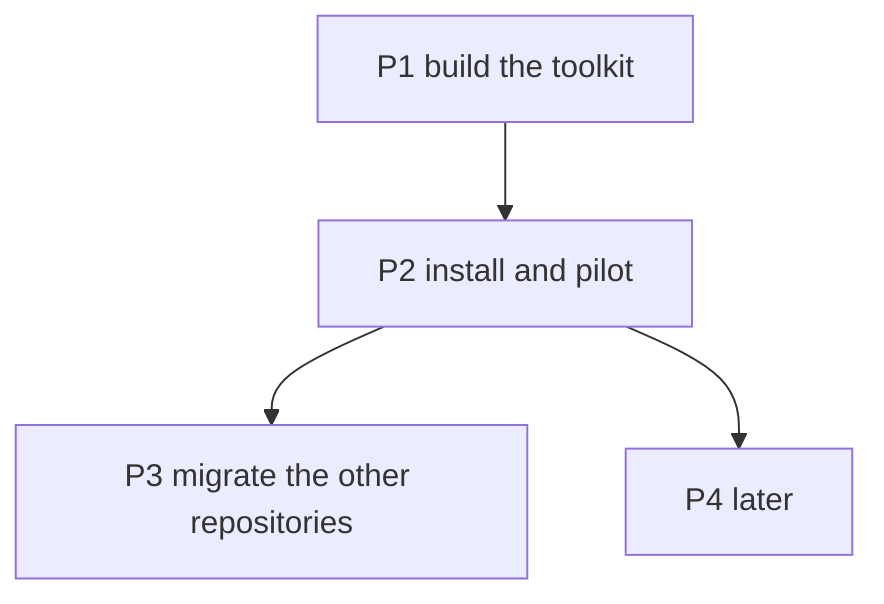

# Agent Toolkit — Task Board

> Created 2026-10-10. One source for the agent instructions and skills shared by the personal
> repositories under `~/GitHub/dani`, in open formats (AGENTS.md, Agent Skills), linked into
> `~/.claude/` instead of copied into each repository.
> Companion ADR: [personal toolkit, open formats](../decisions/2026-10-10_personal-toolkit-open-formats.md).
> References: [toolkit/](../../toolkit/), the merge base `../szlavik-tomi`.
> Markers per the `implementation-plan` skill: 💬 discussed · 🟢 ready · 🔨 in progress ·
> ✅ done · ⏸️ deferred.

## Decisions

- ✅ **D1 — Claude Code is the reference tool; the formats stay portable.** Decided 2026-10-10.
  OpenCode reads the same `~/.claude/` folders as a fallback; Codex is two links away (P4.3).
  A Claude Max subscription works only in Anthropic's own clients
  ([terms](https://code.claude.com/docs/en/legal-and-compliance#authentication-and-credential-use));
  another client means an API key.
- ✅ **D2 — The toolkit lives in this repository**, under `toolkit/`, next to the research.
  Decided 2026-10-10.
- ✅ **D3 — Stack rules become Agent Skills.** Decided 2026-10-10. Portable, at the cost of
  loading by the model's judgment instead of by file match.
- ✅ **D4 — `szlavik-tomi`'s versions are the merge base.** Decided 2026-10-10.
- ✅ **D5 — When to install the toolkit.** Decided 2026-10-15: now, option (a), as the gate of
  the harness board's P2.10; repositories migrate when next worked in. The original question:
  a personal skill overrides a project skill of the same
  name ([skills docs](https://code.claude.com/docs/en/skills)), so from the install on, every
  repository still carrying its own `commit`, `adr` or `implementation-plan` gets the toolkit's
  instead (P3.1–P3.4). Options: (a) install now and migrate each repository the next time it is
  worked in; (b) migrate the P3.3 and P3.4 families first. Blocks P2.2.
- ✅ **D6 — Copy into repositories that leave the machine** (client repositories, cloud
  sessions). Decided 2026-10-12: the mechanism is the harness tool's bake, B4 in its
  [ADR](../decisions/2026-10-11_harness-tool-compiler-and-linter.md), tracked as P2.3 on the
  [harness board](2026-10-11_harness-distribution-tool.md). P4.1 moves there. Amended
  2026-10-15: the bake is deferred; the copy for someone who leaves the machine is
  `reins export`, P2.11 there.

## Dependency graph

## P1 — Build the toolkit

Gate: every skill passes the Agent Skills spec check (name matches folder, spec fields only,
description within 1024 characters); `install.sh` tested against a scratch home.

- ✅ **P1.1 — `toolkit/global/AGENTS.md` holds the personal policies.** [EXECUTED]
  Communication, engineering principles, strict execution, the general half of git, sibling
  repositories; project examples replaced by neutral ones. Branch model and versioning left to
  each project (`domain_mesh` and `domainmesh-website` work on `dev`).
- ✅ **P1.2 — `commit`, `adr`, `implementation-plan` are toolkit skills.** [EXECUTED]
  Claude-only `argument-hint` dropped; project scopes and state files left to the projects.
- ✅ **P1.3 — Stack conventions are toolkit skills.** [EXECUTED]
  `go-style`, `go-testing`, `go-cli`, `opentofu`, `cloudflare-pages`, `mermaid-diagrams`,
  `docs-and-taskfile`. Deviation: `cloudflare` became `cloudflare-pages` and holds only the
  core shared by `szlavik-tomi` and `domainmesh-website`; the rest is project-specific.
- ✅ **P1.4 — `toolkit/install.sh` links the toolkit into `~/.claude/`.** [EXECUTED]
  Re-runnable; refuses any path that is not already its own link; leaves
  `~/.claude/skills/synced/` (claude.ai's skills) alone.
- ✅ **P1.5 — The decision is an ADR.** [EXECUTED]

## P2 — Install and pilot

Gate: a new session in `szlavik-tomi` lists the toolkit skills and loads the global
instructions (`/memory`, `/skills`).

- 🟢 **P2.1 — This repository is under git.** [PENDING] (you) `git init`, then the first
  commits.
- ✅ **P2.2 — The toolkit is installed.** [EXECUTED] 2026-10-15 by
  `reins config --user danielmolnar --user-level toolkit`, which replaced `install.sh`
  (harness board P2.10): `~/.claude/CLAUDE.md` and ten skill links, `synced` and
  `reverse-engineer-anything` untouched, a second run reporting `ok`.
- ✅ **P2.3 — `szlavik-tomi` is migrated (pilot).** [EXECUTED]
  Deleted the rules `communication`, `engineering-principles`, `strict-execution`, `git`,
  `sibling-repos`, `go-style`, `mermaid-diagrams` and the skills `commit`, `adr`,
  `implementation-plan`. Slimmed `go-testing` and `docs-and-taskfile` to the project's part;
  `local-dev` gained "Git in this repo" (branch, versions, scopes, state files). `go-cli`,
  `opentofu`, `cloudflare` stay as project rules: they name this project's files and functions.
  Its `CLAUDE.md` says where the global part comes from. Commit pending (you).
- ✅ **P2.4 — This repository's own `.claude/` is migrated.** [EXECUTED] 2026-10-14.
  Deleted the rules `communication`, `engineering-principles`, `strict-execution`, `git`,
  `mermaid-diagrams` (byte-identical to the toolkit skill) and the skills `commit`, `adr`
  (older copies: the repo's `adr` still carried `argument-hint`). The `docs` rule keeps the
  hierarchy, the reference and citation rules and the post-change checklist, and points at the
  `adr`, `implementation-plan` and `mermaid-diagrams` skills for the rest. `CLAUDE.md` says
  where the global part comes from. Gate: `reins lint .` reports 0 errors, 0 warnings;
  `go test ./...` green. Until P2.2 runs `install.sh`, this repository has no copy of the global
  policies at all.

## P3 — Migrate the other repositories

One session in each repository. Gate per repository: no file left that the toolkit also holds,
the project-specific lines kept in its own instructions, its `CLAUDE.md` index updated.

- 🟢 **P3.1 — The `domainmesh` family.** [PENDING]
  `domain_mesh`, `domainmesh-business`, `domainmesh-website`: the five policy rules,
  `mermaid-diagrams`, `docs-and-taskfile`, `commit`, `adr`; plus `go-style`, `go-testing` in
  `domain_mesh`, `sibling-repos` in the two others, `implementation-plan` in the two others,
  `go-cli`, `opentofu`, `cloudflare` in `domainmesh-website`. Branch and promotion rules stay
  as the project's part of git; the `domainmesh-business` "export that leaves the repository"
  section of `commit` moves into its own instructions.
- 🟢 **P3.2 — `java-langauge-server-business`.** [PENDING] `communication`, `mermaid-diagrams`.
- 💬 **P3.3 — The "Batch" boards.** [PENDING]
  `domain-manager`, `formi-realestate-website`, `housing-app`, `housing-app-business`,
  `housing-app-website`, `job-searcher`, `website-danimolnar-com` use another
  `implementation-plan` format. Per repository: adopt the toolkit's board format, or keep theirs
  under another name. `housing-app-business` also carries `commit` and `adr`.
- 💬 **P3.4 — The "house style" commits.** [PENDING]
  `marketing-assistant` and `job-assistant-geert` derive the commit style from the repository's
  history; the toolkit's `commit` imposes Conventional Commits. Per repository: merge that
  approach into the toolkit's `commit`, or rename theirs.

## P4 — Later

- ⏸️ **P4.1 — Repositories that leave the machine carry a copy.** [DEFERRED] Moved on
  2026-10-12 to the harness board's P2.3, the bake (D6).
- 💬 **P4.2 — The general half of `local-dev` moves into the global instructions.** [PENDING]
  The human runs what mutates, deploys or spends; command blocks without comments, one
  operational command per block; `.env` never read; the user's contact details never sent out.
  `local-dev` exists in `szlavik-tomi`, `domainmesh-business`, `domainmesh-website`.
- ⏸️ **P4.3 — Codex reads the toolkit.** [DEFERRED] Not needed while Claude Code is the
  reference tool (D1). When it is: `~/.codex/AGENTS.md` and `~/.agents/skills/<name>` links
  ([Codex AGENTS.md](https://learn.chatgpt.com/docs/agent-configuration/agents-md),
  [Codex skills](https://learn.chatgpt.com/docs/build-skills)).

## Progress log

- (2026-10-10) P1 built and P2.3 done from a session in `szlavik-tomi`, under a one-off
  exception to its sibling-repository rule. Gates: the spec check passed for all 10 skills;
  `install.sh` against a scratch home made 11 links (exit 0), a second run left them as they
  were (exit 0), and a real `skills/commit/` in the way was refused (exit 1). Left for the user:
  D5, P2.1, P2.2, the `szlavik-tomi` commit.
- (2026-10-12) D6 decided through the harness tool's bake; P4.1 moved there. Checked on this
  machine: `install.sh` has not been run, `~/.claude/` holds no `CLAUDE.md` and no skill links,
  so `szlavik-tomi` and `w2going`, whose instructions already point at the toolkit, run without
  the global policies until P2.2 (you).
- (2026-10-14) P2.4 executed: this repository's `.claude/` holds only the `docs` rule and the
  permissions. `install.sh` is still not run (checked 2026-10-14), so this repository joins
  `szlavik-tomi` and `w2going` in running without the global policies until P2.2 (you).
- (2026-10-15) D5 decided and P2.2 executed through `reins config`; `install.sh` deleted. This
  repository, `szlavik-tomi` and `w2going` have the global policies again from their next
  session. `w2going`'s `CLAUDE.md` still names `install.sh` (you).
