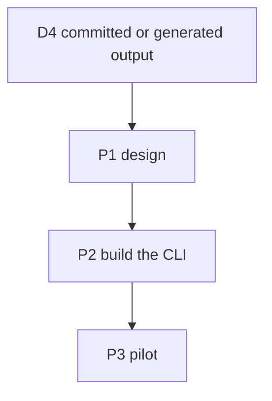
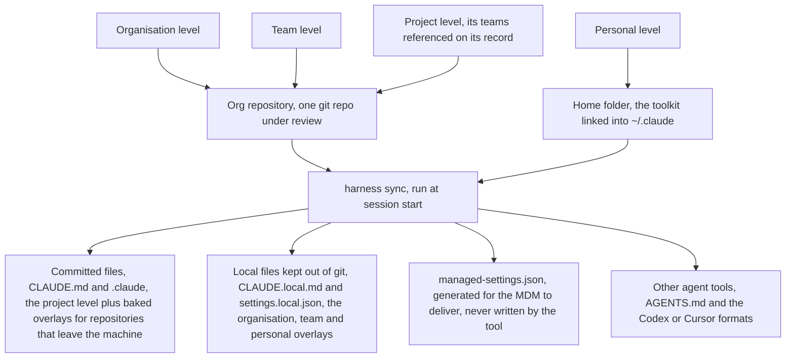
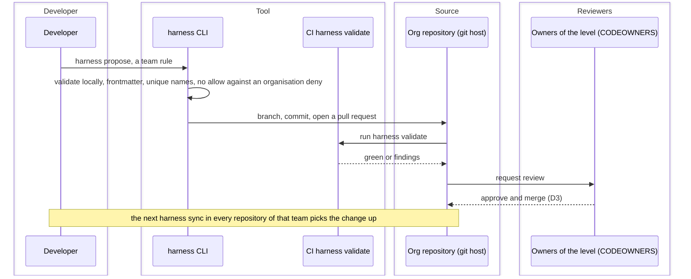

# Harness Distribution Tool — Task Board

> Created 2026-10-11. A proposal under discussion: one tool that holds four levels of agent
> configuration (organisation, team, project, personal), validates every change, and writes each
> level into the files an agent tool reads inside the repository. Nothing on this board is
> approved; every item is 💬. It records the architecture discussion of 2026-10-11 so the next
> session does not restart it.
> Companion ADR: [compiler and linter, not a runtime](../decisions/2026-10-11_harness-tool-compiler-and-linter.md).
> References: [harness-management.md](../harness-management.md)
> (Q1, Q2, Q6), the [toolkit board](2026-10-10_agent-toolkit.md) (its D6), the
> [toolkit ADR](../decisions/2026-10-10_personal-toolkit-open-formats.md),
> [toolkit/install.sh](../../toolkit/install.sh).
> Markers per the `implementation-plan` skill: 💬 discussed · 🟢 ready · 🔨 in progress ·
> ✅ done · ⏸️ deferred.

## The proposal as stated

A Go service on the developer's machine. `init` deploys the files an agent needs into a
repository (for Claude Code, `CLAUDE.md` and the `.claude/` tree) from four levels of
preferences — organisation, team, project, personal — merged into one file. A server holds the
levels; machines register with it; an update is pushed down to every relevant repository; a
workflow validates each request (rules, workflows, MCP servers, …). Every generated agent file is
gitignored and never enters the repository.

The assessment below keeps the four levels, the central validation and the generated files
inside the repository, and changes three mechanics: pull instead of push (D2), review as a
pull request on the source instead of a tool-native workflow (D3), and the project level
committed instead of gitignored (D4).

## Terms

- **Org repository** (`OrgRepository`): the one git repository per organisation that holds the
  `declarations/` tree, with the organisation, team, project and user declarations, the labels
  and the exceptions. People write there; the tool reads it. For the pilot, this repository.
  The ADR says "the source repository" for the same thing.
- **Product repository** (`ProductRepository`): any repository that holds software. Each one
  carries a manifest (organisation, team, project, pinned org-repository version) and the files
  the tool writes for it. The tool writes there. For the pilot, the siblings under
  `~/GitHub/dani`.

## Decisions

- ✅ **D1 — Who the tool is for.** Decided 2026-10-11 by the
  [ADR](../decisions/2026-10-11_harness-tool-compiler-and-linter.md): an organisation with many
  teams, with the personal toolkit in this repository as the pilot. The symlinks of
  [install.sh](../../toolkit/install.sh) stay the delivery on this machine; the tool adds the
  lint (B1) and the bake (B4) for repositories that leave it (the toolkit board's D6).
- ✅ **D2 — Pull at session start, not push from a daemon.** Decided 2026-10-11 (ADR, N1 and
  N2). A CLI run by a `SessionStart` hook or by hand; the org repository is git and
  "registering" is cloning it. Why: the root `CLAUDE.md` is read at launch and again only after
  `/compact` ([memory docs](https://code.claude.com/docs/en/memory#instructions-seem-lost-after-compact)),
  so a push into a running session is not seen until then, while settings files reload live
  ([settings docs](https://code.claude.com/docs/en/settings)), leaving a session half old and
  half new. A daemon also writes into every working tree and must be installed, kept alive,
  updated and secured. Every vendor pulls: managed settings at startup and hourly, marketplaces
  on update, Goose's allowlist on restart ([Q1](../harness-management.md#q1--how-dev-teams-receive-the-harness)).
- ✅ **D3 — A change to a level is reviewed as a pull request.** Decided 2026-10-11 (ADR, N3).
  The org repository is git; the approval is a pull request routed by CODEOWNERS, which the tool
  opens from `harness propose`. Review, history and blame come free; a tool-native workflow
  would re-implement them. The diagram [Propose a change to a level](#propose-a-change-to-a-level)
  shows it.
- 💬 **D4 — Whether the generated files are committed in the product repository.** Re-opened
  2026-10-11 (M14). Both options start from one fact: the agent reads its files from the product
  repository's working tree, so the compiler's output must exist there on every machine. What
  is generated per repository is small: the manifest, the project-level output, `.mcp.json` and
  the settings that enable the org plugin. Organisation and team content travels as a plugin
  through managed settings and needs no commit in any product repository. Options: (a) commit
  the generated files, marked as generated and with their hash in the manifest; a cloud session,
  a CI agent, a fresh clone and a client outside the organisation all see them without the tool
  ([what reaches a cloud session](#what-reaches-a-cloud-session)); the cost is derived files in
  the product history. (b) gitignore them and run `sync` on every machine and in every cloud or
  CI environment; the cost is the tool and access to the org repository everywhere, and at least
  `.claude/settings.json` with the `SessionStart` hook must be committed anyway for the first
  session to run `sync`. Recommendation (a). Blocks P1.3.
- ✅ **D5 — The tool merges guidance only; policy stays in the vendor's lock.** Decided
  2026-10-11 (ADR, N4). Permissions, bypass mode, MCP and model allowlists live in managed
  settings at the root-owned policy path, delivered by MDM, the admin console or the Claude apps
  gateway; the tool generates the drop-in file, or acts as the `policyHelper`, and never writes
  the policy path ([managed settings](https://code.claude.com/docs/en/managed-settings)). On a
  vendor switch the tool regenerates the guidance into the new tool's format and the policy into
  that tool's equivalent where one exists ([Q4](../harness-management.md#harness-portability-across-tools)
  lists what is portable and what is not).

## Design

Decided in the 2026-10-11 discussion unless marked open. The ADR's B1 and B2 are built from this.

### Address and context path

- An **address** says where a declaration is stored: `organizations.{org}.skills.{id}`,
  `organizations.{org}.teams.{team}.skills.{id}`,
  `organizations.{org}.projects.{project}.skills.{id}`, `users.{user}.skills.{id}`. The last
  two segments are the kind and the id. Ids are lowercase letters, digits and hyphens, so an
  address splits on dots without ambiguity.
- A **context path** says what to resolve for one repository on one machine: the organisation
  and the project from the committed manifest, the user from the machine, the teams from the
  project record. It is assembled at sync time and never committed as a whole.
- A **declaration** is the unit: a skill, a rule, an MCP server, a hook, a permission set, a
  label category, an exception, a project record or a user record. Each has an address, a kind
  and a schema; the schema is what the lint checks.

### Storage tree of the org repository

Projects sit beside teams, not under them: a project record references its teams, so a team can
be added or removed without moving files, and several teams can work on one project.

```text
declarations/
  organizations/<org>/
    labels/<category>.yaml          one file per category, listing its labels
    exceptions/<id>.yaml
    skills/  rules/  mcpservers/  hooks/  permissions/
    teams/<team>/
      skills/ ...
    projects/<project>/
      project.yaml                  the project record: teams, labels, fingerprint
      skills/ ...
  users/<user>/
    user.yaml
    skills/ ...
```

Users keep their declarations here too: everyone is part of the organisation, every change is in
one history, and the lint can see a personal declaration shadowing a required one. CODEOWNERS
makes each user the reviewer of their own folder and the referenced teams the reviewers of a
project folder; the tool can emit that file from the records.

### Labels

- Labels are a registry, not free text. A category is a declaration,
  `organizations.{org}.labels.{category}`; a label is referenced as `category:value`, for
  instance `language:go`. Categories are seeded with defaults (`language`, `kind`, `data`) that
  the organisation edits. Organisation level only to start.
- `label create`, `label rename` and `label delete` edit the category files. Rename rewrites
  every reference in one commit; delete is refused while a reference exists.
- A project's effective labels are its own plus those of its teams and of its organisation.
- Detecting labels from repository contents is parked: [F1](../future-ideas.md#L8).

### Selectors, enforcement, skip lists and exceptions

- A declaration carries `applyIf` and `doNotApplyIf`, lists of labels. `doNotApplyIf` wins.
- Every declaration has an enforcement, `required` or `default`; unmarked means `default`. A
  lower level may skip a `default` declaration or replace it with one of the same id. It cannot
  skip or redeclare a `required` one.
- A team or project may keep a skip list. It is honoured for `default` declarations. For a
  `required` declaration it is honoured only through an exception.
- An exception is a declaration at the owner's level, `organizations.{org}.exceptions.{id}`,
  naming the declaration, the grantee, a reason and an optional end date. An expired exception
  is a lint error and the declaration applies again.

### Resolution order

1. Read the organisation and the project from the manifest, the user from the machine, the
   teams from the project record.
2. Collect declarations from the organisation, each referenced team, the project and the user.
3. Drop those whose selectors do not match the project's effective labels.
4. Apply skip lists, checking exceptions and their end dates.
5. Resolve the same kind and id across levels: a lower `default` replaces; a lower redeclaration
   of a `required` is an error; the same id from two teams is an error unless the project
   resolves it.
6. Emit per vendor (ADR, B3).

### Project record, identity and init

- Identity is the address, written into the committed manifest at init. A clone never needs a
  lookup.
- The fingerprint is the set of root commit hashes reachable from the default branch, sorted.
  It matches a clone that has no manifest yet and feeds the inventory. Several roots occur when
  unrelated histories were merged; two records with one fingerprint are a lint error, and
  identity falls back to the manifest.
- `init` refuses a folder without `.git`. It stages only the files it wrote, commits them with a
  fixed message and the command echoed, and offers `--no-commit`. Then it verifies: a new `HEAD`
  exists and `git status --porcelain` lists none of its files. If the commit fails, a pre-commit
  hook for instance, init prints git's output, leaves its files staged, records no fingerprint,
  writes `committed: false` into the manifest and exits non-zero. The next `sync` sees that flag
  and offers the commit again. Re-running init is safe.
- `localPath` is per machine and lives in local state, never in the record.

### Where each thing is stored

| Store | Holds | Rule |
|---|---|---|
| Org repository | every declaration: labels, exceptions, project and user records included | shared truth, reviewed, with history |
| Product repository | the manifest (organisation, project, pinned org-repository version) and the generated files (D4) | about this repository, so every clone has it |
| Local state on the machine | user identity, clone paths, a cache of the org repository, last sync, drift cache | about this machine; no tokens, git's credential helper does auth |

### What the lint checks

Schema per kind; skill name equals folder; description length; unique id within a level; every
`applyIf`, `doNotApplyIf` and project label a registered label; every skip list entry resolving
to an address; every skip of a `required` backed by a live exception; no exception without a
reason, a warning without an end date; no `allow` matching an organisation `deny`; MCP server
URLs on the allowlist; no `CLAUDE.md` inside a plugin; no personal declaration shadowing a
`required` one; two project records with one fingerprint.

## Dependency graph



## How the tool works

Three diagrams: where each level lands, how a repository is brought up to date at session
start, and how a change to a level is reviewed. Drawing conventions are the
[mermaid-diagrams rule](../../.claude/rules/mermaid-diagrams.md). There is no renderer in this
repository; the diagrams are verified by opening the file.

### Place each level



### Sync a repository at session start


### Propose a change to a level



## What Claude Code reloads mid-session

The question from the discussion: can Claude be forced to re-read `CLAUDE.md` mid-session? No
command does that. The table says what is read when; every row is from the official docs read on
2026-10-11.

| What | When it is read | Source |
|---|---|---|
| Root `CLAUDE.md`, `CLAUDE.local.md`, rules without `paths:` | At launch; again after `/compact`, which re-reads the root file from disk | [memory docs](https://code.claude.com/docs/en/memory#instructions-seem-lost-after-compact) |
| Rules with `paths:`, `CLAUDE.md` in subdirectories | When Claude reads, writes or edits a matching file | [memory docs](https://code.claude.com/docs/en/memory#organize-rules-with-claude/rules/) |
| Settings files (permissions, hooks, credential helpers) | Watched; most edits apply to the running session | [settings docs](https://code.claude.com/docs/en/settings) |
| Hook-injected context | `SessionStart` (matchers `startup`, `resume`, `clear`, `compact`, `fork`) and `UserPromptSubmit` on every prompt, through `additionalContext` | [hooks docs](https://code.claude.com/docs/en/hooks) |

Consequences for the tool:

1. A change to the root `CLAUDE.md` lands at the next session, or after `/compact` or `/clear`.
   This is why D2 recommends syncing at session start rather than pushing into a running one.
2. The one way to land guidance mid-session is a `UserPromptSubmit` hook that injects it on every
   prompt. It costs tokens on each turn and is for small, urgent content only.
3. Permissions and hooks do land mid-session, so a policy change in a settings file is live at
   once. That is the vendor's enforcement layer doing its job; the tool does not need to add to it.

## What reaches a cloud session

From the [cloud environments docs](https://code.claude.com/docs/en/cloud-environments#what-carries-over-from-your-setup),
read on 2026-10-11. A cloud session starts from the git clone, so:

| Reaches the cloud session | Does not |
|---|---|
| The repository's `CLAUDE.md`, `.claude/rules/`, `.claude/skills/`, `.claude/agents/` | `~/.claude/CLAUDE.md`, `~/.claude/skills/`, user settings and user-enabled plugins |
| The repository's `.claude/settings.json` hooks and permissions (single-repository session) | `.claude/settings.local.json` and any other gitignored file |
| `SessionStart` hooks from the repository's settings | `SessionStart` hooks from `~/.claude/settings.json` |
| An environment setup script, which may write `~/.claude/CLAUDE.md` | Plugins and marketplaces declared in the repository's settings |

So the committed project level is the only level that reaches the cloud on its own. A
`SessionStart` hook committed in the repository could run `harness sync` there too, if the
environment's network allowlist admits the org repository's host (open point O2).

## Value

### For a single developer

Today, `install.sh` places symlinks: a symlink is a filesystem entry that points at another
path, so `~/.claude/skills/commit` *is* `toolkit/skills/commit` and an edit in the toolkit is
seen by every repository on this machine at its next session, with no code. The tool adds:

- **V1 — Copies for repositories that leave the machine.** A client repository, a cloud session
  or a CI agent sees none of the symlinked files. The tool bakes the overlays into the committed
  files for such a repository. This is the toolkit board's D6, which is decided in principle with
  the mechanism open.
- **V2 — One source for several agent tools.** The same levels generated into the formats of
  Claude Code, Codex and Cursor. Worth it only when a second tool is in real use (the toolkit
  ADR deferred this).
- **V3 — Drift report.** Which repository's committed files differ from what the levels would
  generate.
- **V4 — One-command init** for a new repository.

For one developer, one tool and one machine, V3 and V4 are conveniences. V1 and V2 are the
real value, and both can be a short script before they are a tool.

### For an organisation

- **V5 — One vendor-neutral source for four levels, generated per tool.** The vendor layers
  (managed settings, marketplaces, plugins) are each vendor's own; switching tools means
  rebuilding them. With the source outside any vendor format, the tool regenerates guidance and
  the policy file for the new tool. This is the point accepted as D5.
- **V6 — A validation gate before distribution**, over everything a level can carry: rules,
  skills, subagents, hooks, permissions, MCP servers, model and provider settings
  ([the layer table](../harness-management.md#0-the-harness-layer-by-layer)).
- **V7 — Reviewed changes per level**, with owners (D3).
- **V8 — Inventory and drift across the fleet.** Which repository runs which version of which
  level. Only the Backstage AI Coding Rules plugin offers this today
  ([Q6](../harness-management.md#q6--adopt-existing-solutions-or-build)).
- **V9 — Guidance and policy kept apart** (D5): the tool generates the managed settings file for
  the MDM and never pretends a prose file is enforcement.

### What it does not replace

The vendor's enforcement (managed settings), the LLM gateway (Q4, Q5), the MCP registry (Q3),
and the plugin marketplace where a team wants one. The tool can generate a plugin as one of its
output formats; it does not need to be the marketplace.

## P1 — Design

Gate: the manifest, the merge rules and the slot map are written on this board and approved.

- ✅ **P1.1 — A repository manifest names its organisation, its project and the pinned version
  of the org repository.** [EXECUTED] Written in [Design](#design), approved 2026-10-11.
  Deviation from the ADR's B2: the manifest names no team; teams are referenced on the project
  record, so several teams can share a project and be added or removed without moving files.
- ✅ **P1.2 — The merge rules per level are written.** [EXECUTED] Selectors, enforcement, skip
  lists, exceptions and the resolution order in [Design](#design), approved 2026-10-11.
- 🟢 **P1.3 — The slot map per agent tool is written.** [PENDING]
  Which file each kind lands in, for Claude Code first (the ADR's B3 lists the outputs), then
  the tools D1 names. Blocked by D4.
- ✅ **P1.4 — The validation rules are written.** [EXECUTED]
  [What the lint checks](#what-the-lint-checks), approved 2026-10-11.

## P2 — Build

In the ADR's order. Gate per item: tests green and the item run against this repository.

- ⏸️ **P2.1 — `harness init`, `sync`, `validate` and `propose` exist as a Go CLI with tests.**
  [DEFERRED] Split into P2.2 to P2.6 in the ADR's order.
- 🟢 **P2.2 — The lint (B1) runs against [toolkit/](../../toolkit/) and this repository's
  `.claude/`.** [PENDING] The declaration checks can start; the plugin checks wait for P1.3.
- 🟢 **P2.3 — The bake (B4) copies the overlays into a repository that leaves the machine.**
  [PENDING] Closes the toolkit board's D6.
- 🟢 **P2.4 — The manifest, the label registry and the merge (B2) exist in code, with `init`,
  `label` and `propose`.** [PENDING]
- 🟢 **P2.5 — The compiler for Claude Code (B3) emits the plugin and marketplace repository, the
  managed-settings drop-in, `.mcp.json` and `CLAUDE.local.md`.** [PENDING] Blocked by P1.3.
- 🟢 **P2.6 — The drift and inventory report (B5).** [PENDING]

## P3 — Pilot

- 💬 **P3.1 — This repository is the pilot's org repository: [toolkit/](../../toolkit/) moves
  to `declarations/users/<you>/`, and one sibling repository runs `sync` at session start and
  reports no drift.** [PENDING]

## Open points

- O1 — Whether a file written by a `SessionStart` hook is loaded in the same session or only in
  the next. The hook's `additionalContext` reaches the session either way. To verify on this
  machine before P1.3.
- O2 — Whether a cloud environment's network allowlist admits the org repository's host, so
  `sync` can run in a cloud session.

## Progress log

- (2026-10-11) Board created from the architecture discussion in this repository; nothing built.
  Left for the user: D1 to D5.
- (2026-10-11) ADR written: the tool is a compiler and a linter, not a runtime, B1 to B5 built in
  that order, N1 to N6 not ([ADR](../decisions/2026-10-11_harness-tool-compiler-and-linter.md)).
  The decisions and phases above still carry the pre-ADR wording; aligning them waits for the
  user's go-ahead.
- (2026-10-11) Terms "org repository" and "product repository" documented and the board's wording
  aligned to them. Label detection parked as F1 in [future-ideas.md](../future-ideas.md).
- (2026-10-11) Design written: address and context path, storage tree with teams referenced on
  projects, label registry, enforcement, exceptions, resolution order, identity and init with its
  failure path, the three stores, the lint checks. P1.1, P1.2 and P1.4 executed. D1, D2, D3 and
  D5 marked decided per the ADR; D4 re-opened with options; P2 split into the ADR's order.
  Left for the user: D4.
