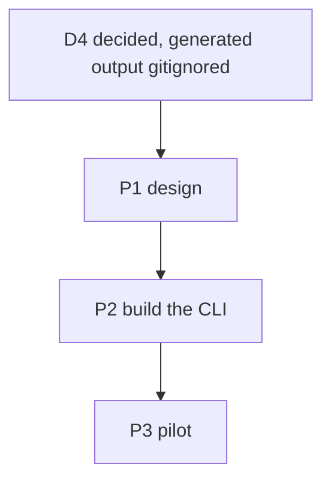
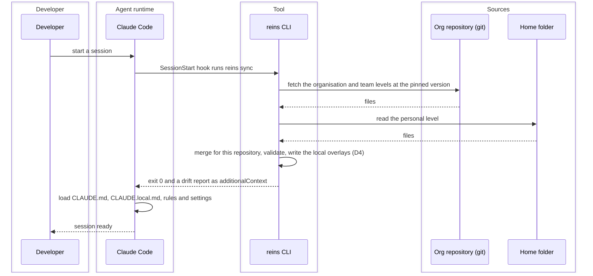
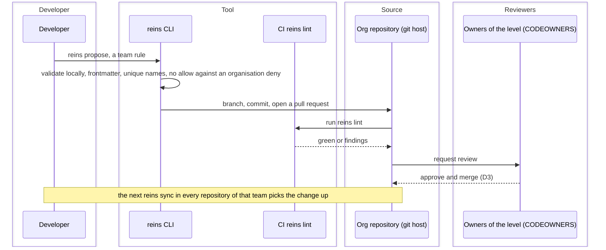

# Harness Distribution Tool — Task Board

> Created 2026-10-11. The harness distribution tool: one tool that holds four levels of agent
> configuration (organisation, team, project, personal), validates every change, and writes each
> level into the files an agent tool reads inside the repository. It records the architecture
> discussion of 2026-10-11 and the decisions that came out of it, so the next session does not
> restart it.
> Companion ADR: [compiler and linter, not a runtime](../decisions/2026-10-11_harness-tool-compiler-and-linter.md).
> References: [harness-management.md](../harness-management.md)
> (Q1, Q2, Q6), the [toolkit board](2026-10-10_agent-toolkit.md) (its D6), the
> [toolkit ADR](../decisions/2026-10-10_personal-toolkit-open-formats.md),
> [cmd/reins](../../cmd/reins/).
> Markers per the `implementation-plan` skill: 💬 discussed · 🟢 ready · 🔨 in progress ·
> ✅ done · ⏸️ deferred.

## The proposal as stated

A Go service on the developer's machine. `init` deploys the files an agent needs into a
repository (for Claude Code, `CLAUDE.md` and the `.claude/` tree) from four levels of
preferences — organisation, team, project, personal — merged into one file. A server holds the
levels; machines register with it; an update is pushed down to every relevant repository; a
workflow validates each request (rules, workflows, MCP servers, …). Every generated agent file is
gitignored and never enters the repository.

The assessment below keeps the four levels, the central validation and the generated files
inside the repository, and changes three mechanics: pull instead of push (D2), review as a
pull request on the source instead of a tool-native workflow (D3), and the project level
committed instead of gitignored (D4).

## Terms

- **Agent**: the program that reads the settings and acts, Claude Code, Codex and the like.
  Reins is agent-agnostic; Claude Code is the first agent it writes for.
- **Harness**: everything an agent reads before it acts, instructions, rules, skills, tool
  servers, hooks, permissions and provider settings. The harness is what reins manages; the
  research document defines it the same way.
- **reins** (`reins`): the tool's name, decided 2026-10-12. The thing you hold to steer a
  harnessed team. Binary `cmd/reins`, module `github.com/Danidani23/reins`,
  manifest and hook command named after it.
- **Product repository** (`ProductRepository`): the repository where this tool's own source lives
  and is built and released from. Nothing from any organisation ever goes there. Decided
  2026-10-12: this repository.
- **Org repository** (`OrgRepository`): the git repository an organisation links the tool to at
  setup. It holds the `declarations/` tree, with the organisation, team, project and user
  declarations, the labels and the exceptions. Every configuration change is pushed there, and
  the tool checks everything against it. For the pilot, a GitHub repository that the tool
  itself creates with `org create` (P2.7, P3.1).
- **Project repository** (`ProjectRepository`): any repository that holds software and has a
  project record in the org repository. It carries a manifest (organisation, project, pinned
  org-repository version) and the files the tool writes for it. The agent reads its instructions
  from this working tree, so the compiled output has to land here (D4). For the pilot, the
  siblings under `~/GitHub/dani`.

## Decisions

- ✅ **D1 — Who the tool is for.** Decided 2026-10-11 by the
  [ADR](../decisions/2026-10-11_harness-tool-compiler-and-linter.md): an organisation with many
  teams, with the personal toolkit in this repository as the pilot. The symlinks of
  [install.sh](../../toolkit/install.sh) stay the delivery on this machine; the tool adds the
  lint (B1) and the bake (B4) for repositories that leave it (the toolkit board's D6). Amended
  2026-10-14: P2.10 moves the links into `reins config`, which retires `install.sh`.
- ✅ **D2 — Pull at session start, not push from a daemon.** Decided 2026-10-11 (ADR, N1 and
  N2). A CLI run by a `SessionStart` hook or by hand; the org repository is git and
  "registering" is cloning it. Why: the root `CLAUDE.md` is read at launch and again only after
  `/compact` ([memory docs](https://code.claude.com/docs/en/memory#instructions-seem-lost-after-compact)),
  so a push into a running session is not seen until then, while settings files reload live
  ([settings docs](https://code.claude.com/docs/en/settings)), leaving a session half old and
  half new. A daemon also writes into every working tree and must be installed, kept alive,
  updated and secured. Every vendor pulls: managed settings at startup and hourly, marketplaces
  on update, Goose's allowlist on restart ([Q1](../harness-management.md#q1--how-dev-teams-receive-the-harness)).
- ✅ **D3 — A change to a level is reviewed as a pull request.** Decided 2026-10-11 (ADR, N3).
  The org repository is git; the approval is a pull request routed by CODEOWNERS, which the tool
  opens from `reins propose`. Review, history and blame come free; a tool-native workflow
  would re-implement them. The diagram [Propose a change to a level](#propose-a-change-to-a-level)
  shows it.
- ✅ **D4 — The generated files are gitignored in the project repository and regenerated by
  `sync`.** Decided 2026-10-11, option (b). The agent reads its files from the project
  repository's working tree, so the compiler's output must exist there on every machine; `sync`
  writes it and git ignores it. Committed, by `init`: the manifest, the `.gitignore` entries for
  the generated paths, and `.claude/settings.json` carrying the `SessionStart` hook that runs
  `sync` and the org plugin's marketplace and `enabledPlugins` entries. Organisation and team
  content travels as a plugin through managed settings and needs no file in any project
  repository. Consequences: a cloud session or a CI job needs the tool installed and network
  access to the org repository (O2), through a setup script or the committed hook; a client
  outside the organisation receives nothing but what the bake (B4) copies in, so the bake is the
  one deliberate exception to this decision; and the first session on a fresh clone depends on
  O1, whether a file the `SessionStart` hook writes is read in that same session. Option (a),
  committing the generated files, was the recommendation and was not chosen: derived files in
  every project's history, and churn on every project-level change.
  Amended 2026-10-15: a project repository carries no reins file at all, since agent settings
  are not repository settings. The manifest is gone; a clone is matched to its project record
  by fingerprint. The only footprint is a marked block that `sync` keeps in `.gitignore`, naming
  the generated paths and `.claude/settings.local.json`, which the user commits. The block opens
  with a comment saying that reins wrote it, that agent settings live outside this repository,
  and that the block is to be committed and not edited by hand. The
  `SessionStart` hook, the project-level hooks, permissions and plugin keys live in
  `.claude/settings.local.json`, written by `sync` and never committed, so they exist only in
  registered clones; reins owns the keys it writes and never removes the approvals Claude Code
  saved there. A fresh clone needs one explicit `reins sync`, which identifies the project by
  fingerprint and writes the rest. The personal level is delivered per project the same way, so
  two organisations on one machine never collide in `~/.claude/`; the placement `reins config`
  makes today is the interim until then (P3.1).
- ✅ **D5 — The tool merges guidance only; policy stays in the vendor's lock.** Decided
  2026-10-11 (ADR, N4). Permissions, bypass mode, MCP and model allowlists live in managed
  settings at the root-owned policy path, delivered by MDM, the admin console or the Claude apps
  gateway; the tool generates the drop-in file, or acts as the `policyHelper`, and never writes
  the policy path ([managed settings](https://code.claude.com/docs/en/managed-settings)). On a
  vendor switch the tool regenerates the guidance into the new tool's format and the policy into
  that tool's equivalent where one exists ([Q4](../harness-management.md#harness-portability-across-tools)
  lists what is portable and what is not).
- ✅ **D6 — Provider and gateway settings are declarations, not machine config.** Decided
  2026-10-15: the organisation level sets the default and a team or a project overrides it,
  unless the organisation marked it `required`. Which provider or gateway a project talks to,
  the model aliases and the allowed providers are policy of a level, so they belong in the org
  repository as a `providers`
  declaration kind at organisation, team or project level, `required` or `default` like any
  other, compiled into the vendor's `env` and model keys by P2.5. Never a token: the gateway URL
  travels, the credential stays in the user's keychain or environment. `reins config` holds
  nothing about providers, because a machine is not a level. Switching provider is then one
  change in the org repository that every project receives at its next sync; the routing itself
  stays the gateway's job (ADR, N5). The address grammar gains `providers`.

## Design

Decided in the 2026-10-11 discussion unless marked open. The ADR's B1 and B2 are built from this.

### Address and context path

- An **address** says where a declaration is stored: `organizations.{org}.skills.{id}`,
  `organizations.{org}.teams.{team}.skills.{id}`,
  `organizations.{org}.projects.{project}.skills.{id}`, `users.{user}.skills.{id}`. The last
  two segments are the kind and the id. Ids are lowercase letters, digits and hyphens, so an
  address splits on dots without ambiguity.
- A **context path** says what to resolve for one repository on one machine: the organisation
  and the project from the nearest manifest, found by walking up from the working directory as
  git finds `.git`, the user from the machine, the teams from the project record. It is
  assembled at sync time and never committed as a whole.
- A **declaration** is the unit: a skill, a rule, an MCP server, a hook, a permission set, a
  label category, an exception, a project record or a user record. Each has an address, a kind
  and a schema; the schema is what the lint checks.

### Identity and naming

Decided 2026-10-12 for organisations, teams, projects and users. An entity that can be renamed
carries three things:

- **`id`**, a UUID, generated at creation and never changed. It is the identity for every
  reference that lives *outside* the org repository and cannot be rewritten by a commit there:
  the manifest in a project repository, the local state on a machine, telemetry.
- **`slug`**, the address segment and folder name, lowercase letters, digits and hyphens, for
  instance `dani`. It is the identity for every reference *inside* the org repository: addresses,
  skip lists, exceptions, CODEOWNERS. A slug stays readable in paths, diffs and reviews, which a
  UUID would not. Renaming a slug is a tool verb, like `label rename`: the tool rewrites every
  reference in one commit, and the UUID lets a manifest or a machine that still carries the old
  slug resolve the entity anyway.
- **`name`** and **`description`**, free text, changed at will. Renaming here breaks nothing.

The manifest in a project repository therefore carries the organisation's and the project's
`id` and `slug`; the tool resolves by `id` and shows the `slug`. Declarations such as skills,
rules and MCP servers keep a slug only: every reference to them lives inside the org repository,
so a rename rewrite is always complete.

### Storage tree of the org repository

Projects sit beside teams, not under them: a project record references its teams, so a team can
be added or removed without moving files, and several teams can work on one project.

```text
declarations/
  organizations/<org>/
    organization.yaml               id, name, description
    labels/<category>.yaml          one file per category, listing its labels
    exceptions/<id>.yaml
    skills/  rules/  mcpservers/  hooks/  permissions/
    teams/<team>/
      team.yaml                     id, name, description
      skills/ ...
    projects/<project>/
      project.yaml                  id, name, description, teams, labels, fingerprint, path
      skills/ ...
  users/<user>/
    user.yaml                       id, name
    skills/ ...
```

Users keep their declarations here too: everyone is part of the organisation, every change is in
one history, and the lint can see a personal declaration shadowing a required one. A person
in several organisations keeps one user level per organisation (C1, decided 2026-10-15), so
each organisation lints it against its own rules; `export` and `import` copy a user level
across. CODEOWNERS
makes each user the reviewer of their own folder and the referenced teams the reviewers of a
project folder; the tool can emit that file from the records.

### Labels

- Labels are a registry, not free text. A category is a declaration,
  `organizations.{org}.labels.{category}`; a label is referenced as `category:value`, for
  instance `language:go`. Categories are seeded with defaults (`language`, `kind`, `data`) that
  the organisation edits. Organisation level only to start.
- `label create`, `label rename` and `label delete` edit the category files. Rename rewrites
  every reference in one commit; delete is refused while a reference exists.
- A project's effective labels are its own plus those of its teams and of its organisation.
- Detecting labels from repository contents is parked: [F1](../future-ideas.md#L8).

### Selectors, enforcement, skip lists and exceptions

- A declaration carries `applyIf` and `doNotApplyIf`, lists of labels. `doNotApplyIf` wins.
- Every declaration has an enforcement, `required` or `default`; unmarked means `default`. A
  lower level may skip a `default` declaration or replace it with one of the same id. It cannot
  skip or redeclare a `required` one.
- A team or project may keep a skip list. It is honoured for `default` declarations. For a
  `required` declaration it is honoured only through an exception.
- An exception is a declaration at the owner's level, `organizations.{org}.exceptions.{id}`,
  naming the declaration, the grantee, a reason and an optional end date. An expired exception
  is a lint error and the declaration applies again.

Contradictions between levels, and what guarantees what (2026-10-15):

- **Structured policy is proven, not read.** Permissions, hooks, tool servers and providers are
  data, so the compiler and the lint decide contradictions mechanically: a team `allow` that an
  organisation `deny` covers, a provider outside the organisation's allowed list, a hook that
  replaces an organisation hook, a lower redeclaration of a `required` id are all errors, and
  the harness is not written until they are gone. What the organisation must hold at any price
  goes into the vendor's own lock, managed settings, where no level below can touch it (D5).
- **Prose is ordered, not proven.** Two rules in words under different ids can still disagree,
  and no lint reads meaning. The compiler writes the resolved instructions in level order,
  organisation first, each level under its own heading, with a generated preamble that tells the
  agent the precedence: a higher level's `required` rule wins over anything below it. Claude
  Code's `/doctor prompt-audit`, which looks for contradictory instruction files, is the review
  tool for the rest, and a model-judged consistency check in CI is a later option (Q6, evals).

### Review of prose policies

Decided 2026-10-15. Prose contradictions are semantic, so no lint reads them; a judge model is
the gate, before merge. Four rules make it precise and affordable:

1. **Judge the compiled harness, not the tree.** A contradiction can only exist between
   declarations that reach the same project at the same time. For a change, `reins review`
   resolves every affected project and gives the judge, per project, the text an agent would
   read, with each declaration's level, id and enforcement marked. A team change affects that
   team's projects; an org change affects every project, which covers the downstream direction
   at no extra cost. Identical resolved texts are deduplicated.
2. **The rubric is the hierarchy, and every finding names the structured fix.** A lower rule
   may add to or narrow an upper rule, never widen or negate it. Against a `default` upper
   rule the fix is to redeclare that id at the lower level, an explicit override; against a
   `required` rule the fix is an exception at the owner's level. The judge says which applies
   and quotes both sentences, so conflicts move out of prose into mechanisms the lint proves.
3. **Two severities.** A contradiction is a required status check and blocks the merge. A
   tension, two rules a reader might misread together, is advisory and never blocks. On any
   cross-level finding the CI requests review from the upper level's owners, whom CODEOWNERS
   would not involve since the change touches only the lower level's paths.
4. **Keep the judge honest.** Findings are structured and quoted. A fixture set of known
   contradictory and compatible pairs runs against the judge whenever the rubric changes. The
   judge's model and provider are an organisation setting under D6, so it runs through the
   organisation's gateway, never with a token in CI.

`reins propose` runs the review locally before opening the pull request; the org repository's
CI runs it as the required check (P2.13). At runtime the compiled harness keeps its precedence
preamble, and `/doctor prompt-audit` per clone is a later drift check.

### Resolution order

1. Read the organisation and the project from the manifest, the user from the machine, the
   teams from the project record.
2. Collect declarations from the organisation, each referenced team, the project and the user.
3. Drop those whose selectors do not match the project's effective labels.
4. Apply skip lists, checking exceptions and their end dates.
5. Resolve the same kind and id across levels: a lower `default` replaces; a lower redeclaration
   of a `required` is an error; the same id from two teams is an error unless the project
   resolves it.
6. Emit per vendor (ADR, B3).

### Project record, identity and init

- Identity is the address. Since 2026-10-15 no manifest is committed: a clone is matched to its
  project record by fingerprint across the connected organisations (D4 as amended).
- The fingerprint is the set of root commit hashes reachable from the default branch, sorted.
  It matches a clone that has no manifest yet and feeds the inventory. Several roots occur when
  unrelated histories were merged. A project record also carries its `path` inside the
  repository, `.` for the root, so several projects can share one monorepo: two records with
  one fingerprint and one path are a lint error, and identity falls back to the manifest.
- A changed fingerprint, after a merged history or a rewrite, is reported by `sync` as drift
  with an offer to update the record through `reins propose`.
- A clone whose fingerprint matches a project record in two connected organisations is refused
  by `sync`, which names both; `reins init --org <slug>` binds it to one, recorded in local
  state, never silently to the active organisation (C2, decided 2026-10-15).
- `init` refuses a folder without `.git` and, since 2026-10-15, commits nothing: it creates or
  matches the project record, records the fingerprint once a root commit exists, extends
  `.gitignore` with the marked block and reports that change for the user to commit, writes
  `.claude/settings.local.json`, and runs the first sync. Re-running init is safe.
- `localPath` is per machine and lives in local state, never in the record.

### Slot map for Claude Code

Where each kind of declaration lands, by level. Facts from the Claude Code docs read on
2026-10-11: a plugin carries skills, commands, agents, hooks, MCP and LSP servers, output styles
and only two settings keys, `agent` and `subagentStatusLine`; it never loads a `CLAUDE.md`
([plugin components](https://code.claude.com/docs/en/plugins/components)). Plugins declared in a
project repository's settings do not install in cloud sessions, while plugins from server-managed
settings do ([cloud environments](https://code.claude.com/docs/en/cloud-environments#what-carries-over-from-your-setup)).
So organisation and team content travels as plugins enabled by managed settings, and project
content is written as plain files into the working tree, which every kind of session reads.
Everything in the "Project" column is gitignored and written by `sync` (D4 as amended
2026-10-15); the one committed trace is the marked block in `.gitignore`.

| Kind | Organisation | Team | Project | User |
|---|---|---|---|---|
| Always-on prose rule | managed `claudeMd` key, or the managed `CLAUDE.md` at the policy path | a section of the generated `CLAUDE.md` | a section of the generated `CLAUDE.md` | `CLAUDE.local.md` |
| Path-scoped rule | `.claude/rules/org-<id>.md` with `paths:` | `.claude/rules/<team>-<id>.md` | `.claude/rules/<id>.md` | `~/.claude/rules/<id>.md` |
| Skill | baseline plugin `skills/<id>/` | team plugin `skills/<id>/`, invoked as `/<team>:<id>` | `.claude/skills/<id>/` | `~/.claude/skills/<id>` (the toolkit's links today) |
| Subagent | baseline plugin `agents/` | team plugin `agents/` | `.claude/agents/<id>.md` | `~/.claude/agents/` |
| Hook | managed settings `hooks` | team plugin `hooks/hooks.json` | `.claude/settings.local.json` `hooks`, uncommitted | `~/.claude/settings.json`, not touched by the tool |
| MCP server | `managedMcpServers` in the drop-in, HTTPS only, OAuth or header auth | team plugin `.mcp.json` | `.mcp.json`, with `${VAR}` for secrets; interactive sessions ask once per server (O3) | `~/.claude.json` user scope, not touched by the tool |
| Permission rule | managed drop-in `permissions`, with `allowManagedPermissionRulesOnly` when locked | `.claude/settings.local.json` `permissions`, uncommitted | same file | `.claude/settings.local.json`, Claude Code's own, not touched by the tool |
| Model and provider | managed drop-in `env` and `availableModels` | not applicable | `.claude/settings.local.json` `env`, uncommitted | not applicable |
| Plugin enablement | managed `extraKnownMarketplaces` and `enabledPlugins` | same keys, the team plugin | `.claude/settings.local.json`, the `SessionStart` hook that runs `sync` | not applicable |
| Label, exception | not emitted; they decide what the other rows contain | | | |
| Project record | | | the manifest, committed; file name decided in P2.4 | |

Three rules the table implies:

- No generated file is committed (D4 as amended 2026-10-15). The hook, the plugin keys and the
  team and project hooks, permissions and `env` live in `.claude/settings.local.json`, which
  `sync` writes and Claude Code keeps out of git; the only committed trace is the marked block
  `sync` keeps in `.gitignore`.
- The policy drop-in (`managed-settings.d/<org>.json`) is emitted for the MDM and holds the
  "Organisation" column's managed keys. For cloud sessions the same keys go into server-managed
  settings, since the policy path does not reach them.
- A project in a subdirectory of a monorepo gets the "Project" column under its `path`; Claude
  Code loads that `CLAUDE.md` on demand and discovers `.claude/rules/` recursively.
- A file written by the startup hook is read only from the next session on (O1). So on the run
  that creates the files, `sync` also prints the always-on content to stdout, which Claude Code
  adds to that session's context ([hooks docs](https://code.claude.com/docs/en/hooks)). Later
  runs print nothing, because the files are already there when the session starts.

### Exchange format

Decided 2026-10-15. Agent settings travel between people and machines as a zip in reins's own
layout, never in an agent's: one level in the declarations layout, `rules/<id>.md` and
`skills/<id>/`, later `mcpservers/`, `hooks/`, `permissions/` and `providers/`, with no owner
baked in, because the receiver places it as their own level. A manifest, `reins-export.yaml`,
carries the format version, the kind of level, whose it was, the source, the time, the tool
version and a hash per file. The export's identity is the hash over its files, so the same
content has the same identity whenever it was written. From the toolkit layout, the global
instructions become `rules/global.md`, a rule without `paths:` that loads in every session.

`reins import` verifies the manifest and every hash, unpacks under `~/.reins/imports/<hash>/`,
lints the level and refuses on errors, then places it for the agent named in config: for
Claude Code, rules into `~/.claude/rules/` and skills into `~/.claude/skills/`, never
`CLAUDE.md`, as links on macOS and Linux and copies on Windows, every placement recorded with
its owner. The placement rule, decided the same day after an import silently re-pointed a link
that `config` had made: a command replaces only what the same command placed before, and
reports `replaced`; anything else at a target, another command's placement included, is refused.
Another agent is refused until its emitter exists (P2.5).

### Where each thing is stored

| Store | Holds | Rule |
|---|---|---|
| Org repository | every declaration: labels, exceptions, project and user records included | shared truth, reviewed, with history |
| Project repository | committed: only the marked block in `.gitignore`; present but ignored: every generated file and `.claude/settings.local.json` (D4 as amended) | about this repository; `sync` rebuilds everything from the org repository and the fingerprint |
| Local state on the machine | user identity, clone paths, a cache of the org repository, last sync, drift cache | about this machine; no tokens, git's credential helper does auth |

### Commands and local state

Decided 2026-10-14. The verbs of `reins`, and the two files it keeps on a machine.

- `reins config` sets up the machine: the user slug, the agent reins writes for, `claude-code`
  being the only value today, and the first organisation. Every command that acts for a user
  refuses until it has run, with "run reins config first". Exempt, because
  they run where no user exists: `lint`, which CI runs on the org repository, and `version`.
  Its placement of the user level into `~/.claude/` is the interim until `sync` delivers the
  personal level per project (P3.1).
- `reins org create` (interactive, P2.7), `org connect <remote>`, `org list`, `org use <slug>`,
  `org disconnect`, `org destroy`. Disconnect removes the local registration and clone without
  touching GitHub; destroy deletes the repository after an explicit confirmation, which only an
  owner should ever do.
- The active organisation decides only where commands without a repository context go: `init`
  for a new project, `propose`, `label`. An initialised project is bound to the organisation its
  manifest names, so `sync` never depends on which organisation is active.
- `reins init` binds the current repository to a project record of the active organisation,
  creating the record when it is new, with the clone's fingerprint; then it runs the first sync.
  Reins commits nothing; the marked block it adds to `.gitignore` is the user's commit.
- `reins sync` syncs the current repository: it matches the clone to its project record by
  fingerprint across the connected organisations, writes the hook and the project settings into
  `.claude/settings.local.json`, keeps the marked block in `.gitignore`, headed by a comment
  that says reins wrote it and asks for it to be committed, reporting when it changed it, and
  rewrites the generated files. Refused with "run reins init" when no record matches. `--all`
  syncs every project registered on this machine; `--project <slug>`, repeatable, a selection;
  `--report` prints drift. A fresh clone is registered on its first sync, which is how the
  inventory fills.
- `reins propose` delivers a change to the org repository as a pull request, which is the
  proposal itself (D3): its creation time orders proposals, its state is the status, its thread
  holds the review. Every value has a flag; without flags and with a terminal it asks, in
  order: the level, listed from the active organisation's clone; the kind; the id, validated
  and unique at that level; the enforcement and the selectors, chosen from the label registry;
  the content, in `$EDITOR` on a template with the frontmatter pre-filled, or from `--file`.
  Then it lints, runs `reins review`, and if nothing blocks: a branch named
  `propose/<level>/<kind>/<id>-<hash>`, one commit, a push, and the pull request through `gh`,
  with the lint and review summary in its description. The result is the pull request URL.
  The hash is the content hash of the declaration. `reins propose list` shows the ledger with
  each proposal's state read through `gh`. No proposals folder and no status file exist in the
  org repository: those would be a second pull request system (decided 2026-10-15).
- `reins review` takes a diff and judges it per the [review design](#review-of-prose-policies);
  a resolved harness whose hash it already judged is not judged again.
- `reins export [--out <path>]` writes the [exchange format](#exchange-format), by default
  `reins-export-<user>-<date>.zip` in the current directory; `reins import <zip>` places it.
- `reins lint <path>`, `reins label create|rename|delete`, `reins uninstall`, `reins reset`,
  `reins version`, `reins update`.

Two files under `~/.reins/`, the folder overridable with `REINS_HOME`:

- `config.yaml`, what the user chose, small and hand-editable: the user slug, the connected
  organisations (UUID, slug, git remote) and which one is active. Never a secret: git's
  credential helper and `gh` hold the tokens.
- `state.yaml`, what the tool learned and owns: the clone path of each org repository under
  `~/.reins/orgs/<uuid>/`, the registered project repositories on this machine with clone path,
  address, fingerprint and last sync, every link or copy placed into `~/.claude/`, so
  `reset` removes exactly those, and the proposal ledger: branch, content hash, time and pull
  request URL of every proposal made from this machine.

### What the lint checks

Schema per kind; skill name equals folder; description length; unique id within a level; every
`applyIf`, `doNotApplyIf` and project label a registered label; every skip list entry resolving
to an address; every skip of a `required` backed by a live exception; no exception without a
reason, a warning without an end date; no `allow` matching an organisation `deny`; MCP server
URLs on the allowlist; no `CLAUDE.md` inside a plugin; no personal declaration shadowing a
`required` one; two project records with one fingerprint and one path; every organisation, team,
project and user record carries a valid, unique UUID `id`, and a rename keeps it.
## Dependency graph



## How the tool works

Three diagrams: where each level lands, how a repository is brought up to date at session
start, and how a change to a level is reviewed. Drawing conventions are the
[mermaid-diagrams rule](../../.claude/rules/mermaid-diagrams.md). There is no renderer in this
repository; the diagrams are verified by opening the file.

### Place each level


### Sync a repository at session start



### Propose a change to a level



## What Claude Code reloads mid-session

The question from the discussion: can Claude be forced to re-read `CLAUDE.md` mid-session? No
command does that. The table says what is read when; every row is from the official docs read on
2026-10-11.

| What | When it is read | Source |
|---|---|---|
| Root `CLAUDE.md`, `CLAUDE.local.md`, rules without `paths:` | At launch; again after `/compact`, which re-reads the root file from disk | [memory docs](https://code.claude.com/docs/en/memory#instructions-seem-lost-after-compact) |
| Rules with `paths:`, `CLAUDE.md` in subdirectories | When Claude reads, writes or edits a matching file | [memory docs](https://code.claude.com/docs/en/memory#organize-rules-with-claude/rules/) |
| Settings files (permissions, hooks, credential helpers) | Watched; most edits apply to the running session | [settings docs](https://code.claude.com/docs/en/settings) |
| Hook-injected context | `SessionStart` (matchers `startup`, `resume`, `clear`, `compact`, `fork`) and `UserPromptSubmit` on every prompt, through `additionalContext` | [hooks docs](https://code.claude.com/docs/en/hooks) |

Consequences for the tool:

1. A change to the root `CLAUDE.md` lands at the next session, or after `/compact` or `/clear`.
   This is why D2 recommends syncing at session start rather than pushing into a running one.
2. The one way to land guidance mid-session is a `UserPromptSubmit` hook that injects it on every
   prompt. It costs tokens on each turn and is for small, urgent content only.
3. Permissions and hooks do land mid-session, so a policy change in a settings file is live at
   once. That is the vendor's enforcement layer doing its job; the tool does not need to add to it.

## What reaches a cloud session

From the [cloud environments docs](https://code.claude.com/docs/en/cloud-environments#what-carries-over-from-your-setup),
read on 2026-10-11. A cloud session starts from the git clone, so:

| Reaches the cloud session | Does not |
|---|---|
| The repository's `CLAUDE.md`, `.claude/rules/`, `.claude/skills/`, `.claude/agents/` | `~/.claude/CLAUDE.md`, `~/.claude/skills/`, user settings and user-enabled plugins |
| The repository's `.claude/settings.json` hooks and permissions (single-repository session) | `.claude/settings.local.json` and any other gitignored file |
| `SessionStart` hooks from the repository's settings | `SessionStart` hooks from `~/.claude/settings.json` |
| An environment setup script, which may write `~/.claude/CLAUDE.md` | Plugins and marketplaces declared in the repository's settings |

So the committed project level is the only level that reaches the cloud on its own. A
`SessionStart` hook committed in the repository could run `reins sync` there too, if the
environment's network allowlist admits the org repository's host (open point O2).

## Value

### For a single developer

Today, `reins config` places symlinks: a symlink is a filesystem entry that points at another
path, so `~/.claude/skills/commit` *is* `toolkit/skills/commit` and an edit in the toolkit is
seen by every repository on this machine at its next session, with no code. The tool adds:

- **V1 — Agent settings handed from person to person.** A client, a cloud session or a CI
  agent sees none of the symlinked files. `reins export` writes what the agent would see as a
  zip, and `reins import` or a plain unzip into `~/.claude/` brings it to another machine. This
  answers the toolkit board's D6; the bake, a committed copy, was deferred on 2026-10-15.
- **V2 — One source for several agent tools.** The same levels generated into the formats of
  Claude Code, Codex and Cursor. Worth it only when a second tool is in real use (the toolkit
  ADR deferred this).
- **V3 — Drift report.** Which repository's committed files differ from what the levels would
  generate.
- **V4 — One-command init** for a new repository.

For one developer, one tool and one machine, V3 and V4 are conveniences. V1 and V2 are the
real value, and both can be a short script before they are a tool.

### For an organisation

- **V5 — One vendor-neutral source for four levels, generated per tool.** The vendor layers
  (managed settings, marketplaces, plugins) are each vendor's own; switching tools means
  rebuilding them. With the source outside any vendor format, the tool regenerates guidance and
  the policy file for the new tool. This is the point accepted as D5.
- **V6 — A validation gate before distribution**, over everything a level can carry: rules,
  skills, subagents, hooks, permissions, MCP servers, model and provider settings
  ([the layer table](../harness-management.md#0-the-harness-layer-by-layer)).
- **V7 — Reviewed changes per level**, with owners (D3).
- **V8 — Inventory and drift across the fleet.** Which repository runs which version of which
  level. Only the Backstage AI Coding Rules plugin offers this today
  ([Q6](../harness-management.md#q6--adopt-existing-solutions-or-build)).
- **V9 — Guidance and policy kept apart** (D5): the tool generates the managed settings file for
  the MDM and never pretends a prose file is enforcement.

### What it does not replace

The vendor's enforcement (managed settings), the LLM gateway (Q4, Q5), the MCP registry (Q3),
and the plugin marketplace where a team wants one. The tool can generate a plugin as one of its
output formats; it does not need to be the marketplace.

## P1 — Design

Gate: the manifest, the merge rules and the slot map are written on this board and approved.

- ✅ **P1.1 — A repository manifest names its organisation, its project and the pinned version
  of the org repository.** [EXECUTED] Written in [Design](#design), approved 2026-10-11.
  Deviation from the ADR's B2: the manifest names no team; teams are referenced on the project
  record, so several teams can share a project and be added or removed without moving files.
  Deviation 2026-10-15: the manifest is dropped altogether; identity is the fingerprint matched
  against the project records (D4 as amended).
- ✅ **P1.2 — The merge rules per level are written.** [EXECUTED] Selectors, enforcement, skip
  lists, exceptions and the resolution order in [Design](#design), approved 2026-10-11.
- ✅ **P1.3 — The slot map per agent tool is written.** [EXECUTED]
  [Slot map for Claude Code](#slot-map-for-claude-code) written 2026-10-11; gate O1 answered
  2026-10-12 for `-p` runs, the interactive case assumed equal. Other tools follow when D1
  names them.
- ✅ **P1.4 — The validation rules are written.** [EXECUTED]
  [What the lint checks](#what-the-lint-checks), approved 2026-10-11.

## P2 — Build

In the ADR's order. Gate per item: tests green and the item run against this repository.

- ⏸️ **P2.1 — `reins init`, `sync`, `validate` and `propose` exist as a Go CLI with tests.**
  [DEFERRED] Split into P2.2 to P2.6 in the ADR's order.
- ✅ **P2.2 — The lint (B1) runs against [toolkit/](../../toolkit/) and this repository's
  `.claude/`.** [EXECUTED] 2026-10-12. Module `github.com/Danidani23/reins`,
  binary `cmd/reins`, packages `internal/address`, `declaration`, `lint` and `cli`; cobra and
  yaml.v3 only; standard `testing`. Checks: the Agent Skills frontmatter fields, name grammar
  and directory match, description and compatibility lengths, rule `paths` lists, allow rules a
  deny rule makes dead, skills sharing a name, and the address of every file in a declarations
  tree. Gate ran green: gofmt, `go vet ./...`, `go test ./...` over four packages;
  `reins lint toolkit/skills` clean; `reins lint .claude` reports the one real error, the
  `argument-hint` field in the older `adr` skill; `reins lint .` adds four warnings, `adr` and
  `commit` existing in both `.claude/` and `toolkit/`. Both are the toolkit board's P2.4, the
  migration of this repository's `.claude/`, done 2026-10-14. The plugin checks wait for P2.5,
  where plugins first exist.
- ✅ **P2.10 — `reins config`, the org verbs, and the user level into `~/.claude/`.** [EXECUTED]
  2026-10-15. Packages `local` (config.yaml, state.yaml), `execute` (the one shell-out helper),
  `placement` (links or copies, refusals, recording), the organisation record in `declaration`;
  commands `config`, `org connect|list|use|disconnect`, `version`; exit code 3 for a failed
  program. Gate ran green: gofmt, vet, tests over seven packages including `org connect`
  against a scratch repository; the real `reins config --user danielmolnar --user-level toolkit`
  made eleven links and left `synced` alone, a second run reported `ok`; `reins lint .` clean.
  `install.sh` deleted. As approved 2026-10-14: `config`
  writes `config.yaml`; `org connect`, `list`, `use` and `disconnect` manage the organisations
  in it and their clones in state; the user level is placed into `~/.claude/` as links on macOS
  and Linux and copies on Windows, refusing any target that is not its own, with every
  placement recorded in state. `install.sh` is deleted in the same change and the toolkit
  board's P2.2 becomes "run reins config". Source of the user level until P3.1: `toolkit/`,
  given explicitly, never a silent default.
- ⏸️ **P2.3 — The bake (B4) copies the overlays into a repository that leaves the machine.**
  [DEFERRED] Replaced on 2026-10-15 by P2.11 (export): agent settings are not repository
  settings, so nothing of them is ever committed into a project repository, not even as a copy
  for someone who leaves the machine. The toolkit board's D6 is answered by export instead.
- ✅ **P2.11 — `reins export` writes the agent settings as a zip, so people can hand them to
  each other.** [EXECUTED] 2026-10-15, in the [exchange format](#exchange-format) rather than
  an agent's layout, as the user decided the same day. Packages `exchange` and `version`,
  `PlanLevel` in `placement`, the `agent` field in config, the `owner` on placements. Gate:
  gofmt, vet and tests over eight packages ran green, including an export of a scratch source
  and its import into throwaway homes. The real export of this machine's toolkit and its
  import were declined from the agent session and are left for the user, after `reins config`
  is rerun with the new toolkit path. Today the content is the user level; inside a registered
  project it will be everything the agent sees there, after `sync`.
- 🟢 **P2.12 — `docs/reins.md`, the user guide.** [PENDING] Approved 2026-10-15. Install,
  `config`, `org`, `init`, `sync` with "getting back on track on a fresh clone", `export`,
  `reset`; written as each command lands, starting with what exists.
- 🟢 **P2.13 — `reins review` judges a change against the levels it meets.** [PENDING]
  Approved 2026-10-15, after P2.5 because it needs resolution. Takes a diff, resolves the
  affected projects, builds the judge prompts per the [review design](#review-of-prose-policies),
  prints structured, quoted findings; a contradiction exits 1. Run by `propose` locally and by
  the org repository's CI as the required check, with the fixture set as its own test. The
  judge is one model call, not an agent loop, reached through one of two backends named in
  the `providers` declaration: `api`, a Messages-compatible endpoint with the key from the
  environment or the CI secret, and `agent-cli`, the installed agent in non-interactive mode,
  `claude -p` first, which uses the developer's own subscription locally. The pilot's default
  is `agent-cli` locally and `api` in CI. A resolved harness is cached by hash and not judged
  twice (amended 2026-10-15).
- 🟢 **P2.4 — The manifest, the label registry and the merge (B2) exist in code, with `init`,
  `label` and `propose`.** [PENDING]
- 🟢 **P2.5 — The compiler for Claude Code (B3) emits the plugin and marketplace repository, the
  managed-settings drop-in, `.mcp.json` and `CLAUDE.local.md`.** [PENDING] Blocked by P1.3.
- 🟢 **P2.6 — The drift and inventory report (B5).** [PENDING]
- 🟢 **P2.7 — `org create`, interactive (part of B2).** [PENDING] Approved 2026-10-12. Asks for
  name, description, GitHub owner and visibility; creates the GitHub repository through the `gh`
  CLI; scaffolds `declarations/` with the organisation record (UUID, slug), the seeded label
  categories, CODEOWNERS and `.github/workflows/reins.yml`, which installs the pinned reins
  release and runs `reins lint` and `reins review` on every pull request, posting findings as
  review comments and a status; sets the judge's key as a repository secret with `gh secret
  set`, read from the terminal and never stored by reins; writes the `providers` declaration
  that names the judge's endpoint and model; protects `main` through the GitHub API with the
  two checks required and a CODEOWNERS review required; commits, pushes, and registers the
  organisation in local state. `org destroy` removes all of it with the repository (P2.9).
  Amended 2026-10-15.
- 🟢 **P2.8 — Release and install on macOS, Linux and Windows.** [PENDING] Approved 2026-10-12:
  GoReleaser builds for the three systems and both architectures, GitHub Releases as the
  source, a Homebrew tap for macOS and Linux, a Scoop bucket for Windows, `go install` for Go
  users, and a `version` and an `update` command in the tool. macOS notarisation needs an Apple
  developer account; without it, Homebrew is the path that avoids the Gatekeeper prompt.
- 🟢 **P2.9 — Everything the tool does can be undone (part of B2).** [PENDING] Required
  2026-10-12 so the whole experience can be rerun from scratch: `org destroy` deletes the GitHub
  repository after an explicit confirmation and removes the local registration; `uninstall` in
  a project repository removes the generated files and drafts the revert of init's commit;
  `reset` clears local state. Gate: after the three, no trace on the machine, on GitHub or in
  `w2going`.

## P3 — Pilot

- 🟢 **P3.1 — The pilot: a GitHub org repository created by the tool, `../w2going` as the
  project repository, this repository as the product repository.** [PENDING] Decided
  2026-10-12. The run is the whole user experience: install the tool (P2.8), `org create` with
  slug `dani` (P2.7), `init` in `w2going`, `sync`, a session there, then `org destroy`,
  `uninstall` and `reset` (P2.9) back to nothing. Your user slug is `danielmolnar`. The
  personal level moves from [toolkit/](../../toolkit/) into
  `declarations/users/danielmolnar/` in the org repository and reaches `~/.claude/` by symlinks
  into the org repository's local clone, which replaces `install.sh` (D1). `w2going`'s eight
  committed `.claude/rules/*.md` and the project part of its `CLAUDE.md` become project
  declarations under `declarations/organizations/dani/projects/w2going/`, and the generated
  files replace the committed ones (D4). Fingerprint today: one root commit, `1febe175`. Work
  inside `w2going` happens from a session there or by the user running the tool, never from a
  session here. This repository's own harness, `CLAUDE.md`, `.claude/rules/docs.md` and
  `.claude/settings.json`, was untracked on 2026-10-15, before the first push; at the pilot it
  becomes the project level of `reins` in the org repository, written back by `sync`. Until
  then a fresh clone of this repository has no harness.
  Gate: a session in `w2going` lists the same rules and skills as before the
  migration, `sync --report` shows no drift, and the rollback leaves no trace. Blocked by P2.2
  to P2.5, P2.7 and P2.9.

## Open points

- O1 — Answered 2026-10-12 for `-p` runs: a file written by the startup hook is read only from
  the next session on. The hook ran under `--settings`, wrote `CLAUDE.local.md`, the same run
  answered `NO-SECRET`, a second run answered `ZEBRA-7731`. The interactive case was not
  measured, because the run stopped at the terminal's first-run theme chooser; the design
  assumes the same behaviour there. Consequence in the [slot map](#slot-map-for-claude-code):
  on the run that creates the files, `sync` also prints the always-on content, which Claude Code
  adds to that session's context. Residual, optional: repeat step 3 after choosing a theme.
- O2 — Cloud sessions and CI are in scope since 2026-10-12. To verify: whether a cloud
  environment's network allowlist admits the org repository's host, and whether the setup script
  or the committed hook can install the tool and run `sync` there. Constraint: the pilot runs on
  a Max subscription, which has no admin console, so server-managed settings and managed plugins
  do not exist for it; the policy file route works on this machine, and a cloud session can only
  be fed by the committed hook ([managed settings](https://code.claude.com/docs/en/managed-settings)).
- O3 — Decided 2026-10-12: `enableAllProjectMcpServers: true` in the committed
  `.claude/settings.json`, so generated `.mcp.json` servers load without a per-user prompt. An
  organisation that wants the prompt back changes one key in its org record.

### Verify O1

In a scratch folder outside any repository. The hook writes `CLAUDE.local.md` at startup; the
answer shows whether that file was read in the same session.

```bash
mkdir -p /tmp/o1 && cd /tmp/o1
cat > hook.json <<'EOF'
{
  "hooks": {
    "SessionStart": [
      {
        "matcher": "startup",
        "hooks": [
          {
            "type": "command",
            "command": "printf '# Local instructions\n\nThe secret word is ZEBRA-7731. When asked for the secret word, answer with it and nothing else.\n' > \"$CLAUDE_PROJECT_DIR/CLAUDE.local.md\""
          }
        ]
      }
    ]
  }
}
EOF
claude -p "What is the secret word in your instructions? If there is none, answer exactly NO-SECRET" --model haiku --max-turns 1 --settings hook.json
```

`ZEBRA-7731` means the file is read in the same session. `NO-SECRET` means it is read only from
the next one, so the hook must also pass the content as `additionalContext` for the first
session. A `-p` run may differ from an interactive one: repeat the check with
`claude --settings hook.json` and the same question before closing O1.

Step 2, after the first run answered `NO-SECRET` (2026-10-12): confirm the hook wrote the file,
then ask again in a second session, which tells whether the file is read from the next session.

```bash
ls -la /tmp/o1 && cat /tmp/o1/CLAUDE.local.md
```

```bash
cd /tmp/o1 && claude -p "What is the secret word in your instructions? If there is none, answer exactly NO-SECRET" --model haiku --max-turns 1 --settings hook.json
```

Step 3, the interactive case: remove the file, start an interactive session with the hook and
ask the same question.

```bash
cd /tmp/o1 && rm -f CLAUDE.local.md && claude --settings hook.json
```

Results, 2026-10-12: step 1 `NO-SECRET`; step 2 the file was present with the hook's content,
and the second run answered `ZEBRA-7731`; step 3 not measured, the interactive run stopped at
the first-run theme chooser. Reading: the hook runs under `--settings` in `-p`, and a file it
writes is read from the next session on, not in the same one.

## Progress log

- (2026-10-11) Board created from the architecture discussion in this repository; nothing built.
  Left for the user: D1 to D5.
- (2026-10-11) ADR written: the tool is a compiler and a linter, not a runtime, B1 to B5 built in
  that order, N1 to N6 not ([ADR](../decisions/2026-10-11_harness-tool-compiler-and-linter.md)).
  The decisions and phases above still carry the pre-ADR wording; aligning them waits for the
  user's go-ahead.
- (2026-10-11) Terms "org repository" and "project repository" documented and the board's wording
  aligned to them. Label detection parked as F1 in [future-ideas.md](../future-ideas.md).
- (2026-10-11) Design written: address and context path, storage tree with teams referenced on
  projects, label registry, enforcement, exceptions, resolution order, identity and init with its
  failure path, the three stores, the lint checks. P1.1, P1.2 and P1.4 executed. D1, D2, D3 and
  D5 marked decided per the ADR; D4 re-opened with options; P2 split into the ADR's order.
  Left for the user: D4.
- (2026-10-11) Terms set to the user's naming: product repository is this tool's own repository,
  org repository the organisation's, project repository a repository that holds software. The
  project record gained `path`, the manifest is found by walking up, and the fingerprint rule is
  fingerprint plus path. The ADR's "source repository" aligned to "org repository".
- (2026-10-11) D4 decided: generated files are gitignored and regenerated by `sync`; `init`
  commits the manifest, the `.gitignore` entries and the settings file with the hook. P1.3
  unblocked, gated on O1. The ADR's consequence bullet amended accordingly.
- (2026-10-11) Slot map for Claude Code written; P1.3 in progress, gated on O1. The O1 experiment
  was prepared and declined to run from the agent session; its commands are under O1 for the
  user. O3 added. Plugins cannot carry permission rules or `CLAUDE.md`, so team and project hooks,
  permissions and `env` land in the committed `.claude/settings.json`.
- (2026-10-12) O1, first result: the `-p` run with the startup hook answered `NO-SECRET`. Steps 2
  and 3 added under Verify O1 to tell "hook did not run" from "file read next session only" and
  to cover the interactive case.
- (2026-10-12) O1 answered for `-p` runs: next session only. Slot map gained the first-run rule,
  `sync` prints the always-on content on the run that creates the files. P1.3 executed. Left for
  the user: P3.1 yes or no, and the optional interactive repeat of O1.
- (2026-10-12) P3.1 approved with `../w2going` as the pilot's project repository: a Go and
  Cloudflare project already on the toolkit, with eight project rules and one root commit.
- (2026-10-12) Identity and naming: organisations carry a UUID `id`, a `slug` as the address
  segment, and a mutable `name` and `description`; the manifest carries `id` and `slug`.
  Extended to teams, projects and users, to confirm. The pilot's organisation slug is `dani`.
- (2026-10-12) Answers recorded: this repository is the product repository; the pilot's org
  repository is created on GitHub by `org create` (P2.7); identity fields confirmed for teams,
  projects and users; O3 decided; cloud and CI in scope (O2); rollback required (P2.9); release
  and install drafted (P2.8). P3.1 rewritten as the full user experience with rollback.
- (2026-10-12) The tool is named `reins`; command names on the board renamed. P2.8 approved.
- (2026-10-12) P2.2 executed: `reins lint` exists with tests, gate green. Its first run found
  the `argument-hint` field in this repository's older `adr` skill and the `adr` and `commit`
  duplicates between `.claude/` and `toolkit/`; fixing them is the toolkit board's P2.4 (you).
- (2026-10-14) Commands and local state decided and written; P2.10 added after P2.2. Parked
  without recording: a scheduled `sync --all` as the polling form of "push from the top".
- (2026-10-15) P2.10 executed; the machine is configured and the toolkit is placed by `reins`.
  Left for the user: the commit; `w2going`'s `CLAUDE.md` still names `install.sh`.
- (2026-10-15) The bake (P2.3) deferred in favour of export (P2.11). Open: whether a project
  repository carries no reins file at all, which would retire the manifest, the committed
  `.gitignore` entries and the committed hook (see the discussion of D4).
- (2026-10-15) D4 amended to zero footprint: no manifest, no committed settings, no committed
  hook; a marked block in `.gitignore` is the only trace; `.claude/settings.local.json` holds
  the hook and the project settings; the personal level goes per project. Slot map, commands,
  identity, P1.1, V1 and the diagram follow. P2.11 approved, P2.12 added. README rewritten.
- (2026-10-15) The `.gitignore` block carries a comment naming reins and asking for a commit;
  D6 raised: provider and gateway settings as a `providers` declaration kind. README reframed
  around Reins for one developer up to an organisation.
- (2026-10-15) D6 decided with the cascade: organisation default, team and project override
  unless required. README made agent-agnostic with a supported and planned agents table; agent
  and harness defined in Terms.
- (2026-10-15) README: logo, the four-levels diagram. `.gitignore` added for this repository.
  Design: what guarantees non-contradiction between levels, structured policy proven, prose
  ordered with a precedence preamble. P3.1 untracks this repository's own harness.
- (2026-10-15) Repository renamed to `reins`, module path with it. `CLAUDE.md` and `.claude/`
  untracked and ignored before the first push; history to be cleaned of them (you). The links
  in `~/.claude/` still point at the old folder: `reins config` rerun deferred by the user
  until the collision discussion is settled.
- (2026-10-15) Review of prose policies decided and written; P2.13 `reins review` added after
  the compiler. C1 (user level per organisation) and C2 (a clone matching two organisations is
  refused, `init --org` binds) decided. Tension severity taken as advisory, per the
  recommendation, the user having agreed to the design as a whole.
- (2026-10-15) `propose` designed as an interactive flow that ends in a pull request, with a
  local ledger instead of a proposals folder; `org create` deploys the workflow, the judge's
  secret, the providers declaration and branch protection; `review` gains its two backends and
  the cache by hash.
- (2026-10-15) P2.11 executed: export and import in reins's own exchange format. A test
  exposed that an import re-pointed a link `config` had made; the placement rule is now "a
  command replaces only what the same command placed", recorded in the design. README gained a
  Commands section.
