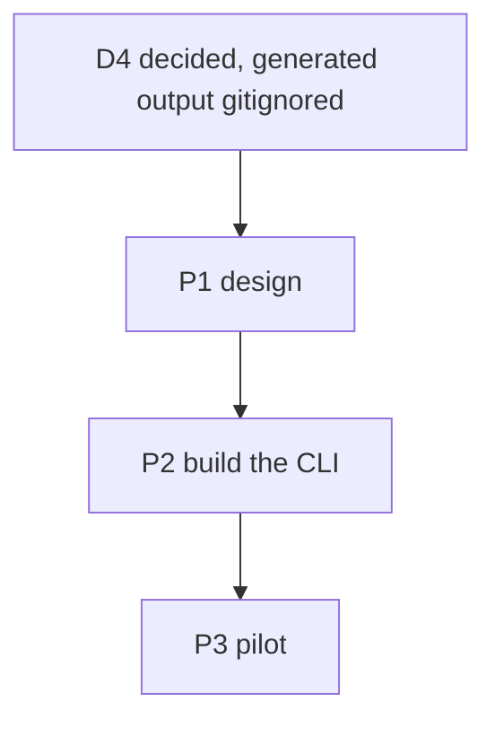
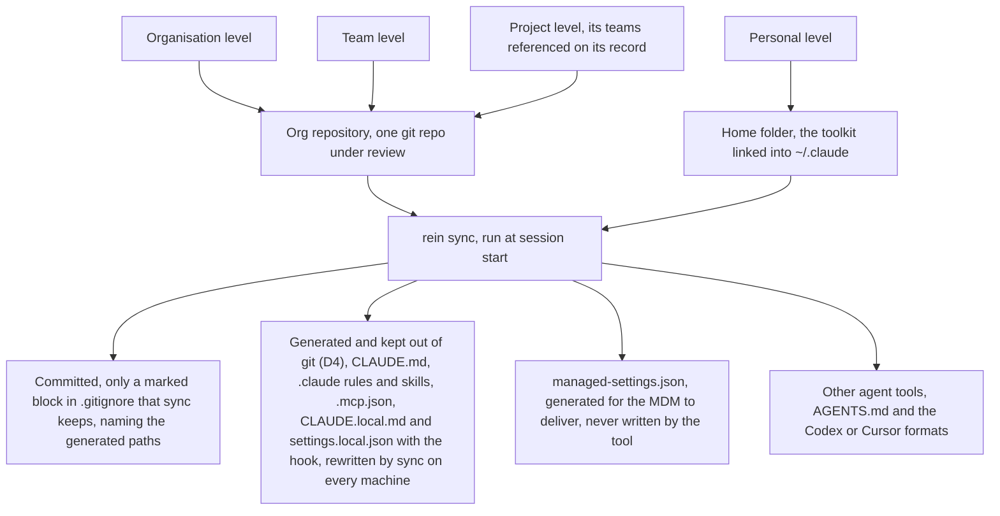
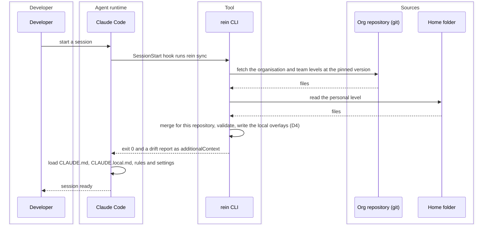
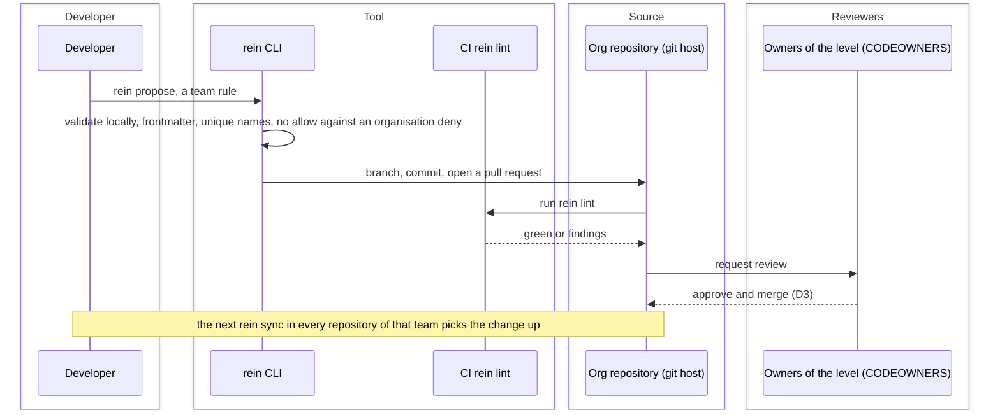

# Harness Distribution Tool — Task Board

> Created 2026-10-11. The harness distribution tool: one tool that holds four levels of agent
> configuration (organisation, team, project, personal), validates every change, and writes each
> level into the files an agent tool reads inside the repository. It records the architecture
> discussion of 2026-10-11 and the decisions that came out of it, so the next session does not
> restart it.
> Companion ADR: [compiler and linter, not a runtime](../decisions/2026-10-11_harness-tool-compiler-and-linter.md).
> References: [harness-management.md](../harness-management.md)
> (Q1, Q2, Q6), the [toolkit board](2026-10-10_agent-toolkit.md) (its D6), the
> [toolkit ADR](../decisions/2026-10-10_personal-toolkit-open-formats.md),
> [cmd/rein](../../cmd/rein/).
> Markers per the `implementation-plan` skill: 💬 discussed · 🟢 ready · 🔨 in progress ·
> ✅ done · ⏸️ deferred.

## The proposal as stated

A Go service on the developer's machine. `init` deploys the files an agent needs into a
repository (for Claude Code, `CLAUDE.md` and the `.claude/` tree) from four levels of
preferences — organisation, team, project, personal — merged into one file. A server holds the
levels; machines register with it; an update is pushed down to every relevant repository; a
workflow validates each request (rules, workflows, MCP servers, …). Every generated agent file is
gitignored and never enters the repository.

The assessment below keeps the four levels, the central validation and the generated files
inside the repository, and changes three mechanics: pull instead of push (D2), review as a
pull request on the source instead of a tool-native workflow (D3), and the project level
committed instead of gitignored (D4).

## Terms

- **Agent**: the program that reads the settings and acts, Claude Code, Codex and the like.
  Agents Rein is agent-agnostic; Claude Code is the first agent it writes for.
- **Harness**: everything an agent reads before it acts, instructions, rules, skills, tool
  servers, hooks, permissions and provider settings. The harness is what rein manages; the
  research document defines it the same way.
- **Agents Rein** (`agents-rein`, command `rein`): the product's name, decided 2026-10-15; it
  replaced `reins` (2026-10-12) because two AI projects on GitHub already carried that name,
  one with the same pitch. The thing you hold to steer a harnessed team. Domains
  `agents-rein.com`, canonical, and `agent-rein.com`, a redirect, both bought 2026-10-15.
  Module `github.com/Danidani23/agents-rein`, binary `cmd/rein`, home `~/.rein`, env
  `REIN_HOME`.
- **Product repository** (`ProductRepository`): the repository where this tool's own source lives
  and is built and released from. Nothing from any organisation ever goes there. Decided
  2026-10-12: this repository.
- **Org repository** (`OrgRepository`): the git repository an organisation links the tool to at
  setup. It holds the `declarations/` tree, with the organisation, team, project and user
  declarations, the labels and the exceptions. Every configuration change is pushed there, and
  the tool checks everything against it. For the pilot, a GitHub repository that the tool
  itself creates with `org create` (P2.7, P3.1).
- **Project repository** (`ProjectRepository`): any repository that holds software and has a
  project record in the org repository. It carries a manifest (organisation, project, pinned
  org-repository version) and the files the tool writes for it. The agent reads its instructions
  from this working tree, so the compiled output has to land here (D4). For the pilot, the
  siblings under `~/GitHub/dani`.

## Decisions

- ✅ **D1 — Who the tool is for.** Decided 2026-10-11 by the
  [ADR](../decisions/2026-10-11_harness-tool-compiler-and-linter.md): an organisation with many
  teams, with the personal toolkit in this repository as the pilot. The symlinks of
  [install.sh](../../toolkit/install.sh) stay the delivery on this machine; the tool adds the
  lint (B1) and the bake (B4) for repositories that leave it (the toolkit board's D6). Amended
  2026-10-14: P2.10 moves the links into `rein config`, which retires `install.sh`.
- ✅ **D2 — Pull at session start, not push from a daemon.** Decided 2026-10-11 (ADR, N1 and
  N2). A CLI run by a `SessionStart` hook or by hand; the org repository is git and
  "registering" is cloning it. Why: the root `CLAUDE.md` is read at launch and again only after
  `/compact` ([memory docs](https://code.claude.com/docs/en/memory#instructions-seem-lost-after-compact)),
  so a push into a running session is not seen until then, while settings files reload live
  ([settings docs](https://code.claude.com/docs/en/settings)), leaving a session half old and
  half new. A daemon also writes into every working tree and must be installed, kept alive,
  updated and secured. Every vendor pulls: managed settings at startup and hourly, marketplaces
  on update, Goose's allowlist on restart ([Q1](../harness-management.md#q1--how-dev-teams-receive-the-harness)).
- ✅ **D3 — A change to a level is reviewed as a pull request.** Decided 2026-10-11 (ADR, N3).
  The org repository is git; the approval is a pull request routed by CODEOWNERS, which the tool
  opens from `rein propose`. Review, history and blame come free; a tool-native workflow
  would re-implement them. The diagram [Propose a change to a level](#propose-a-change-to-a-level)
  shows it.
- ✅ **D4 — The generated files are gitignored in the project repository and regenerated by
  `sync`.** Decided 2026-10-11, option (b). The agent reads its files from the project
  repository's working tree, so the compiler's output must exist there on every machine; `sync`
  writes it and git ignores it. Committed, by `init`: the manifest, the `.gitignore` entries for
  the generated paths, and `.claude/settings.json` carrying the `SessionStart` hook that runs
  `sync` and the org plugin's marketplace and `enabledPlugins` entries. Organisation and team
  content travels as a plugin through managed settings and needs no file in any project
  repository. Consequences: a cloud session or a CI job needs the tool installed and network
  access to the org repository (O2), through a setup script or the committed hook; a client
  outside the organisation receives nothing but what the bake (B4) copies in, so the bake is the
  one deliberate exception to this decision; and the first session on a fresh clone depends on
  O1, whether a file the `SessionStart` hook writes is read in that same session. Option (a),
  committing the generated files, was the recommendation and was not chosen: derived files in
  every project's history, and churn on every project-level change.
  Amended 2026-10-15: a project repository carries no rein file at all, since agent settings
  are not repository settings. The manifest is gone; a clone is matched to its project record
  by fingerprint. The only footprint is a marked block that `sync` keeps in `.gitignore`, naming
  the generated paths and `.claude/settings.local.json`, which the user commits. The block opens
  with a comment saying that rein wrote it, that agent settings live outside this repository,
  and that the block is to be committed and not edited by hand. The
  `SessionStart` hook, the project-level hooks, permissions and plugin keys live in
  `.claude/settings.local.json`, written by `sync` and never committed, so they exist only in
  registered clones; rein owns the keys it writes and never removes the approvals Claude Code
  saved there. A fresh clone needs one explicit `rein sync`, which identifies the project by
  fingerprint and writes the rest. The personal level is delivered per project the same way, so
  two organisations on one machine never collide in `~/.claude/`; the placement `rein config`
  makes today is the interim until then (P3.1).
- ✅ **D5 — The tool merges guidance only; policy stays in the vendor's lock.** Decided
  2026-10-11 (ADR, N4). Permissions, bypass mode, MCP and model allowlists live in managed
  settings at the root-owned policy path, delivered by MDM, the admin console or the Claude apps
  gateway; the tool generates the drop-in file, or acts as the `policyHelper`, and never writes
  the policy path ([managed settings](https://code.claude.com/docs/en/managed-settings)). On a
  vendor switch the tool regenerates the guidance into the new tool's format and the policy into
  that tool's equivalent where one exists ([Q4](../harness-management.md#harness-portability-across-tools)
  lists what is portable and what is not).
- ✅ **D6 — Provider and gateway settings are declarations, not machine config.** Decided
  2026-10-15: the organisation level sets the default and a team or a project overrides it,
  unless the organisation marked it `required`. Which provider or gateway a project talks to,
  the model aliases and the allowed providers are policy of a level, so they belong in the org
  repository as a `providers`
  declaration kind at organisation, team or project level, `required` or `default` like any
  other, compiled into the vendor's `env` and model keys by P2.5. Never a token: the gateway URL
  travels, the credential stays in the user's keychain or environment. `rein config` holds
  nothing about providers, because a machine is not a level. Switching provider is then one
  change in the org repository that every project receives at its next sync; the routing itself
  stays the gateway's job (ADR, N5). The address grammar gains `providers`.
- ✅ **D7 — Public repository under Apache-2.0.** Decided 2026-10-15. The source is public so
  that the tap, the bucket, the install scripts and `go install` all point at one place and
  companies can adopt it without legal friction; `LICENSE` holds the Apache-2.0 text. Timing:
  after the pilot's first end-to-end run, so the first visitor sees something that works.
  Until then the repository stays private and `go install` serves its one user.
- ✅ **D8 — GitHub is the host; git stays host-neutral.** Decided 2026-10-16. Identity is the
  GitHub login, read from `gh` and never typed: the record keeps it exactly, `github:
  Danidani23`, for CODEOWNERS and pull requests, and the slug is its lowercase form, because
  macOS and Windows file systems are case-insensitive and GitHub logins are unique regardless
  of case, so no two accounts can share a slug. A proposal is a GitHub pull request, `review`
  runs in GitHub Actions with a GitHub secret, `org create` makes a GitHub repository, and
  `gh` is a prerequisite checked before any command that acts for a user. Amended
  2026-10-16: the host is a property of an organisation, `host: github` in its record, chosen
  at `org create` from a selector that lists the supported and the planned hosts, mirrored
  into the machine state per organisation so the right adapter is picked, and identity is
  per host; nothing about the host is configured on a machine (D10). What stays host-neutral
  is plain git, cloning
  and fetching, and the declarations, so a GitLab adapter can be added behind one interface
  later. Visibility follows GitHub's unit of access, the repository: everyone who can read an
  org repository sees every level, every proposal and every user level in it, so nothing
  private belongs in a user level, which `config` says; between organisations nothing leaks;
  a team that must hide its declarations from other teams would need its own repository.
- ✅ **D9 — No local config; the local state is a rebuildable cache.** Decided 2026-10-16.
  Identity comes from `gh` each time; the agent belongs to the user, so it lives in the user
  record in the org repository, defaulting to the agent found installed; the connected
  organisations are the clones under `~/.rein/orgs/`; a placement in the agent's home is
  rein's when its target is under `~/.rein/`, a copy on Windows carrying a marker file; the
  proposal ledger is `gh pr list --author @me`. What remains local is `state.yaml`, the
  active organisation when there are several and the project registrations for `sync --all`,
  both rebuildable from the clones and from `sync`. `connect`, `propose` and `org create`
  need the remote and fail without it; `sync` works offline from the clone and warns that it
  could not fetch. Until the org repository exists (P2.7), `config` stays as the bridge: it
  shows the identity from `gh`, places the user level from a remembered folder, and confirms;
  it is deleted when `org connect` can place the user level, so P2.7 moves ahead of P2.5.
- ✅ **D10 — No `config` command at all.** Decided 2026-10-16, finishing D9 at once instead of
  at P2.7. Identity comes from `gh` on every command that acts for a user, and a logged-out
  `gh` is the refusal, naming `gh auth login`. Which agents a project allows is a declaration
  of its levels, `agents`, allowed at organisation level and narrowed by a team or a project
  (P2.4); which of them a machine has is detected by their command on the PATH, so nobody
  configures an agent anywhere, and a person with two agents gets both. Content reaches the
  agent's home through `rein import <zip or folder>` into `~/.rein/imports/`, and from P2.7
  on from the org repository's clone, both in the home folder; a folder inside a git checkout
  is never remembered. `config.yaml` is gone; `state.yaml` is the one local file and holds
  the connected organisations, the active one, the clones, the projects, the placements and
  the imports. `rein reset` removes everything rein placed and `--all` forgets the machine.
  A placement may be replaced only by the same command from the same source, so re-importing
  an edited folder refreshes it and a different level that claims the same id is refused.
- ✅ **D11 — Import and export go through the org repository; existing settings are
  snapshotted, never adopted blindly.** Decided 2026-10-16. `rein import <zip or folder>` adds
  a level to an org repository, the user's own level by default, a team or project level when
  named, and goes through `propose`, so it is reviewed like everything else; `rein export`
  writes a level out of an org repository as a zip. Nothing reaches an agent except through
  `sync`, so the local import of 2026-10-15 is removed, and until `org create` and `sync`
  exist nothing of rein's reaches an agent, which is also today's state. At `org connect` rein
  snapshots the agent's home, and at `init` a clone's `.claude/` and `CLAUDE.md`, into
  `~/.rein/snapshots/<agent or project>-<time>.json`, path to content, harness paths only,
  never transcripts, memory or plugin caches: the record of what was there before rein, and
  the raw material for `rein migrate`, which later turns a snapshot into declarations with an
  agent's help and offers them through `propose`. Connect places nothing (D4). Order: P2.4,
  then P2.7 with the snapshot, then P2.5.
- ✅ **D12 — The mutation ledger, `restore` and `reset`.** Proposed 2026-10-16 from the user's
  model, reworded and confirmed 2026-10-19 with its storage: rein records every mutation it makes on
  this machine, in an agent's home (`~/.claude/`) and in a project clone, the working copy of
  a project repository where `sync` writes files; the org repository clone under
  `~/.rein/orgs/` is rein's own cache and not a mutation of anything the user owns. It records
  what it moved out, kept only in `~/.rein/snapshots/` as path to content and never in any
  repository, and what it placed in. `restore` removes everything rein placed and puts the
  moved-out files back, machine as before rein; `reset` restores first, then deletes the
  ledger, the snapshots, the clones and the registrations, so no placed file is ever
  orphaned. Storage, by the user: the ledger lives under `~/.rein/`; the removals, what rein
  moved out of an agent's home or a project clone, in one file with a section per agent, their
  contents in `~/.rein/snapshots/`; the inserts, what rein placed, in one file per
  organisation, so disconnecting or destroying an organisation takes its inserts with it.
- ✅ **D13 — The organisation's owner writes records directly.** Proposed 2026-10-16, confirmed
  2026-10-19. Teams
  and projects are records; the account that ran `org create` writes them to `main` while
  setting the organisation up, and branch protection exempts the owner for records only, since
  a pull request approved by its own author is ceremony. Declarations always go through
  `propose`. In `org create` it is the protection of `main` with administrators not enforced.
- ✅ **D14 — `init` commits the move-out itself.** Proposed 2026-10-16, confirmed 2026-10-19,
  reversing the
  "commits nothing" part of D4 for this one case. After the move-out the deleted paths are
  still tracked in `HEAD`, a `.gitignore` entry does not ignore a tracked file, and the
  generated files `sync` writes at those paths would show as modifications and could be
  committed by a careless `git add .`; a `git checkout .` would resurrect the old files. So
  `init` stages exactly the paths it touched, commits with a fixed message, verifies the
  commit, offers `--no-commit`, and on a failed commit reports, leaves the paths staged and
  records the clone as not committed; `sync` refuses to write at tracked paths until then.
  Pushing stays the user's.
- ✅ **D16 — Gateway, orchestration, services: one modular monolith behind interfaces.**
  Decided 2026-10-16, on D15. The gateway depends on the orchestration through one interface
  per area, `Organizations` and `Machine` today, `Projects`, `Review` and `Distill` to come,
  held by an `Orchestrator`; every method takes and returns plain data and never asks or
  prints, so a remote implementation can stand in for the local one if a backend ever
  exists, and the host is a port so leaving GitHub is an adapter. Interfaces for services
  only where an implementation is swapped or faked; the rest are concrete packages. `main`
  is the composition root. The three layers sit under `internal/app/` as `0_gateway`,
  `1_orchestration` and `2_services`, numbered to read in order, with `ports`, `adapters`,
  `architecture` and `version` beside them; Go accepts the names, the package names stay
  plain, and the import paths carry the numbers, which is the one cost accepted for the
  neatness. Refined by D17: the areas are services, and the orchestration keeps only
  workflows and queries. D18 removed the interfaces in front of the orchestration.
- ✅ **D17 — Services hold the single operations; the orchestration holds workflows and
  queries only.** Decided 2026-10-17 on the user's review of D16: `Organizations` and
  `Machine` in the orchestration were services wearing the orchestration's name. Now
  `2_services` has two kinds of package: the libraries (`address`, `declaration`, `lint`,
  `exchange`, `machine`), pure and stateless, and the services (`identity`, `organizations`,
  `clones`, `placements`), each owning one piece of state or one kind of side effect behind
  the ports and never importing another service. `1_orchestration` keeps what spans
  services: workflows, a list of steps each with its compensation, run by a saga runner of
  fifty lines that undoes the completed steps in reverse when one fails, Temporal's shape
  without Temporal, since a workflow engine brings a server and rein has none (ADR, N1); and
  queries, reads across services that change nothing. The gateway calls a service directly
  for a single operation (`org list`, `org use`) and a workflow for several (`org connect`,
  `org disconnect`, `reset`), and still sees interfaces only, held by
  `Orchestrator{Workflows, Queries, Organizations}`. The architecture test enforces the new
  rule: a service imports the ports and the libraries, never a sibling; the gateway imports
  no service package. The rules and where a new piece goes are written out in
  [docs/architecture.md](../architecture.md), with a local `architecture` skill pointing at
  it, so the document travels with the repository and the skill with rein.
- ✅ **D18 — One concrete orchestrator, no interface in front of it.** Decided 2026-10-18 on
  the user's question of 2026-10-17 why a `local` implementation exists when the orchestrator
  will never run anywhere else. The interfaces of D16 bought one thing, fakes for the
  gateway's tests, and nothing for a backend: if one ever exists the gateway calls it, and Go
  lets an interface be drawn around the concrete type that day with no change to it. So
  `Orchestrator` is a struct embedding `Services`, built by `orchestration.New`; the gateway
  calls `orchestrator.ConnectOrganization` for a workflow and `orchestrator.Organizations.List()`
  for a single operation. The identity gate moves to the gateway, `requireIdentity` in front
  of every command that acts for a user, like authentication at a gateway, and the workflows
  stop checking it themselves. The fakes for the ports become an adapter,
  `internal/adapters/fake`, shared by the tests of the services, the orchestration and the
  gateway, which now drive real code over a scratch home. Refusals become one library,
  `2_services/refusal`, that every layer raises and the gateway maps to exit 1 in one place,
  replacing the orchestration's `Refusal` and the gateway's own `commandRefusal`. The
  one-workflow-per-file test reads the methods of `Orchestrator`: each lives in `queries.go`
  or in `workflow_<name>.go`.
- ✅ **D19 — The machine state stays a YAML file that rein owns.** Decided 2026-10-18 on the
  user's question whether an easily editable file is common practice for state. It is, for
  config and for small single-writer state; the tools that chose a database did it for
  concurrent writers, size or integrity (the survey is [State storage](#state-storage)).
  Rein's state is small, has one writer, and `status` is its human view, so it stays
  `~/.rein/state.yaml`. With the ledger (D12) it stops being a rebuildable cache and becomes
  the only record of what rein moved out and placed, so from P2.15 on it is treated as the
  tool's file, not the user's: a header comment saying so, a `version` field for migrations,
  validation on load that refuses with a reason instead of misbehaving, atomic writes through
  a temporary file and a rename, a lock file against two rein processes, the previous copy
  kept before each write, and snapshot contents as files on disk indexed from the state,
  never inline. An embedded database is the fallback if concurrent writers appear, such as
  sync hooks from several agent sessions, or the ledger outgrows one file; that is a
  dependency decision against the cobra-and-yaml.v3 rule and gets its own ADR then.
- ✅ **D20 — Every record rein writes carries the time it was written.** Decided 2026-10-19 by
  the user: a clean record is kept whether or not anything reads it yet, because a timestamp
  not stored when the work is done is history lost. First case: `connected_at` on the
  organisation in the state, set by `Register` from the service's clock; the ledger's entries
  (D12) follow. A time is stored as a time, never as a flag: `BecameActive` on the connect
  result stays a bool, because it answers whether this connect made the organisation active,
  which is what the gateway prints on.
- ✅ **D21 — Every generated file lives in the project clone; the agent's home holds nothing
  of rein's.** Confirmed 2026-10-19 when the hooks format seemed to put scripts into the
  home. `sync` writes `CLAUDE.md`, `.claude/rules/`, `.claude/skills/`, `.claude/hooks/<id>/`,
  `.claude/settings.local.json` and `.mcp.json` into the clone, gitignored and rewritten, the
  user level delivered the same way per project; the settings reference a hook script
  through the clone's own path, which Claude Code hands to hook commands as
  `CLAUDE_PROJECT_DIR`. Two organisations therefore never meet on a machine: each clone
  belongs to one project and each project to one organisation. The eleven links still in the
  user's `~/.claude/` are the removed `config`'s, which `reset` takes away.
- ✅ **D22 — Secrets by reference, told and checked, never asked or stored.** Decided
  2026-10-19. A declaration never holds a secret: a tool server's `env` and `headers` carry
  `${REIN_...}` references to variables of the developer's shell, every referenced variable
  starts with `REIN_` so a profile shows what rein's declarations need and nothing collides,
  and each is described under `variables` so the lint can demand it. The need is known per
  project, so `sync` ends by naming the variables that are not set and `rein status` repeats
  it per project as the health check. Rein never asks for a value: asking means storing or
  writing a shell profile. Rein itself holds no token either: it acts as the user through the
  `gh` login and the git credentials the user has, with exactly the user's access, so there
  is nothing per organisation to issue or revoke; a second account is `gh auth switch`, an
  enterprise host `gh auth login --hostname`. Consent is rein's own confirmations and the pull
  request review, not an SSH passphrase prompt. The judge's key follows the rule,
  `REIN_JUDGE_API_KEY` from the shell locally and from a repository secret in CI.
- ✅ **D23 — The judge's backends, and the organisation's provider wins.** Decided 2026-10-19.
  One judge port with two backends: `api`, an endpoint speaking Anthropic Messages or OpenAI
  Chat Completions, which covers vendors, gateways and private inference, with the model and
  the key's variable name in the `providers` declaration, and the only backend CI can use;
  `agent-cli`, the agent a developer already has run headless, `claude -p` today, other
  agents' CLIs later as adapters of the same port, on the developer's subscription. An IDE
  without a headless command is not a backend; such an organisation declares an API. An
  organisation that declares a provider gets it used everywhere, locally and in CI, so
  verdicts are comparable and the data goes where it decided; one without gets the
  developer's `agent-cli` locally and a refusal in CI that names what to declare. Distill
  follows the same rule, with `--judge agent-cli` as the local override. Two wire formats are
  enough for now.
- ✅ **D15 — Hexagonal layout now.** Decided 2026-10-16: a pure core and replaceable adapters,
  with a port only where a second implementation is plausible: the host (GitHub, later
  GitLab), the agent (Claude Code, later the planned ones), the repository (git), state and
  snapshots, the prompter, the judge. `cmd/rein`, `internal/cli` as the driving adapter,
  `internal/app` for the use cases, `internal/domain` with no I/O, `internal/ports`,
  `internal/adapters/{github,git,claudecode,localstate,terminal}`. Distill is a pure domain
  function, snapshot in, declarations out, with the model-assisted pass behind the judge port.
  Nothing is a service in the process sense (ADR, N1). The move is mechanical and happens
  before P2.4 so no use case is written against the wrong seams.

## Design

Decided in the 2026-10-11 discussion unless marked open. The ADR's B1 and B2 are built from this.

### Address and context path

- An **address** says where a declaration is stored: `organizations.{org}.skills.{id}`,
  `organizations.{org}.teams.{team}.skills.{id}`,
  `organizations.{org}.projects.{project}.skills.{id}`, `users.{user}.skills.{id}`. The last
  two segments are the kind and the id. Ids are lowercase letters, digits and hyphens, so an
  address splits on dots without ambiguity.
- A **context path** says what to resolve for one repository on one machine: the organisation
  and the project from the nearest manifest, found by walking up from the working directory as
  git finds `.git`, the user from the machine, the teams from the project record. It is
  assembled at sync time and never committed as a whole.
- A **declaration** is the unit: a skill, a rule, an MCP server, a hook, a permission set, a
  label category, an exception, a project record or a user record. Each has an address, a kind
  and a schema; the schema is what the lint checks.

### Identity and naming

Decided 2026-10-12 for organisations, teams, projects and users. An entity that can be renamed
carries three things:

- **`id`**, a UUID, generated at creation and never changed. It is the identity for every
  reference that lives *outside* the org repository and cannot be rewritten by a commit there:
  the manifest in a project repository, the local state on a machine, telemetry.
- **`slug`**, the address segment and folder name, lowercase letters, digits and hyphens, for
  instance `dani`. It is the identity for every reference *inside* the org repository: addresses,
  skip lists, exceptions, CODEOWNERS. A slug stays readable in paths, diffs and reviews, which a
  UUID would not. Renaming a slug is a tool verb, like `label rename`: the tool rewrites every
  reference in one commit, and the UUID lets a manifest or a machine that still carries the old
  slug resolve the entity anyway.
- **`name`** and **`description`**, free text, changed at will. Renaming here breaks nothing.

The manifest in a project repository therefore carries the organisation's and the project's
`id` and `slug`; the tool resolves by `id` and shows the `slug`. Declarations such as skills,
rules and MCP servers keep a slug only: every reference to them lives inside the org repository,
so a rename rewrite is always complete.

### Storage tree of the org repository

Projects sit beside teams, not under them: a project record references its teams, so a team can
be added or removed without moving files, and several teams can work on one project.

```text
declarations/
  organizations/<org>/
    organization.yaml               id, name, description, minimum_rein_version
    labels/<category>.yaml          one file per category, listing its labels
    exceptions/<id>.yaml
    skills/  rules/  mcpservers/  hooks/  permissions/
    teams/<team>/
      team.yaml                     id, name, description
      skills/ ...
    projects/<project>/
      project.yaml                  id, name, description, teams, labels, fingerprint, path
      skills/ ...
  users/<user>/
    user.yaml                       id, name
    skills/ ...
```

Users keep their declarations here too: everyone is part of the organisation, every change is in
one history, and the lint can see a personal declaration shadowing a required one. A person
in several organisations keeps one user level per organisation (C1, decided 2026-10-15), so
each organisation lints it against its own rules; `export` and `import` copy a user level
across. CODEOWNERS
makes each user the reviewer of their own folder and the referenced teams the reviewers of a
project folder; the tool can emit that file from the records.

### Labels

- Labels are a registry, not free text. A category is a declaration,
  `organizations.{org}.labels.{category}`; a label is referenced as `category:value`, for
  instance `language:go`. Categories are seeded with defaults (`language`, `kind`, `data`) that
  the organisation edits. Organisation level only to start.
- `label create`, `label rename` and `label delete` edit the category files. Rename rewrites
  every reference in one commit; delete is refused while a reference exists.
- A project's effective labels are its own plus those of its teams and of its organisation.
- Detecting labels from repository contents is parked: [F1](../future-ideas.md#L8).

### Selectors, enforcement, skip lists and exceptions

- A declaration carries `applyIf` and `doNotApplyIf`, lists of labels. `doNotApplyIf` wins;
  `applyIf` means any of the listed labels; no `applyIf` means everywhere (P2.4, 2026-10-20).
  The fields live in a rule's frontmatter, in the YAML of a tool server, a permission set and
  a hook, and in a skill's `metadata` as `rein-apply-if`, `rein-do-not-apply-if` and
  `rein-enforcement`, string-valued as the Agent Skills specification demands.
- Every declaration has an enforcement, `required` or `default`; unmarked means `default`. A
  lower level may skip a `default` declaration or replace it with one of the same id. It cannot
  skip or redeclare a `required` one.
- A team or project may keep a skip list, `skip` on its record, the addresses of declarations
  above its level. It is honoured for `default` declarations. For a `required` declaration it
  is honoured only through an exception.
- An exception is a declaration at the owner's level, `organizations.{org}.exceptions.{id}`
  or a team's, `exceptions/<id>.yaml` with `declaration`, `grantee` (a team or a project),
  `reason`, `until` and `created_at`. An expired exception is a lint error and the
  declaration applies again. `rein resolve --project <slug>` shows what a project resolves,
  what was skipped and through which exception, and the problems that would make `sync`
  refuse.

Contradictions between levels, and what guarantees what (2026-10-15):

- **Structured policy is proven, not read.** Permissions, hooks, tool servers and providers are
  data, so the compiler and the lint decide contradictions mechanically: a team `allow` that an
  organisation `deny` covers, a provider outside the organisation's allowed list, a hook that
  replaces an organisation hook, a lower redeclaration of a `required` id are all errors, and
  the harness is not written until they are gone. What the organisation must hold at any price
  goes into the vendor's own lock, managed settings, where no level below can touch it (D5).
- **Prose is ordered, not proven.** Two rules in words under different ids can still disagree,
  and no lint reads meaning. The compiler writes the resolved instructions in level order,
  organisation first, each level under its own heading, with a generated preamble that tells the
  agent the precedence: a higher level's `required` rule wins over anything below it. Claude
  Code's `/doctor prompt-audit`, which looks for contradictory instruction files, is the review
  tool for the rest, and a model-judged consistency check in CI is a later option (Q6, evals).

### Declaration formats: tool servers, permissions, hooks

Decided 2026-10-19 with P2.18. Every declaration carries the selector fields above,
`description`, `applyIf`, `doNotApplyIf` and `enforcement`; these three kinds add their own.
Built in `declaration` (`ParseToolServer`, `ParsePermissionSet`, `ParseHook`) and checked by
the lint with their addresses.

A tool server, `mcpservers/<id>.yaml`, mirrors the `.mcp.json` entry Claude Code, Cursor and
VS Code share, so the compiler copies it. `transport` is `stdio` with a `command` and `args`,
or `http` or `sse` with a `url`. Secrets never appear: `env` and `headers` values reference
variables of the developer's shell as `${REIN_...}`, each described under `variables` (D22);
a literal that looks like a token, an unprefixed reference or an undescribed one is an error.

```yaml
description: GitHub through the official MCP server
applyIf: []
enforcement: default
transport: stdio
command: npx
args: ["-y", "@modelcontextprotocol/server-github"]
env:
  GITHUB_PERSONAL_ACCESS_TOKEN: ${REIN_GITHUB_TOKEN}
variables:
  REIN_GITHUB_TOKEN: a fine-grained token with contents:read, made at github.com/settings/tokens
```

A permission set, `permissions/<id>.yaml`, names the agent whose rule syntax it uses, since
permission strings are an agent's own and no translation exists; the compiler emits it for
that agent alone. `format: claude-code` is the one this build knows; its rules are `Tool` or
`Tool(specifier)`, and an allow a deny in the same set covers is dead and an error, as in a
settings file.

```yaml
description: Never rewrite history or force-push
enforcement: required
format: claude-code
deny:
  - "Bash(git push --force*)"
  - "Bash(git reset --hard*)"
allow:
  - "Bash(go test*)"
```

A hook runs code on every developer's machine, so it is a folder like a skill,
`hooks/<id>/hook.yaml` with its script beside it, and `run` names a file in that folder,
never a path. `sync` places the folder into the project clone under `.claude/hooks/<id>/`
and the settings it writes point at the placed script (D21); the review flags hooks first.
`event` is one Claude Code fires; `matcher` and `timeout_seconds` are optional.

```yaml
description: Format Go files before each commit
applyIf: [language:go]
enforcement: default
format: claude-code
event: PreToolUse
matcher: "Bash(git commit*)"
run: run.sh
timeout_seconds: 30
```

### Review of prose policies

Decided 2026-10-15. Prose contradictions are semantic, so no lint reads them; a judge model is
the gate, before merge. Four rules make it precise and affordable:

1. **Judge the compiled harness, not the tree.** A contradiction can only exist between
   declarations that reach the same project at the same time. For a change, `rein review`
   resolves every affected project and gives the judge, per project, the text an agent would
   read, with each declaration's level, id and enforcement marked. A team change affects that
   team's projects; an org change affects every project, which covers the downstream direction
   at no extra cost. Identical resolved texts are deduplicated.
2. **The rubric is the hierarchy, and every finding names the structured fix.** A lower rule
   may add to or narrow an upper rule, never widen or negate it. Against a `default` upper
   rule the fix is to redeclare that id at the lower level, an explicit override; against a
   `required` rule the fix is an exception at the owner's level. The judge says which applies
   and quotes both sentences, so conflicts move out of prose into mechanisms the lint proves.
3. **Two severities.** A contradiction is a required status check and blocks the merge. A
   tension, two rules a reader might misread together, is advisory and never blocks. On any
   cross-level finding the CI requests review from the upper level's owners, whom CODEOWNERS
   would not involve since the change touches only the lower level's paths.
4. **Keep the judge honest.** Findings are structured and quoted. A fixture set of known
   contradictory and compatible pairs runs against the judge whenever the rubric changes. The
   judge's model and provider are an organisation setting under D6, so it runs through the
   organisation's gateway, never with a token in CI.

`rein propose` runs the review locally before opening the pull request; the org repository's
CI runs it as the required check (P2.13). At runtime the compiled harness keeps its precedence
preamble, and `/doctor prompt-audit` per clone is a later drift check.

### Resolution order

1. Read the organisation and the project from the manifest, the user from the machine, the
   teams from the project record.
2. Collect declarations from the organisation, each referenced team, the project and the user.
3. Drop those whose selectors do not match the project's effective labels.
4. Apply skip lists, checking exceptions and their end dates.
5. Resolve the same kind and id across levels: a lower `default` replaces; a lower redeclaration
   of a `required` is an error; the same id from two teams is an error unless the project
   resolves it.
6. Emit per vendor (ADR, B3).

### Project record, identity and init

- Identity is the address. Since 2026-10-15 no manifest is committed: a clone is matched to its
  project record by fingerprint across the connected organisations (D4 as amended).
- The fingerprint is the set of root commit hashes reachable from the default branch, sorted.
  It matches a clone that has no manifest yet and feeds the inventory. Several roots occur when
  unrelated histories were merged. A project record also carries its `path` inside the
  repository, `.` for the root, so several projects can share one monorepo: two records with
  one fingerprint and one path are a lint error, and identity falls back to the manifest.
- A changed fingerprint, after a merged history or a rewrite, is reported by `sync` as drift
  with an offer to update the record through `rein propose`.
- A clone whose fingerprint matches a project record in two connected organisations is refused
  by `sync`, which names both; `rein init --org <slug>` binds it to one, recorded in local
  state, never silently to the active organisation (C2, decided 2026-10-15).
- `init` refuses a folder without `.git` and, since 2026-10-15, commits nothing: it creates or
  matches the project record, records the fingerprint once a root commit exists, extends
  `.gitignore` with the marked block and reports that change for the user to commit, writes
  `.claude/settings.local.json`, and runs the first sync. Re-running init is safe.
- `localPath` is per machine and lives in local state, never in the record.

### Slot map for Claude Code

Where each kind of declaration lands, by level. Facts from the Claude Code docs read on
2026-10-11: a plugin carries skills, commands, agents, hooks, MCP and LSP servers, output styles
and only two settings keys, `agent` and `subagentStatusLine`; it never loads a `CLAUDE.md`
([plugin components](https://code.claude.com/docs/en/plugins/components)). Plugins declared in a
project repository's settings do not install in cloud sessions, while plugins from server-managed
settings do ([cloud environments](https://code.claude.com/docs/en/cloud-environments#what-carries-over-from-your-setup)).
So organisation and team content travels as plugins enabled by managed settings, and project
content is written as plain files into the working tree, which every kind of session reads.
Everything in the "Project" column is gitignored and written by `sync` (D4 as amended
2026-10-15); the one committed trace is the marked block in `.gitignore`.

| Kind | Organisation | Team | Project | User |
|---|---|---|---|---|
| Always-on prose rule | managed `claudeMd` key, or the managed `CLAUDE.md` at the policy path | a section of the generated `CLAUDE.md` | a section of the generated `CLAUDE.md` | `CLAUDE.local.md` |
| Path-scoped rule | `.claude/rules/org-<id>.md` with `paths:` | `.claude/rules/<team>-<id>.md` | `.claude/rules/<id>.md` | `~/.claude/rules/<id>.md` |
| Skill | baseline plugin `skills/<id>/` | team plugin `skills/<id>/`, invoked as `/<team>:<id>` | `.claude/skills/<id>/` | `~/.claude/skills/<id>` (the toolkit's links today) |
| Subagent | baseline plugin `agents/` | team plugin `agents/` | `.claude/agents/<id>.md` | `~/.claude/agents/` |
| Hook | managed settings `hooks` | team plugin `hooks/hooks.json` | `.claude/settings.local.json` `hooks`, uncommitted | `~/.claude/settings.json`, not touched by the tool |
| MCP server | `managedMcpServers` in the drop-in, HTTPS only, OAuth or header auth | team plugin `.mcp.json` | `.mcp.json`, with `${VAR}` for secrets; interactive sessions ask once per server (O3) | `~/.claude.json` user scope, not touched by the tool |
| Permission rule | managed drop-in `permissions`, with `allowManagedPermissionRulesOnly` when locked | `.claude/settings.local.json` `permissions`, uncommitted | same file | `.claude/settings.local.json`, Claude Code's own, not touched by the tool |
| Model and provider | managed drop-in `env` and `availableModels` | not applicable | `.claude/settings.local.json` `env`, uncommitted | not applicable |
| Plugin enablement | managed `extraKnownMarketplaces` and `enabledPlugins` | same keys, the team plugin | `.claude/settings.local.json`, the `SessionStart` hook that runs `sync` | not applicable |
| Label, exception | not emitted; they decide what the other rows contain | | | |
| Project record | | | the manifest, committed; file name decided in P2.4 | |

Three rules the table implies:

- No generated file is committed (D4 as amended 2026-10-15). The hook, the plugin keys and the
  team and project hooks, permissions and `env` live in `.claude/settings.local.json`, which
  `sync` writes and Claude Code keeps out of git; the only committed trace is the marked block
  `sync` keeps in `.gitignore`.
- The policy drop-in (`managed-settings.d/<org>.json`) is emitted for the MDM and holds the
  "Organisation" column's managed keys. For cloud sessions the same keys go into server-managed
  settings, since the policy path does not reach them.
- A project in a subdirectory of a monorepo gets the "Project" column under its `path`; Claude
  Code loads that `CLAUDE.md` on demand and discovers `.claude/rules/` recursively.
- A file written by the startup hook is read only from the next session on (O1). So on the run
  that creates the files, `sync` also prints the always-on content to stdout, which Claude Code
  adds to that session's context ([hooks docs](https://code.claude.com/docs/en/hooks)). Later
  runs print nothing, because the files are already there when the session starts.

### Exchange format

Decided 2026-10-15. Agent settings travel between people and machines as a zip in rein's own
layout, never in an agent's: one level in the declarations layout, `rules/<id>.md` and
`skills/<id>/`, later `mcpservers/`, `hooks/`, `permissions/` and `providers/`, with no owner
baked in, because the receiver places it as their own level. A manifest, `rein-export.yaml`,
carries the format version, the kind of level, whose it was, the source, the time, the tool
version and a hash per file. The export's identity is the hash over its files, so the same
content has the same identity whenever it was written. From the toolkit layout, the global
instructions become `rules/global.md`, a rule without `paths:` that loads in every session.

`rein import` verifies the manifest and every hash, lints the level, and adds it to the org
repository through `propose` (D11); nothing is placed on the machine. The placement rule that
`sync` inherits, decided 2026-10-15 after an import silently re-pointed a link another command
had made: a command replaces only what the same command placed before from the same source,
and reports `replaced`; anything else at a target is refused.

### Where each thing is stored

| Store | Holds | Rule |
|---|---|---|
| Org repository | every declaration: labels, exceptions, project and user records included | shared truth, reviewed, with history |
| Project repository | committed: only the marked block in `.gitignore`; present but ignored: every generated file and `.claude/settings.local.json` (D4 as amended) | about this repository; `sync` rebuilds everything from the org repository and the fingerprint |
| Local state on the machine | user identity, clone paths, a cache of the org repository, last sync, drift cache | about this machine; no tokens, git's credential helper does auth |

### Commands and local state

Decided 2026-10-14. The verbs of `rein`, and the two files it keeps on a machine.

- There is no setup command (D10). Every command that acts for a user reads the active GitHub
  account from `gh` and refuses when it is logged out. Exempt, because they run where no user
  exists: `lint`, which CI runs on the org repository, `status` and `version`.
- `rein org create` (interactive, P2.7), `org connect <remote>`, `org list`, `org use <slug>`,
  `org disconnect`, `org destroy`. Disconnect removes the local registration and clone without
  touching GitHub; destroy deletes the repository after an explicit confirmation, which only an
  owner should ever do.
- The active organisation decides only where commands without a repository context go: `init`
  for a new project, `propose`, `label`. An initialised project is bound to the organisation its
  manifest names, so `sync` never depends on which organisation is active.
- `rein init` binds the current repository to a project record of the active organisation,
  creating the record when it is new, with the clone's fingerprint; then it runs the first sync.
  Agents Rein commits nothing; the marked block it adds to `.gitignore` is the user's commit.
- `rein sync` syncs the current repository: it matches the clone to its project record by
  fingerprint across the connected organisations, writes the hook and the project settings into
  `.claude/settings.local.json`, keeps the marked block in `.gitignore`, headed by a comment
  that says rein wrote it and asks for it to be committed, reporting when it changed it, and
  rewrites the generated files. Refused with "run rein init" when no record matches. `--all`
  syncs every project registered on this machine; `--project <slug>`, repeatable, a selection;
  `--report` prints drift. A fresh clone is registered on its first sync, which is how the
  inventory fills.
- `rein propose` delivers a change to the org repository as a pull request, which is the
  proposal itself (D3): its creation time orders proposals, its state is the status, its thread
  holds the review. Every value has a flag; without flags and with a terminal it asks, in
  order: the level, listed from the active organisation's clone; the kind; the id, validated
  and unique at that level; the enforcement and the selectors, chosen from the label registry;
  the content, in `$EDITOR` on a template with the frontmatter pre-filled, or from `--file`.
  Then it lints, runs `rein review`, and if nothing blocks: a branch named
  `propose/<level>/<kind>/<id>-<hash>`, one commit, a push, and the pull request through `gh`,
  with the lint and review summary in its description. The result is the pull request URL.
  The hash is the content hash of the declaration. `rein propose list` shows the ledger with
  each proposal's state read through `gh`. No proposals folder and no status file exist in the
  org repository: those would be a second pull request system (decided 2026-10-15).
- `rein review` takes a diff and judges it per the [review design](#review-of-prose-policies);
  a resolved harness whose hash it already judged is not judged again.
- `rein import <zip or folder> [--level <address>]` adds a level to the active organisation's
  repository through `propose`, the user's own level by default (D11); `rein export <address>
  [--out <path>]` writes a level of an org repository as the [exchange format](#exchange-format).
  Both wait for P2.7.
- `rein reset` removes every placement rein ever made in an agent's home; `--all` also forgets
  the organisations, deletes their clones and the project registrations, leaving the machine
  as before rein.
- `rein lint <path>`, `rein label create|rename|delete`, `rein uninstall`, `rein reset`,
  `rein version`, `rein update`.

One file under `~/.rein/`, the folder overridable with `REIN_HOME` (D10):

- `state.yaml`, a rebuildable cache (D9): the connected organisations (UUID, slug, git remote)
  and which one is active, the clone path of each org repository under
  `~/.rein/orgs/<uuid>/`, the registered project repositories on this machine with clone path,
  address, fingerprint and last sync, every link or copy placed into `~/.claude/`, so
  `reset` removes exactly those, and the imports. Never a secret: git's credential helper
  and `gh` hold the tokens. The proposal ledger is `gh pr list --author @me` on the org
  repository.

### State storage

Decided as D19. What comparable tools do with their config and state, read 2026-10-18:

| Tool | File | Format | Hand-edited? | Source |
|---|---|---|---|---|
| gh | `~/.config/gh/config.yml`, `hosts.yml` | YAML | yes, and by `gh config` | [gh config](https://cli.github.com/manual/gh_config) |
| kubectl | `~/.kube/config` | YAML | yes, and by `kubectl config` | [Organizing cluster access](https://kubernetes.io/docs/concepts/configuration/organize-cluster-access-kubeconfig/) |
| Docker CLI | `~/.docker/config.json` | JSON | yes | [docker CLI reference](https://docs.docker.com/reference/cli/docker/) |
| Claude Code | `~/.claude/settings.json`, `.claude/settings.json` | JSON | yes | [Claude Code settings](https://code.claude.com/docs/en/settings) |
| cargo | `.crates.toml`, `.crates2.json` in the install root | TOML, JSON | managed by cargo | [cargo install](https://doc.rust-lang.org/cargo/commands/cargo-install.html) |
| Terraform | `terraform.tfstate` | JSON | no: `serial` and `lineage` guard it, a lock, `terraform state` for surgery | [State](https://developer.hashicorp.com/terraform/language/state), [locking](https://developer.hashicorp.com/terraform/language/state/locking), [state push](https://developer.hashicorp.com/terraform/cli/commands/state/push) |
| Nix | `/nix/var/nix/db/db.sqlite` | SQLite | no | [Nix glossary](https://nixos.org/manual/nix/stable/glossary) |
| chezmoi | `~/.config/chezmoi/chezmoistate.boltdb` | BoltDB | no: `chezmoi state` inspects and resets it | [chezmoi state](https://www.chezmoi.io/reference/commands/state/) |
| git | `.git/config`; `.git/index` | INI; binary | config yes; index no | [index format](https://git-scm.com/docs/index-format) |

The pattern: config, the user's intent, is text and hand-edited; state, the tool's record of
what it did, is text while it is small and has one writer, and becomes a database for
concurrent writers, size or integrity. Rein's `state.yaml` is state, and once the ledger
(D12) lives in it, the only record of what rein did to a machine. The consequences are D19
and P2.23: it stays YAML, rein owns it, and it is guarded like Terraform's rather than
edited like gh's.

### What the lint checks

Schema per kind; skill name equals folder; description length; unique id within a level; every
`applyIf`, `doNotApplyIf` and project label a registered label; every skip list entry resolving
to an address; every skip of a `required` backed by a live exception; no exception without a
reason, a warning without an end date; no `allow` matching an organisation `deny`; MCP server
URLs on the allowlist; no `CLAUDE.md` inside a plugin; no personal declaration shadowing a
`required` one; two project records with one fingerprint and one path; every organisation, team,
project and user record carries a valid, unique UUID `id`, and a rename keeps it.
## Dependency graph



## How the tool works

Three diagrams: where each level lands, how a repository is brought up to date at session
start, and how a change to a level is reviewed. Drawing conventions are the
[mermaid-diagrams rule](../../.claude/rules/mermaid-diagrams.md). There is no renderer in this
repository; the diagrams are verified by opening the file.

### Place each level



### Sync a repository at session start



### Propose a change to a level



## What Claude Code reloads mid-session

The question from the discussion: can Claude be forced to re-read `CLAUDE.md` mid-session? No
command does that. The table says what is read when; every row is from the official docs read on
2026-10-11.

| What | When it is read | Source |
|---|---|---|
| Root `CLAUDE.md`, `CLAUDE.local.md`, rules without `paths:` | At launch; again after `/compact`, which re-reads the root file from disk | [memory docs](https://code.claude.com/docs/en/memory#instructions-seem-lost-after-compact) |
| Rules with `paths:`, `CLAUDE.md` in subdirectories | When Claude reads, writes or edits a matching file | [memory docs](https://code.claude.com/docs/en/memory#organize-rules-with-claude/rules/) |
| Settings files (permissions, hooks, credential helpers) | Watched; most edits apply to the running session | [settings docs](https://code.claude.com/docs/en/settings) |
| Hook-injected context | `SessionStart` (matchers `startup`, `resume`, `clear`, `compact`, `fork`) and `UserPromptSubmit` on every prompt, through `additionalContext` | [hooks docs](https://code.claude.com/docs/en/hooks) |

Consequences for the tool:

1. A change to the root `CLAUDE.md` lands at the next session, or after `/compact` or `/clear`.
   This is why D2 recommends syncing at session start rather than pushing into a running one.
2. The one way to land guidance mid-session is a `UserPromptSubmit` hook that injects it on every
   prompt. It costs tokens on each turn and is for small, urgent content only.
3. Permissions and hooks do land mid-session, so a policy change in a settings file is live at
   once. That is the vendor's enforcement layer doing its job; the tool does not need to add to it.

## What reaches a cloud session

From the [cloud environments docs](https://code.claude.com/docs/en/cloud-environments#what-carries-over-from-your-setup),
read on 2026-10-11. A cloud session starts from the git clone, so:

| Reaches the cloud session | Does not |
|---|---|
| The repository's `CLAUDE.md`, `.claude/rules/`, `.claude/skills/`, `.claude/agents/` | `~/.claude/CLAUDE.md`, `~/.claude/skills/`, user settings and user-enabled plugins |
| The repository's `.claude/settings.json` hooks and permissions (single-repository session) | `.claude/settings.local.json` and any other gitignored file |
| `SessionStart` hooks from the repository's settings | `SessionStart` hooks from `~/.claude/settings.json` |
| An environment setup script, which may write `~/.claude/CLAUDE.md` | Plugins and marketplaces declared in the repository's settings |

So the committed project level is the only level that reaches the cloud on its own. A
`SessionStart` hook committed in the repository could run `rein sync` there too, if the
environment's network allowlist admits the org repository's host (open point O2).

## Value

### For a single developer

Until 2026-10-16 the toolkit reached the agent through symlinks placed by hand and later by
rein: a symlink is a filesystem entry that points at another path, so `~/.claude/skills/commit`
*was* `toolkit/skills/commit` and an edit in the toolkit was seen by every repository on this
machine at its next session. From the pilot on, `rein sync` delivers it per project. The tool
adds:

- **V1 — Agent settings handed from person to person.** A client, a cloud session or a CI
  agent sees none of the symlinked files. `rein export` writes what the agent would see as a
  zip, and `rein import` or a plain unzip into `~/.claude/` brings it to another machine. This
  answers the toolkit board's D6; the bake, a committed copy, was deferred on 2026-10-15.
- **V2 — One source for several agent tools.** The same levels generated into the formats of
  Claude Code, Codex and Cursor. Worth it only when a second tool is in real use (the toolkit
  ADR deferred this).
- **V3 — Drift report.** Which repository's committed files differ from what the levels would
  generate.
- **V4 — One-command init** for a new repository.

For one developer, one tool and one machine, V3 and V4 are conveniences. V1 and V2 are the
real value, and both can be a short script before they are a tool.

### For an organisation

- **V5 — One vendor-neutral source for four levels, generated per tool.** The vendor layers
  (managed settings, marketplaces, plugins) are each vendor's own; switching tools means
  rebuilding them. With the source outside any vendor format, the tool regenerates guidance and
  the policy file for the new tool. This is the point accepted as D5.
- **V6 — A validation gate before distribution**, over everything a level can carry: rules,
  skills, subagents, hooks, permissions, MCP servers, model and provider settings
  ([the layer table](../harness-management.md#0-the-harness-layer-by-layer)).
- **V7 — Reviewed changes per level**, with owners (D3).
- **V8 — Inventory and drift across the fleet.** Which repository runs which version of which
  level. Only the Backstage AI Coding Rules plugin offers this today
  ([Q6](../harness-management.md#q6--adopt-existing-solutions-or-build)).
- **V9 — Guidance and policy kept apart** (D5): the tool generates the managed settings file for
  the MDM and never pretends a prose file is enforcement.

### What it does not replace

The vendor's enforcement (managed settings), the LLM gateway (Q4, Q5), the MCP registry (Q3),
and the plugin marketplace where a team wants one. The tool can generate a plugin as one of its
output formats; it does not need to be the marketplace.

## P1 — Design

Gate: the manifest, the merge rules and the slot map are written on this board and approved.

- ✅ **P1.1 — A repository manifest names its organisation, its project and the pinned version
  of the org repository.** [EXECUTED] Written in [Design](#design), approved 2026-10-11.
  Deviation from the ADR's B2: the manifest names no team; teams are referenced on the project
  record, so several teams can share a project and be added or removed without moving files.
  Deviation 2026-10-15: the manifest is dropped altogether; identity is the fingerprint matched
  against the project records (D4 as amended).
- ✅ **P1.2 — The merge rules per level are written.** [EXECUTED] Selectors, enforcement, skip
  lists, exceptions and the resolution order in [Design](#design), approved 2026-10-11.
- ✅ **P1.3 — The slot map per agent tool is written.** [EXECUTED]
  [Slot map for Claude Code](#slot-map-for-claude-code) written 2026-10-11; gate O1 answered
  2026-10-12 for `-p` runs, the interactive case assumed equal. Other tools follow when D1
  names them.
- ✅ **P1.4 — The validation rules are written.** [EXECUTED]
  [What the lint checks](#what-the-lint-checks), approved 2026-10-11.

## P2 — Build

In the ADR's order. Gate per item: tests green and the item run against this repository.

- ⏸️ **P2.1 — `rein init`, `sync`, `validate` and `propose` exist as a Go CLI with tests.**
  [DEFERRED] Split into P2.2 to P2.6 in the ADR's order.
- ✅ **P2.2 — The lint (B1) runs against [toolkit/](../../toolkit/) and this repository's
  `.claude/`.** [EXECUTED] 2026-10-12. Module `github.com/Danidani23/agents-rein`,
  binary `cmd/rein`, packages `internal/address`, `declaration`, `lint` and `cli`; cobra and
  yaml.v3 only; standard `testing`. Checks: the Agent Skills frontmatter fields, name grammar
  and directory match, description and compatibility lengths, rule `paths` lists, allow rules a
  deny rule makes dead, skills sharing a name, and the address of every file in a declarations
  tree. Gate ran green: gofmt, `go vet ./...`, `go test ./...` over four packages;
  `rein lint toolkit/skills` clean; `rein lint .claude` reports the one real error, the
  `argument-hint` field in the older `adr` skill; `rein lint .` adds four warnings, `adr` and
  `commit` existing in both `.claude/` and `toolkit/`. Both are the toolkit board's P2.4, the
  migration of this repository's `.claude/`, done 2026-10-14. The plugin checks wait for P2.5,
  where plugins first exist.
- ✅ **P2.10 — `rein config`, the org verbs, and the user level into `~/.claude/`.** [EXECUTED]
  2026-10-15. Packages `local` (config.yaml, state.yaml), `execute` (the one shell-out helper),
  `placement` (links or copies, refusals, recording), the organisation record in `declaration`;
  commands `config`, `org connect|list|use|disconnect`, `version`; exit code 3 for a failed
  program. Gate ran green: gofmt, vet, tests over seven packages including `org connect`
  against a scratch repository; the real `rein config --user danielmolnar --user-level toolkit`
  made eleven links and left `synced` alone, a second run reported `ok`; `rein lint .` clean.
  `install.sh` deleted. As approved 2026-10-14: `config`
  writes `config.yaml`; `org connect`, `list`, `use` and `disconnect` manage the organisations
  in it and their clones in state; the user level is placed into `~/.claude/` as links on macOS
  and Linux and copies on Windows, refusing any target that is not its own, with every
  placement recorded in state. `install.sh` is deleted in the same change and the toolkit
  board's P2.2 becomes "run rein config". Source of the user level until P3.1: `toolkit/`,
  given explicitly, never a silent default.
- ⏸️ **P2.3 — The bake (B4) copies the overlays into a repository that leaves the machine.**
  [DEFERRED] Replaced on 2026-10-15 by P2.11 (export): agent settings are not repository
  settings, so nothing of them is ever committed into a project repository, not even as a copy
  for someone who leaves the machine. The toolkit board's D6 is answered by export instead.
- ✅ **P2.11 — `rein export` writes the agent settings as a zip, so people can hand them to
  each other.** [EXECUTED] 2026-10-15, in the [exchange format](#exchange-format) rather than
  an agent's layout, as the user decided the same day. Packages `exchange` and `version`,
  `PlanLevel` in `placement`, the `agent` field in config, the `owner` on placements. Gate:
  gofmt, vet and tests over eight packages ran green, including an export of a scratch source
  and its import into throwaway homes. The real export of this machine's toolkit and its
  import were declined from the agent session and are left for the user, after `rein config`
  is rerun with the new toolkit path. Today the content is the user level; inside a registered
  project it will be everything the agent sees there, after `sync`.
- 🟢 **P2.12 — `docs/rein.md`, the user guide.** [PENDING] Approved 2026-10-15. Install,
  `config`, `org`, `init`, `sync` with "getting back on track on a fresh clone", `export`,
  `reset`; written as each command lands, starting with what exists.
- 🟢 **P2.13 — `rein review` judges a change against the levels it meets.** [PENDING]
  Approved 2026-10-15, after P2.5 because it needs resolution. Takes a diff, resolves the
  affected projects, builds the judge prompts per the [review design](#review-of-prose-policies),
  prints structured, quoted findings; a contradiction exits 1. Run by `propose` locally and by
  the org repository's CI as the required check, with the fixture set as its own test. The
  judge is one model call, not an agent loop, reached through one of two backends named in
  the `providers` declaration: `api`, a Messages-compatible endpoint with the key from the
  environment or the CI secret, and `agent-cli`, the installed agent in non-interactive mode,
  `claude -p` first, which uses the developer's own subscription locally. The pilot's default
  is `agent-cli` locally and `api` in CI. A resolved harness is cached by hash and not judged
  twice (amended 2026-10-15).
- ✅ **P2.14 — Questions explain themselves: the `prompt` package and `rein status`.** [EXECUTED]
  2026-10-16. Gate: gofmt, vet and tests green over nine packages, the prompts driven by
  scripted input and `config` end to end both interactively and with flags; `rein status` on
  this machine listed the eleven placements as `missing`, which is the state the move left.
  One deviation found by the tests: without a terminal the agent is assumed to be
  `claude-code`, the one supported value, rather than demanded as a flag. The real interactive
  `rein config` run is the user's (you), since this session cannot type into a terminal.
  Approved 2026-10-16, before P2.4 so that `init`, `org create` and `propose` are built on it.
  One package behind every interactive command: a text question and a selector, each with a
  title, a one-line description under it, a default shown in brackets, a validator that
  re-asks with the reason, and `?` as an answer that prints the long explanation. A selector
  is a numbered list answered by number or name, the default marked, planned-but-unsupported
  choices listed and refused; a multi-select takes several numbers. Every interactive command
  opens with one paragraph saying what it does, ending "Enter keeps the value in brackets; ?
  explains a question", and ends with a summary of what it will change and a confirmation,
  skipped by `--yes`. Without a terminal it refuses and names the flags, as today. Dim and
  bold through plain ANSI codes, off when the output is not a terminal; no library. A
  cursor-driven menu was considered and declined on 2026-10-16 as too much for now: it needs
  raw-mode key reading, a plain fallback for CI, and a TUI library against the
  minimal-dependency rule. `config` is rewritten on the package; `rein status` shows what the
  tool has done on this machine, user, agent, placements, organisations, projects; every
  command's help text becomes an explanation. Tests drive each question with scripted input:
  `?`, an invalid answer, Enter for the default, a number and a name for the selector.
## The pilot path

Decided 2026-10-16 as the order of work, each item planned before it is built: P2.19, P2.4
first half, P2.7, P2.16, P2.17, P2.18, P2.15, then P2.5. Its gate is the user's list: `org
create` creates an organisation; the first team and project exist in it; `init` binds a new
project, moves its agent settings into a snapshot and commits the move-out; `distill` runs
from that project's snapshot.

- ✅ **P2.19 — The hexagonal layout (D15).** [EXECUTED] 2026-10-16. `internal/domain` holds
  `address`, `declaration`, `lint`, `exchange` and the new `machine`, the ledger model moved
  out of the state adapter; `internal/ports` the interfaces for host, repository, agent,
  state and prompter, with the question types; `internal/adapters` has `github` (identity
  over gh), `git` (clone), `claudecode` (the agent: name, detection, unplacing, and the
  placement code kept for sync), `localstate` (a store), `terminal` (the prompter) and
  `execute`; `internal/app` the use cases `OrgConnect`, `OrgList`, `OrgUse`,
  `OrgDisconnect`, `Status`, `PlanReset` and `ApplyReset`, returning results and refusals,
  never printing or asking; `internal/cli` reads flags, asks, calls and prints, and maps a
  refusal to exit 1, a failed program to 3, anything else to 2. The snapshots port waits for
  P2.7, where it is first needed. Gate: `task rein:check` green with every test moved and
  new use-case tests on fakes for each port; `status`, `--help`, `lint .` and the refusals
  unchanged on this machine.
- ✅ **P2.20 — The orchestrator interfaces and the final layout (D16).** [EXECUTED]
  2026-10-16. `internal/app/0_gateway/cli` reads flags, asks and prints against
  `orchestration.Orchestrator`; `internal/app/1_orchestration` holds `Organizations` and
  `Machine` with `NewLocal` over the ports; `internal/app/2_services` the pure packages;
  `cmd/rein` wires the adapters. The repository port gained `Preflight`. Tests: the gateway
  on a fake orchestrator, the orchestration on fakes for every port, `cmd/rein` end to end
  over a stubbed `gh` and `claude`, and the architecture test with the new rules. Gate:
  `task rein:check` green; `status` and `lint .` unchanged on this machine.
- ✅ **P2.21 — Services, workflows and the saga runner (D17).** [EXECUTED] 2026-10-17. New
  under `2_services`: `identity` (who, from the host), `organizations` (register, use,
  forget, restore, forget all, projects, over the state port, with `ErrNotConnected` and
  `ErrAlreadyConnected`), `clones` (temporary clone, verify, place, remove), `placements`
  (list, unplace through the agent, keep). In `1_orchestration`: `saga.go` with `Step`,
  `run` and `CompensationError`; `ConnectOrganization` as clone, verify, register, place,
  where a second connect of the same organisation now refuses before touching the existing
  clone, which the old code removed first; `DisconnectOrganization` as forget then remove,
  restored on failure; `ResetMachine` without compensation, deletions ordered files first;
  the queries `Status` and `PlanReset`. By the user's rule of 2026-10-17, every workflow is
  its own file, `workflow_<name>.go`, the queries share `queries.go`, and the architecture
  test checks the naming. Gateway and `main` rewired; output and exit codes unchanged. Tests: the saga runner on scripted steps including a failing undo, the
  workflows on the real services over fake ports including one compensation, the
  organisations service, the gateway on fake workflows, queries and service, `cmd/rein` end
  to end, and the architecture rules tightened. Documented in
  [docs/architecture.md](../architecture.md). Gate: `task rein:check` green, `rein lint .`
  clean including the new skill.
- ✅ **P2.22 — The concrete orchestrator, the identity gate at the gateway, the fake adapters
  and the refusal library (D18).** [EXECUTED] 2026-10-18. `Orchestrator{Services}` with
  `New`; `Workflows`, `Queries`, `OrganizationsService`, `local`, `guarded` and `NewLocal`
  deleted; `requireIdentity` in the gateway in front of the `org` commands;
  `internal/adapters/fake` with `Host`, `Repository`, `Agent` and `State`, which fails a load
  or a save on demand; `2_services/refusal` with `ErrRefused`, `Refusal` and `New`, matched
  by `organizations.ErrNotConnected` and `ErrAlreadyConnected` through `Is`;
  `placements.InstalledAgents` so `Services` carries no raw port. The gateway tests rewritten
  on the real orchestrator over the fakes and a scratch home, the orchestration and
  organisations tests on the same fakes; the architecture test lets test files import the
  fakes and checks the one-workflow-per-file rule on the methods of `Orchestrator`. Output
  and exit codes unchanged. Gate: `task rein:check` green.
- ✅ **P2.23 — The state file hardened (D19).** [EXECUTED] 2026-10-19 with P2.15: `state.yaml`
  opens with a header saying it is rein's, carries `version: 1`, is decoded with unknown
  fields refused and a newer version refused by name, a file from before the field counting
  as version 1; every save keeps the previous copy as `state.yaml.previous`, writes through a
  temporary file and a rename, and holds `state.lock` with the writer's pid, a lock older
  than ten minutes counting as left behind. The lock spans a save, not a command: two reins
  can still interleave a load and a save, which the ledger's append-only files tolerate and
  the state's sections mostly do; a command-wide lock is a later step if it ever bites.
  Snapshot contents were files already.
- ✅ **P2.16 — `team create` and `project create`.** [EXECUTED] 2026-10-19. Records written by
  the owner to the org repository (D13): `team.yaml` with id, slug, name, description;
  `project.yaml` with the same plus teams, labels chosen from the seeded registry, and path;
  committed and pushed. Built as the workflows `CreateTeam` and `CreateProject` over the new
  `records` service: pull the organisation's clone fast-forward only, check the tree (slug
  free; for a project, the teams exist and the labels are registered, with the record's own
  checks from `ParseProject`), write the record, commit it alone and push to `main`; a rejected
  push puts the clone back to the remote's state. Every record now carries `created_at`
  (D20), the organisation record included. The gateway: `rein team create` and `rein project
  create`, interactive on the prompt package, with the project's teams offered as a
  multi-select over the existing teams and one optional multi-select per label category,
  the new `ChooseMany` of the prompter; the same as flags, `--team` and `--label` repeatable,
  with `--yes`. `DescribeOrganization` is the query the questions are built from. A project
  without a team is refused, and so is `project create` in an organisation without teams.
  Tests on the fakes, whose repository now remembers origins, commits and pushes, and end to
  end with real git into the stub's bare remote, three commits after the two creates. Gate:
  `task rein:check` green.
- ✅ **P2.17 — `init` binds, snapshots and moves out.** [EXECUTED] 2026-10-19, as planned the
  same day with the user's addition: when no record carries the fingerprint, `init` offers
  the unbound projects of the active organisation and the creation of a new one on the spot,
  with the questions of `project create`. The workflow `InitializeProject`: locate the
  repository and fingerprint it (the root commits, sorted; the project's path is the folder
  under the root, `.` at it); bind, by the record that carries fingerprint and path, by the
  record named with `--project`, which gets the fingerprint written and pushed, or by
  creating the record with the fingerprint in it; per agent, snapshot the project harness
  paths (`CLAUDE.md`, `CLAUDE.local.md`, `.claude`, `.mcp.json` for Claude Code) into
  `~/.rein/snapshots/<project>-<agent>-<time>.json`, delete them, and record each removal in
  `~/.rein/removals.yaml`, the ledger's removals file with a section per agent (D12), written
  through a temporary file and a rename (D19); write the marked block into the project
  folder's `.gitignore`; register the clone in the state with `initialized_at` (D20); then
  commit exactly the tracked removed paths and `.gitignore` (D14), `--no-commit` leaving them
  staged, a failed commit reported with everything else standing. A failure before the commit
  puts every file back, removes the snapshot, forgets the removals, takes the block out and
  unregisters. Refusals: outside a repository or without a commit, an initialised clone, a
  record bound to another repository, a fingerprint matched in two organisations (C2). New:
  the `workingcopy` and `ledger` services; `Root`, `RootCommits`, `TrackedPaths`,
  `StagePaths`, `HasStagedChanges` and `CommitStaged` on the repository port;
  `ProjectHarnessPaths` on the agent port; `LocateProject` as the query the gateway decides
  on. Tests on the fakes, whose repository now fakes a project clone through marker files,
  and end to end with real git: a clone with tracked and untracked agent files, the move-out
  committed, the tree clean, the binding pushed. Gate: `task rein:check` green.
- ✅ **P2.18 — `distill`, the minimal `propose`, and the judge.** [EXECUTED] 2026-10-19, in
  four steps, the last the judge: the `Judge` port with the `agent-cli` backend in the Claude
  Code adapter (`claude -p --output-format json --max-turns 1`, the brief on its standard
  input), the `judge` service that asks, validates and asks once more with the problems, the
  corpus (`LoadCorpus`: the resolved set whole, other teams' declarations through the label
  and word prefilter, trimmed to a budget with the dropped addresses in the report), the brief
  (`Brief`), the answer (`ParseAnswer`, with or without a code fence, `Validate` for the
  vocabulary, the addresses and the verbatim quotes, `Apply`), the judgements in the
  candidates, the report and the pull request's table, `--judge none` and `--dry-run` on
  `distill`, and an unavailable judge reported as skipped. The `api` backend and the
  `providers` declaration are P2.13's. Planned
  2026-10-19 from the user's model, in four steps that each leave a working tool. (a) The
  declaration formats for tool servers, permissions and hooks with their lint, executed
  2026-10-19 (the [formats](#declaration-formats-tool-servers-permissions-hooks)). (b) The
  mechanical distill, executed 2026-10-19 as the `distill` library (`ConvertClaudeCode`,
  `Identity`, `LoadCatalogue`, `Compare`), the `distillations` service, the workflow
  `DistillHarness` and `rein distill`, which takes the initialised project's folder,
  `--project`, `--home` for the user's level, or `--snapshot`; a literal secret in `.mcp.json`
  becomes a `${REIN_...}` reference with its variable described; agents and unknown files are
  listed as skipped; the candidates pass the lint. (c) The minimal `propose`, executed
  2026-10-19 as the `proposals` service, the workflow `ProposeDeclarations` and `rein
  propose <folder or zip>`: the candidates are linted in a scratch tree, compared with the
  catalogue, the identical ones left out and named in the pull request, the rest written on
  `rein/propose-<level>-<time>`, committed, pushed and opened through `gh pr create` with the
  comparison and the distillation's notes as the body; a user's level gets the user record
  when the org repository has none; a failure after the push deletes the branch on the
  remote too, and the clone ends on main either way. `CreatePullRequest` on the host port,
  branch operations on the repository port. As planned: the project's snapshot, the
  harness it held, becomes candidate
  declarations at the project's level, `CLAUDE.md` and `.claude/rules/*.md` rules,
  `.claude/skills/` skills, `settings.json` permissions and hooks, `.mcp.json` tool servers,
  written to `~/.rein/distill/<project>-<time>/` with a report that compares each candidate
  with the organisation's existing declarations structurally: same command and arguments or
  URL is the same server, same permission string the same rule, same event, matcher and
  command the same hook, same skill name compared by content hash, same rule content a
  duplicate. (c) The minimal `propose`: a folder of candidates, or a user's folder or zip, is
  linted, checked for duplicates against the organisation, refused when an exact duplicate,
  written on a branch `rein/<kind>-<slug>-<time>` of the org clone, committed, pushed, and
  opened as a pull request through `gh pr create` with the report as its body; `propose` is
  the only writer of declarations, and `rein review` in CI judges the pull request. (d) The
  judge port with the `agent-cli` backend through `claude -p`, the distill brief and the
  answer schema: the model gets the candidates and the resolved set in full, the
  organisation level, the project's teams, the project and the user, each with address,
  selector and text, and the other teams' rules through a prefilter on shared labels and
  words under a prompt budget; it answers one JSON entry per candidate, `new`,
  `duplicate`, `overlaps` or `contradicts`, with related addresses, verbatim quotes, a
  suggestion to keep, drop, merge or lift with a level and a selector, a rewrite and a
  reason; rein validates addresses and quotes before believing it, sends a malformed answer
  back once with the errors, then finishes with the mechanical report alone and says so;
  temperature zero where the backend allows; `--dry-run` prints exactly what would be sent.
  The original scope, approved 2026-10-12, had distill mechanical first and `--assist` later;
  the user's model of 2026-10-19 brought the model pass in.
- ✅ **P2.15 — The ledger, `restore`, and `reset` on it (D12).** [EXECUTED] 2026-10-19 with
  P2.23. `rein restore` reverses `init` for one clone through the workflow `RestoreProject`:
  the pending removals of the project come back from their snapshots, a file now in the way
  stops it unless `--force`, the block leaves `.gitignore`, the removals get `restored_at`
  (D20) and stay in the ledger with their snapshots until reset, the clone is forgotten on
  this machine, and the put-back is committed as the move-out was, only the paths that were
  tracked, which the ledger now records per removal, plus `.gitignore`; `--no-commit` leaves
  it staged. `rein reset` is restore for everything, then forgetting: every initialised
  project is put back and its put-back committed, a project whose folder is gone is skipped
  with its registration dropped, a project whose restore fails stops the reset before anything
  is wiped so no snapshot is lost; then the placements in the agents' homes are removed, the
  organisations forgotten and their clones deleted, and the ledger, the snapshots and the
  distillations removed; `--all` is gone, since reset means all. Inserts, what `sync` will
  place, get their file per organisation with P2.5. Supersedes the undo half of P2.9; `org
  destroy` and `uninstall` stay there. Storage as D12 says: removals in one file with a
  section per agent, inserts in one file per organisation, both under `~/.rein/`. Scope
  added 2026-10-19: the
  placement record is generalised, since `sync` places into project clones as well as into
  an agent's home and the ledger treats both the same. It gains the agent whose home or
  clone it is, the scope (agent home or project clone) with the project and organisation it
  belongs to, `placed_at` (D20), and a reference to the snapshot of what was there before,
  so `restore` knows what to put back; its paths get names that say their role,
  `PlacedPath`, `OriginPath` and `SourceLevel`, and `Owner` becomes `PlacedBy`. Today's
  `Placement` in `machine` is the agent-home case only and says so.
- ✅ **P2.4 — The manifest, the label registry and the merge (B2) exist in code, with `init`,
  `label` and `propose`.** [EXECUTED] Second half 2026-10-20: the resolver, the `resolve`
  library with `LoadDeclarations`, `ContextOf` and `Resolve`, and `rein resolve --project`
  as its window. Selectors on every kind: `applyIf`, `doNotApplyIf` and `enforcement` in a
  rule's frontmatter and in a tool server's, a permission set's and a hook's YAML, and for a
  skill under `metadata` as `rein-apply-if`, `rein-do-not-apply-if` and `rein-enforcement`,
  since the Agent Skills specification allows only strings there; `applyIf` means any of the
  labels, `doNotApplyIf` wins. Skip lists as `skip` on team and project records, addresses of
  declarations above that level. Exceptions as `exceptions/<id>.yaml` at the level that owns
  the declaration: `declaration`, `grantee` (a team or a project), `reason`, `until`,
  `created_at`. The resolution order as designed: collect the organisation, the project's
  teams, the project and the user; drop by selectors; apply the skips, a default skipped
  outright, a required one only through an unexpired exception granted to the skipper, else a
  problem; settle each kind and id across levels, a lower default replacing, a lower
  redeclaration of a required one a problem, the same id from two teams a problem on both and
  applying to neither unless the project declares it. Three consequences the tests fixed:
  a team's skip applies to every project of that team; a required declaration skipped through
  an exception leaves the id free for a lower level; the user's level sits below the project
  and replaces defaults like any level. The lint checks the selectors, the skip entries and the exceptions,
  expiry included, and runs the resolution for every project of a tree, reporting each problem
  at the declaration's address; `sync` refuses while one exists. First half executed
  2026-10-16: the records. In
  `2_services/declaration`: `Team`, `Project` (teams, labels, path, fingerprint), `User`
  (github exactly, slug its lowercase form), `LabelCategory` with the seeded registry
  `language`, `kind`, `data`; the organisation record gained `host`, `github` the only value
  this build accepts and `gitlab` listed as planned and refused, plus `minimum_rein_version`;
  `LoadTree` reads a whole org repository and cross-checks it: teams referenced exist, labels
  are registered, no two records share a UUID, no two projects share a repository and a path;
  the lint classifies the record files and runs the cross-checks once per tree, every finding
  with its address. Gate: `task rein:check` green; `rein lint` over a scratch org repository
  clean, then reporting a planned host, a missing team and an unregistered label. The
  manifest in the title is gone since D4; `init`, `label` and `propose` are P2.17, P2.16 and
  P2.18.
- 🟢 **P2.5 — The compiler for Claude Code (B3) emits the plugin and marketplace repository, the
  managed-settings drop-in, `.mcp.json` and `CLAUDE.local.md`.** [PENDING] Blocked by P1.3.
- 🟢 **P2.6 — The drift and inventory report (B5).** [PENDING]
- ✅ **P2.7 — `org create`, interactive (part of B2).** [EXECUTED] 2026-10-19, as planned
  2026-10-19 with two parts moved out: the judge's secret and the `providers` declaration go
  to P2.13, where `rein review` first needs them, and `.github/workflows/rein.yml` with the
  required checks goes to P2.8, where a release exists to install; `minimum_rein_version`
  stays empty until P2.8 too. The workflow `CreateOrganization`: create the repository
  through `gh repo create` (undo: `gh repo delete`, which needs the `delete_repo` scope, so a
  failed run may leave the repository and the printed command), scaffold the first content
  in a temporary folder (the organisation record with a fresh UUID, the three seeded label
  categories, CODEOWNERS with the creator, a README; undo: remove), publish it with git init,
  one commit and a push to `main` over the protocol `gh` is set to, protect `main` with a
  code-owner review required and administrators excepted (D13), reported as a warning when
  GitHub refuses it for the plan, then run `ConnectOrganization`, which now also snapshots
  every agent's home into `~/.rein/snapshots/<agent>-<time>.json` (D11): harness paths only,
  text files only, readable by the user alone. The gateway asks name, repository name, owner,
  visibility (default private) and description with defaults, confirms, and takes the same as
  flags with `--yes`. New: the `hosting` and `snapshots` services, the `scaffold` library,
  `Publish` on the repository port, `GitProtocol`, `CreateRepository`, `DeleteRepository` and
  `ProtectMainBranch` on the host port, `Home` and `HarnessPaths` on the agent port. Tests on
  the fakes for every path including the compensation after a failed push, and end to end
  over a stub `gh` that creates bare repositories for real git to push into. Gate:
  `task rein:check` green. Original scope, approved 2026-10-12 and amended 2026-10-15: asks for
  name, description, GitHub owner and visibility; creates the GitHub repository through the
  `gh` CLI; scaffolds `declarations/` with the organisation record (UUID, slug), the seeded
  label categories, CODEOWNERS and `.github/workflows/rein.yml`, which installs the pinned
  rein release and runs `rein lint` and `rein review` on every pull request, posting findings
  as review comments and a status; sets the judge's key as a repository secret with `gh
  secret set`, read from the terminal and never stored by rein; writes the `providers`
  declaration that names the judge's endpoint and model; protects `main` through the GitHub
  API with the two checks required and a CODEOWNERS review required; commits, pushes, and
  registers the organisation in local state. `org destroy` removes all of it with the
  repository (P2.9).
- 🟢 **P2.8 — Release and install on macOS, Linux and Windows.** [PENDING] Approved 2026-10-12,
  made concrete 2026-10-15, placed right after P2.7 because the workflow `org create` deploys
  installs a release. One GoReleaser workflow on a version tag builds every platform and
  architecture and attaches the archives and a checksum file to a GitHub Release. Doors, all
  pointing at that release: a Homebrew tap, `homebrew-tap` rewritten on each release, for
  macOS and Linux; a Scoop bucket, its twin, for Windows; `install.sh` and `install.ps1` in
  the repository, which detect the platform, download the matching archive, verify the
  checksum and put the binary into `~/.local/bin`, for CI, cloud environments and everyone
  without a package manager; `go install` for Go users; `pkg` and `msi` from the same
  release for MDM rollouts. Later, once used: Homebrew core and winget. Updates: a
  package-managed install is the manager's job and `rein update` prints its command,
  recognising the install from where the binary lives; a script install is updated by
  `rein update` itself, download, checksum, atomic replace; every install gets a daily
  nudge, one line, cached in state. An organisation's `minimum_rein_version` makes the
  update mandatory through `sync`. The hook `sync` writes calls the binary by absolute path.
  No signing yet: package and `curl` installs carry no quarantine flag, and certificates cost.
- 🟢 **P2.9 — Everything the tool does can be undone (part of B2).** [PENDING] Required
  2026-10-12 so the whole experience can be rerun from scratch: `org destroy` deletes the GitHub
  repository after an explicit confirmation and removes the local registration; `uninstall` in
  a project repository removes the generated files and drafts the revert of init's commit;
  `reset` clears local state. Gate: after the three, no trace on the machine, on GitHub or in
  `w2going`.

## P3 — Pilot

- 🟢 **P3.1 — The pilot: a GitHub org repository created by the tool, `../w2going` as the
  project repository, this repository as the product repository.** [PENDING] Decided
  2026-10-12. The run is the whole user experience: install the tool (P2.8), `org create` with
  slug `dani` (P2.7), `init` in `w2going`, `sync`, a session there, then `org destroy`,
  `uninstall` and `reset` (P2.9) back to nothing. Your user slug is `danielmolnar`. The
  personal level moves from [toolkit/](../../toolkit/) into
  `declarations/users/danielmolnar/` in the org repository and reaches `~/.claude/` by symlinks
  into the org repository's local clone, which replaces `install.sh` (D1). `w2going`'s eight
  committed `.claude/rules/*.md` and the project part of its `CLAUDE.md` become project
  declarations under `declarations/organizations/dani/projects/w2going/`, and the generated
  files replace the committed ones (D4). Fingerprint today: one root commit, `1febe175`. Work
  inside `w2going` happens from a session there or by the user running the tool, never from a
  session here. This repository's own harness, `CLAUDE.md`, `.claude/rules/docs.md` and
  `.claude/settings.json`, was untracked on 2026-10-15, before the first push; at the pilot it
  becomes the project level of `rein` in the org repository, written back by `sync`. Until
  then a fresh clone of this repository has no harness.
  Gate: a session in `w2going` lists the same rules and skills as before the
  migration, `sync --report` shows no drift, and the rollback leaves no trace. Blocked by P2.2
  to P2.5, P2.7 and P2.9.

## Open points

- O1 — Answered 2026-10-12 for `-p` runs: a file written by the startup hook is read only from
  the next session on. The hook ran under `--settings`, wrote `CLAUDE.local.md`, the same run
  answered `NO-SECRET`, a second run answered `ZEBRA-7731`. The interactive case was not
  measured, because the run stopped at the terminal's first-run theme chooser; the design
  assumes the same behaviour there. Consequence in the [slot map](#slot-map-for-claude-code):
  on the run that creates the files, `sync` also prints the always-on content, which Claude Code
  adds to that session's context. Residual, optional: repeat step 3 after choosing a theme.
- O2 — Cloud sessions and CI are in scope since 2026-10-12. To verify: whether a cloud
  environment's network allowlist admits the org repository's host, and whether the setup script
  or the committed hook can install the tool and run `sync` there. Constraint: the pilot runs on
  a Max subscription, which has no admin console, so server-managed settings and managed plugins
  do not exist for it; the policy file route works on this machine, and a cloud session can only
  be fed by the committed hook ([managed settings](https://code.claude.com/docs/en/managed-settings)).
- O3 — Decided 2026-10-12: `enableAllProjectMcpServers: true` in the committed
  `.claude/settings.json`, so generated `.mcp.json` servers load without a per-user prompt. An
  organisation that wants the prompt back changes one key in its org record.

### Verify O1

In a scratch folder outside any repository. The hook writes `CLAUDE.local.md` at startup; the
answer shows whether that file was read in the same session.

```bash
mkdir -p /tmp/o1 && cd /tmp/o1
cat > hook.json <<'EOF'
{
  "hooks": {
    "SessionStart": [
      {
        "matcher": "startup",
        "hooks": [
          {
            "type": "command",
            "command": "printf '# Local instructions\n\nThe secret word is ZEBRA-7731. When asked for the secret word, answer with it and nothing else.\n' > \"$CLAUDE_PROJECT_DIR/CLAUDE.local.md\""
          }
        ]
      }
    ]
  }
}
EOF
claude -p "What is the secret word in your instructions? If there is none, answer exactly NO-SECRET" --model haiku --max-turns 1 --settings hook.json
```

`ZEBRA-7731` means the file is read in the same session. `NO-SECRET` means it is read only from
the next one, so the hook must also pass the content as `additionalContext` for the first
session. A `-p` run may differ from an interactive one: repeat the check with
`claude --settings hook.json` and the same question before closing O1.

Step 2, after the first run answered `NO-SECRET` (2026-10-12): confirm the hook wrote the file,
then ask again in a second session, which tells whether the file is read from the next session.

```bash
ls -la /tmp/o1 && cat /tmp/o1/CLAUDE.local.md
```

```bash
cd /tmp/o1 && claude -p "What is the secret word in your instructions? If there is none, answer exactly NO-SECRET" --model haiku --max-turns 1 --settings hook.json
```

Step 3, the interactive case: remove the file, start an interactive session with the hook and
ask the same question.

```bash
cd /tmp/o1 && rm -f CLAUDE.local.md && claude --settings hook.json
```

Results, 2026-10-12: step 1 `NO-SECRET`; step 2 the file was present with the hook's content,
and the second run answered `ZEBRA-7731`; step 3 not measured, the interactive run stopped at
the first-run theme chooser. Reading: the hook runs under `--settings` in `-p`, and a file it
writes is read from the next session on, not in the same one.

## Progress log

- (2026-10-11) Board created from the architecture discussion in this repository; nothing built.
  Left for the user: D1 to D5.
- (2026-10-11) ADR written: the tool is a compiler and a linter, not a runtime, B1 to B5 built in
  that order, N1 to N6 not ([ADR](../decisions/2026-10-11_harness-tool-compiler-and-linter.md)).
  The decisions and phases above still carry the pre-ADR wording; aligning them waits for the
  user's go-ahead.
- (2026-10-11) Terms "org repository" and "project repository" documented and the board's wording
  aligned to them. Label detection parked as F1 in [future-ideas.md](../future-ideas.md).
- (2026-10-11) Design written: address and context path, storage tree with teams referenced on
  projects, label registry, enforcement, exceptions, resolution order, identity and init with its
  failure path, the three stores, the lint checks. P1.1, P1.2 and P1.4 executed. D1, D2, D3 and
  D5 marked decided per the ADR; D4 re-opened with options; P2 split into the ADR's order.
  Left for the user: D4.
- (2026-10-11) Terms set to the user's naming: product repository is this tool's own repository,
  org repository the organisation's, project repository a repository that holds software. The
  project record gained `path`, the manifest is found by walking up, and the fingerprint rule is
  fingerprint plus path. The ADR's "source repository" aligned to "org repository".
- (2026-10-11) D4 decided: generated files are gitignored and regenerated by `sync`; `init`
  commits the manifest, the `.gitignore` entries and the settings file with the hook. P1.3
  unblocked, gated on O1. The ADR's consequence bullet amended accordingly.
- (2026-10-11) Slot map for Claude Code written; P1.3 in progress, gated on O1. The O1 experiment
  was prepared and declined to run from the agent session; its commands are under O1 for the
  user. O3 added. Plugins cannot carry permission rules or `CLAUDE.md`, so team and project hooks,
  permissions and `env` land in the committed `.claude/settings.json`.
- (2026-10-12) O1, first result: the `-p` run with the startup hook answered `NO-SECRET`. Steps 2
  and 3 added under Verify O1 to tell "hook did not run" from "file read next session only" and
  to cover the interactive case.
- (2026-10-12) O1 answered for `-p` runs: next session only. Slot map gained the first-run rule,
  `sync` prints the always-on content on the run that creates the files. P1.3 executed. Left for
  the user: P3.1 yes or no, and the optional interactive repeat of O1.
- (2026-10-12) P3.1 approved with `../w2going` as the pilot's project repository: a Go and
  Cloudflare project already on the toolkit, with eight project rules and one root commit.
- (2026-10-12) Identity and naming: organisations carry a UUID `id`, a `slug` as the address
  segment, and a mutable `name` and `description`; the manifest carries `id` and `slug`.
  Extended to teams, projects and users, to confirm. The pilot's organisation slug is `dani`.
- (2026-10-12) Answers recorded: this repository is the product repository; the pilot's org
  repository is created on GitHub by `org create` (P2.7); identity fields confirmed for teams,
  projects and users; O3 decided; cloud and CI in scope (O2); rollback required (P2.9); release
  and install drafted (P2.8). P3.1 rewritten as the full user experience with rollback.
- (2026-10-12) The tool is named `reins`; command names on the board renamed. P2.8 approved.
- (2026-10-12) P2.2 executed: `reins lint` exists with tests, gate green. Its first run found
  the `argument-hint` field in this repository's older `adr` skill and the `adr` and `commit`
  duplicates between `.claude/` and `toolkit/`; fixing them is the toolkit board's P2.4 (you).
- (2026-10-14) Commands and local state decided and written; P2.10 added after P2.2. Parked
  without recording: a scheduled `sync --all` as the polling form of "push from the top".
- (2026-10-15) P2.10 executed; the machine is configured and the toolkit is placed by `reins`.
  Left for the user: the commit; `w2going`'s `CLAUDE.md` still names `install.sh`.
- (2026-10-15) The bake (P2.3) deferred in favour of export (P2.11). Open: whether a project
  repository carries no reins file at all, which would retire the manifest, the committed
  `.gitignore` entries and the committed hook (see the discussion of D4).
- (2026-10-15) D4 amended to zero footprint: no manifest, no committed settings, no committed
  hook; a marked block in `.gitignore` is the only trace; `.claude/settings.local.json` holds
  the hook and the project settings; the personal level goes per project. Slot map, commands,
  identity, P1.1, V1 and the diagram follow. P2.11 approved, P2.12 added. README rewritten.
- (2026-10-15) The `.gitignore` block carries a comment naming reins and asking for a commit;
  D6 raised: provider and gateway settings as a `providers` declaration kind. README reframed
  around Reins for one developer up to an organisation.
- (2026-10-15) D6 decided with the cascade: organisation default, team and project override
  unless required. README made agent-agnostic with a supported and planned agents table; agent
  and harness defined in Terms.
- (2026-10-15) README: logo, the four-levels diagram. `.gitignore` added for this repository.
  Design: what guarantees non-contradiction between levels, structured policy proven, prose
  ordered with a precedence preamble. P3.1 untracks this repository's own harness.
- (2026-10-15) Repository renamed to `reins`, module path with it. `CLAUDE.md` and `.claude/`
  untracked and ignored before the first push; history to be cleaned of them (you). The links
  in `~/.claude/` still point at the old folder: `reins config` rerun deferred by the user
  until the collision discussion is settled.
- (2026-10-15) Review of prose policies decided and written; P2.13 `reins review` added after
  the compiler. C1 (user level per organisation) and C2 (a clone matching two organisations is
  refused, `init --org` binds) decided. Tension severity taken as advisory, per the
  recommendation, the user having agreed to the design as a whole.
- (2026-10-15) `propose` designed as an interactive flow that ends in a pull request, with a
  local ledger instead of a proposals folder; `org create` deploys the workflow, the judge's
  secret, the providers declaration and branch protection; `review` gains its two backends and
  the cache by hash.
- (2026-10-15) P2.11 executed: export and import in reins's own exchange format. A test
  exposed that an import re-pointed a link `config` had made; the placement rule is now "a
  command replaces only what the same command placed", recorded in the design. README gained a
  Commands section.
- (2026-10-15) D7 decided: public under Apache-2.0 after the pilot's first run; `LICENSE`
  added. P2.8 made concrete: the tap, the bucket, the two install scripts, update split by
  install method, the daily nudge, `minimum_rein_version`, the absolute hook path, `pkg` and
  `msi` for MDM; placed after P2.7.
- (2026-10-15) Renamed: the product is Agents Rein, the command `rein`, the module
  `github.com/Danidani23/agents-rein`, the home `~/.rein`, because two AI projects on GitHub
  already carried the name `reins`. Dated entries above keep the old name. The wordmark files
  went with it; the README shows the mark until the new wordmark exists (you).
- (2026-10-15) The wordmark stays as "reins" by the user's choice; the three lockup files are
  back as `rein-logo*.svg` and the README header shows the lockup again.
- (2026-10-16) P2.14 added before P2.4: self-explaining questions, a numbered selector, a
  confirmation summary, `rein status`; a TUI menu declined for now.
- (2026-10-16) P2.14 executed: `prompt` package, `config` rewritten on it with intro, `?`,
  selector, validation and confirmation, `rein status`, help texts as explanations.
- (2026-10-16) `Taskfile.yml` added: `rein:build`, `rein:install`, `rein:test`, `rein:lint`,
  `rein:check`; README and CLAUDE.md name the tasks instead of raw commands.
- (2026-10-16) D8 and D9 decided. `config` rebuilt as the bridge: identity from `gh`, the
  slug derived, no slug question, the user level from the remembered folder or `--user-level`,
  never asked; a logged-out `gh` is a refusal naming `gh auth login`. Tests stub `gh` on the
  PATH. The user's slug becomes `danidani23`.
- (2026-10-16) D10: `config` removed; identity from `gh` on every command, agents detected,
  content through `rein import <zip or folder>`, `rein reset` with `--all`, `status` with the
  live identity and the installed agents, `export <folder>`. Ownership of a placement is per
  command and source. The dated entries above keep `config` as history.
- (2026-10-16) D11: import and export go through the org repository, the local import removed,
  snapshots at connect and init for migration. Order: P2.4, P2.7, P2.5.
- (2026-10-16) The user's model recorded: a mutation ledger, `restore` and `reset` (D12), the
  owner writing records directly (D13), `init` committing the move-out (D14), the hexagonal
  layout (D15). The pilot path written with P2.15 to P2.19 in the user's order.
- (2026-10-16) P2.19 executed: the hexagonal layout, use cases on ports, fakes in the tests.
- (2026-10-16) Added with P2.19: a test in `internal/architecture` that fails when a layer
  imports outward, and a fix for the null device counting as a terminal. The user's gateway,
  orchestration and services vocabulary mapped onto `cli`, `app` and `domain` in CLAUDE.md:
  a modular monolith in one binary, never separate processes (ADR, N1).
- (2026-10-16) D16 and P2.20: the orchestrator interfaces, main as the composition root, the
  layers numbered under `internal/app/`.
- (2026-10-16) P2.4 first half: the records, the seeded registry, the tree cross-checks and
  the lint of org repositories. The host lives in the organisation record (D8 amended).
- (2026-10-17) D17 and P2.21: the single operations moved into services (`identity`,
  `organizations`, `clones`, `placements`); the orchestration keeps workflows on a saga runner
  and queries; the gateway calls services directly or runs a workflow. `docs/architecture.md`
  written and a local `architecture` skill added; the architecture test keeps services apart.
- (2026-10-17) The user's rule: one file per workflow, `workflow_<name>.go`; the architecture
  test enforces it, the document and the skill state it.
- (2026-10-18) D18 and P2.22: the orchestrator is one concrete struct, the identity gate at the
  gateway, the fakes an adapter, refusals one library; `local`, `NewLocal` and the interfaces
  gone. D19 and the state-storage survey: the state stays YAML that rein owns; its hardening
  is P2.23, with the ledger.
- (2026-10-19) D20: `connected_at` on the organisation record in the state, from a `Clock` on
  the organisations service. The user's naming rule applied and written into the toolkit's
  `go-style` skill: the clone names became the `OrgClonePath` family, `env` became
  `environment` on a `commandEnvironment`, `run` became `runSteps`, `Forgotten.Active` and
  `DisconnectResult.Active` became `ActiveAfter`, the fake state's field `Current`. The state
  key `clones` became `org_clone_paths`; no machine had an organisation connected.
- (2026-10-19) P2.15's scope grew by the generalised placement record: agent, scope with
  project and organisation, `placed_at`, the snapshot reference, role-naming paths; the
  `Placement` comment says it is the agent-home case until then.
- (2026-10-19) D12 reworded (a clone is a project clone), D13 and D14 confirmed. P2.7 executed:
  `org create` as a workflow with compensations over the new `hosting` and `snapshots`
  services and the `scaffold` library; the secret and the CI workflow moved to P2.13 and P2.8.
- (2026-10-19) D12 confirmed with its storage. P2.16 executed: `team create` and `project
  create` as workflows over the `records` service, `ChooseMany` in the prompter, `created_at`
  on every record.
- (2026-10-19) P2.17 executed: `rein init` binds by fingerprint, by a named record or by
  creating the project, moves the agent files out into a snapshot, starts the ledger's
  removals file, adds the `.gitignore` block, registers the clone and commits the move-out.
- (2026-10-19) D21, D22 and D23 recorded from the discussion of distill: generated files in
  the clone only, secrets by `REIN_` reference told and checked, the judge's backends with the
  organisation's provider winning. P2.18 replanned in four steps; step (a) executed: the
  tool server, permission set and hook formats with their lint.
- (2026-10-19) P2.18 step (b) executed: `rein distill` turns the latest snapshot into
  candidates under `~/.rein/distill/` with the structural comparison report.
- (2026-10-19) P2.18 step (c) executed: `rein propose` lints, compares, branches, pushes and
  opens the pull request; the only writer of declarations into an org repository.
- (2026-10-19) P2.18 step (d) executed, closing P2.18: the judge port behind `claude -p`, the
  corpus, the brief, the validated answer, the judgements in `distill`'s report and in the
  pull request `propose` opens.
- (2026-10-19) P2.15 and P2.23 executed: `rein restore` puts a clone back and commits it,
  `rein reset` restores everything first and then forgets the machine; the state file carries
  a version, a header, a previous copy, an atomic write and a lock.
- (2026-10-20) P2.4 second half executed: selectors on every kind, skip lists, exceptions,
  the resolver and its problems in the lint, `rein resolve` as its window.
