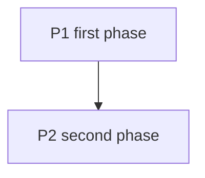

# Implementation Plan (Task Board)

Boards are the living **"how"** and the user's overview of work in flight; ADRs in
`docs/decisions/` are the immutable **"why"** (`adr` skill). The two link each other. Approved
multi-step work gets a board **before** the build begins.

## File

`docs/implementation_plans/YYYY-MM-DD_<short-description>.md` — the date the plan was started,
lowercase kebab-case description.

## Markers

Every actionable item carries a state icon and a bracket marker, kept current in the same change
that does the work:

| Icon | Marker | Meaning |
|---|---|---|
| 💬 | `[PENDING]` | in discussion — not approved; never build it |
| 🟢 | `[PENDING]` | approved, not started |
| 🔨 | `[IN PROGRESS]` | being built |
| ✅ | `[EXECUTED]` | done and its gate ran green — note the commit |
| ⏸️ | `[DEFERRED]` | consciously postponed — note why |

Item format: `- 🟢 **P1.2 — Outcome-phrased title.** [PENDING]`, then one or two lines of detail.
A step the user runs says so: `(you)`.

## Template

~~~markdown
# <Topic> — Task Board

> Created YYYY-MM-DD. <One paragraph: what this board changes and why.>
> Companion ADR: [<name>](../decisions/<file>.md). References: <repos or files it builds on>.
> Markers per the `implementation-plan` skill: 💬 discussed · 🟢 ready · 🔨 in progress ·
> ✅ done · ⏸️ deferred.

## Decisions

- ✅ **D1 — <what was decided>.** Decided YYYY-MM-DD. <One line of why.>
- 💬 **D2 — <open question>.** <Options, recommendation, which items it blocks.>

## Dependency graph

## P1 — <Phase>

Gate: <what proves the phase done>.

- 🟢 **P1.1 — <outcome>.** [PENDING]
  <detail>

## Progress log

- (YYYY-MM-DD) <what landed, which gates ran, what is left for the user>
~~~

## Rules

- **One item, one checkable outcome.** Split an item that cannot flip to ✅ in one go.
- **IDs are stable.** Never renumber; a dropped item becomes ⏸️ with the reason.
- **✅ only after the gate ran green** for that item (the project's definition of done).
- **Deviations** from the approved item are written on the item, not hidden in the log.
- **Open decisions block explicitly.** A 💬 decision names the items it holds back.
- **The progress log** records gates and leftovers for the user (commands to run, dashboard
  steps), newest last.
- **Finishing.** A board with no 💬, 🟢 or 🔨 left gets a closing banner as its first line —
  `> **Finished YYYY-MM-DD.** Successor: [<board>](../<file>.md)` when open ends moved on — and
  moves to `docs/implementation_plans/finished/` in the same session. Fix every relative link in
  the moved file and every inbound link in the same change.
- **Self-contained.** Link the ADRs and the instruction files a fresh session needs.
- Throwaway scratch stays in `.tmp/`; promote it to a board once it is worth sharing.
